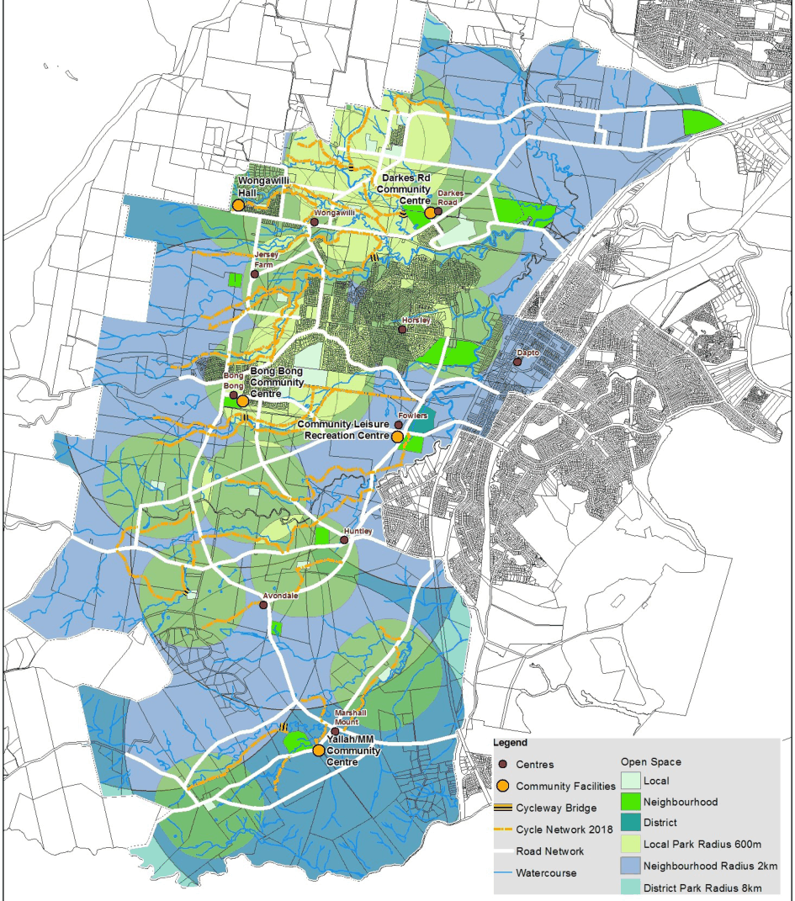

### 9.2 Hierarchy and Catchments

Based on the principles of functionality, accessibility, connectivity and values, there are some guides to the level of open space based on size and characteristics of projected population and its recreational needs categorises relevant population catchment distances for each level of open space provision (hierarchy) and how it generally relates to size requirements in the future urban and residential areas based on NSW Recreation and Open Space Planning Guidelines for Local Government (2010).

It is important to emphasise that any benchmark standards cannot be used as a ‘one size fits all’ assessment tool. Through analysis of local context and community needs, these standards can and should be varied if based on sound evidence.

#### Open Space Provision Standards (based on NSW Recreation and Open Space

Planning Guidelines for Local Government (2010) and the Elton Report (2007) recommendations) – Table 1

| Function and service | Size | Catchment radius (distance) |
|---|---|---|
| Local Passive | 0.5-2 ha | 400-600m |
| Local Active | 1-2 ha | 400-600m |
| Neighbourhood Passive | 2-4 ha | 2km |
| Neighbourhood Active | 3-5 ha | 2km |
| District Active | 5-8 ha | Southern ward of LGA |
| City wide Active | 8 + ha | Facility to serve the whole LGA |

Note: If stormwater infrastructure is proposed to be co-located with open space the general size requirements in Table 1 should be considered with reference to Council’s West Dapto Open Space Design Manual.

The relationship can also be understood in catchments for community populations. Figure 10 shows proposed open space catchments of West Dapto (based on methods established in NSW Recreation and Open Space Planning Guidelines for Local Government, 2010). These catchments are indicative and are shown for illustration purposes only to guide how location of facilities will be planned to be located within a walkable catchment. In the release areas open space network, open space will need to be provided at all hierarchy and catchment levels.

> [Picture on page 37: a picture, saved as a picture (images/chapter-d16-west-dapto-release-area-page-37-1.gif, 150 dpi).]

Figure 10 – Planning for open space in West Dapto Urban Release Area
