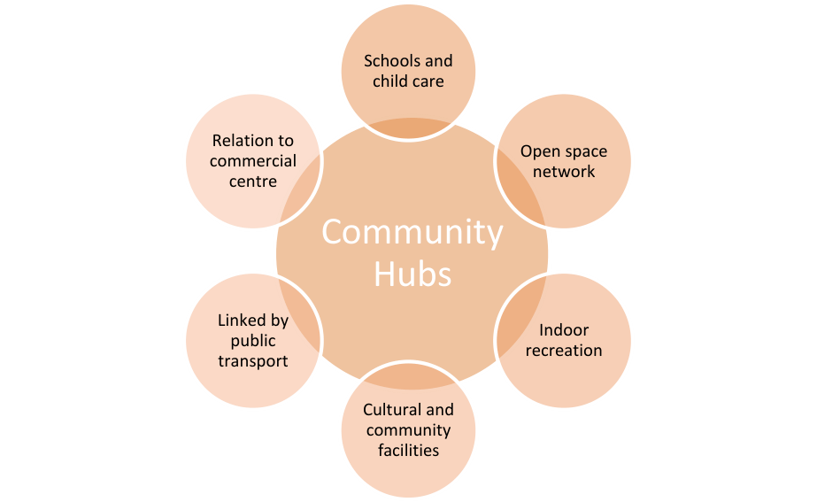

## 10. COMMUNITY AND EDUCATION PRINCIPLES

Community facilities are an increasingly important component of local service provision across a range of areas in the public and private sector. For example, there is a clear trend in public health and alternative education to use local community facilities for regular and specialist community services rather than develop individual facilities. Council understands this increases the importance of flexible design, location and efficiencies to be achieved by these facilities for them to make the best contribution to community outcomes.

> [Picture on page 38: a map, saved as a picture (images/chapter-d16-west-dapto-release-area-page-38-8.gif, 150 dpi); the street names and other small labels are on the picture.]

### Community Hubs

Figure 11 – Community Hub Concept – Co-Location, Joint Use and Multi-Purpose Centres
