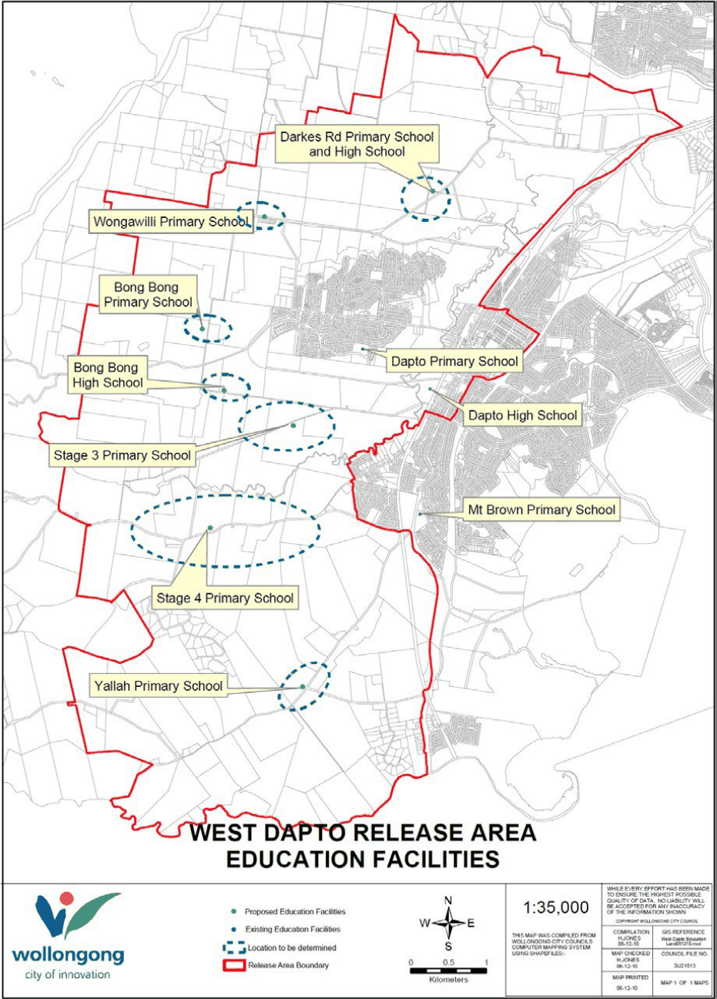

### 10.8 Principle 8 – Viable and Sustainable

Council will work with the State Government and non-government schools’ sector to promote best-practice education outcomes for the community of West Dapto. This will include sharing data and integrating asset solutions, such as opportunity for shared and joint-use facilities.

Planning for the provision of education is important for West Dapto’s growing community. In NSW, the Department of Education provides funds and regulates education services for NSW students from early childhood to secondary school. The Department of Education provided previous support for the six primary schools and two high schools based on the projected housing provision and related future population estimates.

Figure 12 shows some indicative school locations within the release area.

The distribution of schools in the release area ideally would be spread across the residential areas of the five stages. There would be two new primary schools in the vicinities of Darkes Road/West Dapto Road and Wongawilli Village.

In Stage 3 of the release area, a new secondary school close to Bong Bong Town Centre will be supported by three primary schools; potentially Jersey Farm - Robins Creek (Bong Bong Primary School on Figure 12, Bong Bong/Cleveland (Stage 3 Primary School on Figure 12) and Avondale/Mooreland (Stage 4 Primary School in Figure 12).

A third secondary school potentially located in Calderwood Urban Release Area has been approved and will service a primary school in Marshall Mount area (shown in Figure 12 as Yallah Primary School) as well as the required primary schools in Calderwood.

A special needs school should be either co-located with or separate to a mainstream school in the release area.

Note: The NSW Department of Education has advised Council staff that they are undertaking a detailed investigation of the long-term service need within the West Dapto Area (August 2024). Council staff will seek amendment to update this DCP chapter once the investigation outcomes are available.

> [Picture on page 40: a picture, saved as a picture (images/chapter-d16-west-dapto-release-area-page-40-1.gif, 150 dpi).]

Figure 12 – Potential school locations (Council to work with NSW Department of Education)
