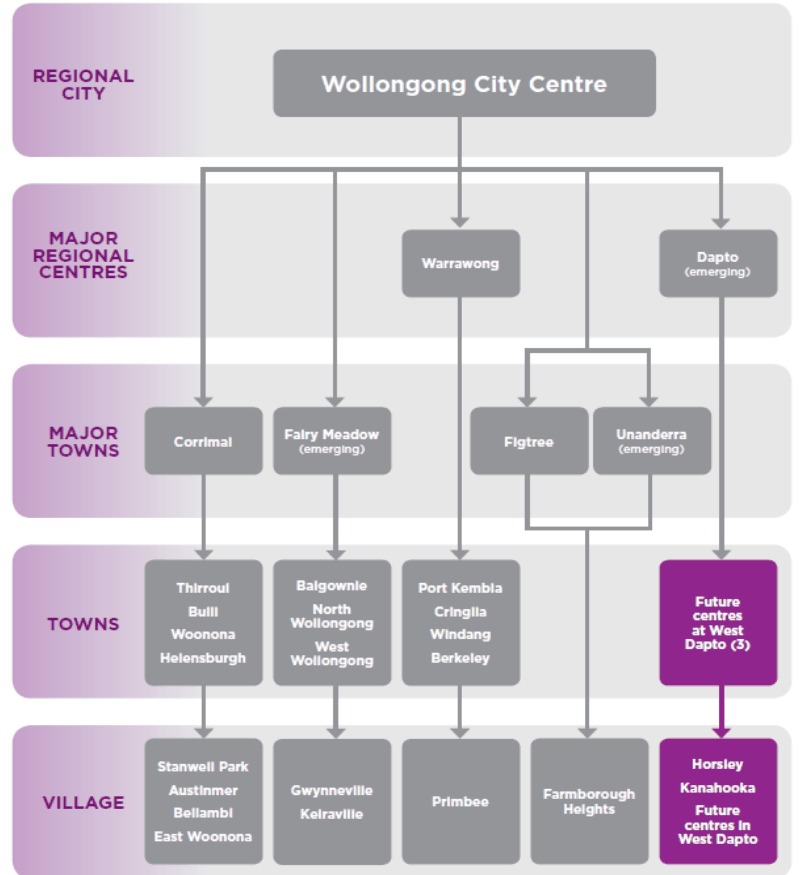

### 11.1 Principle 1 – Hierarchy

Hierarchy provides a basis for which to establish functions, order, and visions as well as allowing the protection of these. Hierarchy is not the only way to understand or to set direction in planning for centres, we understand that the centres are also a connected network, which can support each other in an interlocking way.

Each level of the hierarchy represents the size and general characteristics of the centres commercial, retail and business roles (see Figure 13). The Hierarchy reinforces role and function, supports the Wollongong City Centre and higher order centres and provides certainty for investment decisions. Hierarchy reinforces character and identity as well as provides direction around appropriate residential density sympathetic to community facilities and service locations.

Requirements for development in Business zones must comply with contents of the DCP Chapter B4: Development in Centres and Peripheral Sales Precincts. Chapter B4 outlines the Hierarchy for the LGA as well as other studies or assessments needed to support development applications.

#### Regional Centres

Wollongong Local Government Area has two major regional centres Warrawong and Dapto. It forms and important commercial and business centre role in Wollongong LGA.

A series of new centres will be located close to Dapto’s existing urban landscape. Supporting Dapto’s development as a regional centre will be an important consideration in the planning of new town and village centres. These lower order centres must be sensitive to the levels of hierarchy to maintain existing functions and minimising any negative impact on the hierarchy.

#### Town Centres

There are three town centres planned for the urban release area. The objective of the town centres is to ensure that development in the Darkes Road (1), Bong Bong (2) and Marshall Mount (3) town centres contribute to the creation of retail, business, commercial, and community hubs that act as public transport nodes and provide significant local employment opportunities.

Major town centres (~15,000m2) are planned within the central western (Bong Bong Road) and the southern (Marshall Mount) parts of the release area. A local town centre is planned in the

northern (Darkes Road) area. These are intended to create local retail, business, commercial and community hubs providing significant local employment opportunities. They will need to complement rather than compete with the higher order major regional centre of Dapto.

Council expects the town centres of West Dapto to be master planned demonstrating how the plan responds to these planning principles. Section 14.6 outlines the West Dapto Centres Master Plans that have been adopted into the DCP for the purposes of this Part. Full West Dapto Centres Master Plan packages are available on Council’s website (West Dapto Project Page).

#### Village Centres

The West Dapto further review of release area centres and controls (Urbacity, 2014) noted the role of Villages, as a lower order centre, is to “provide convenient alternative to the supermarket based town centres for daily goods and services with a focus on amenity for housing density and improved public transport use”.

Village and local centres will develop localised business opportunities at key places and intersections where bus stops, community facilities and local open space come together to create an urban focal point for the local community. Small villages are proposed ~2,500 m2 of floor space and accommodate a 1,000-1,500m2 supermarket and variety shops.

> [Picture on page 42: a picture, saved as a picture (images/chapter-d16-west-dapto-release-area-page-42-17.gif, 150 dpi).]

Figure 13 – Wollongong Town Centres Hierarchy
