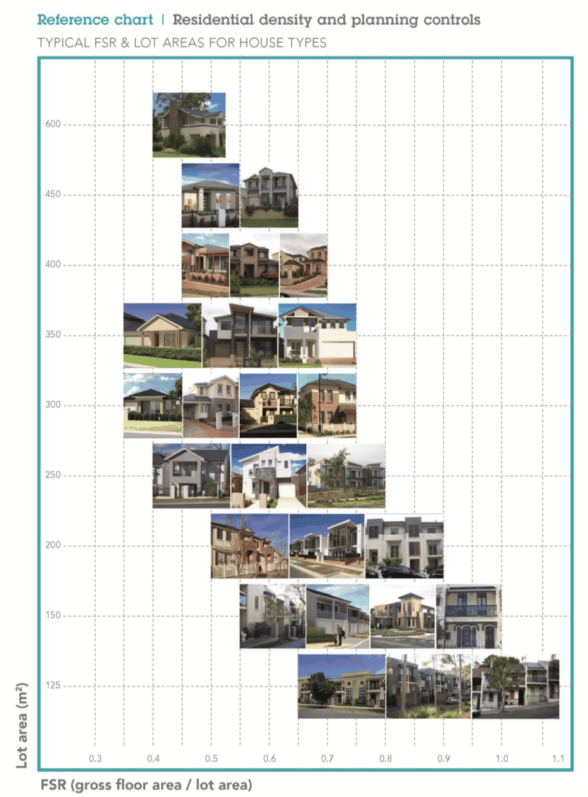
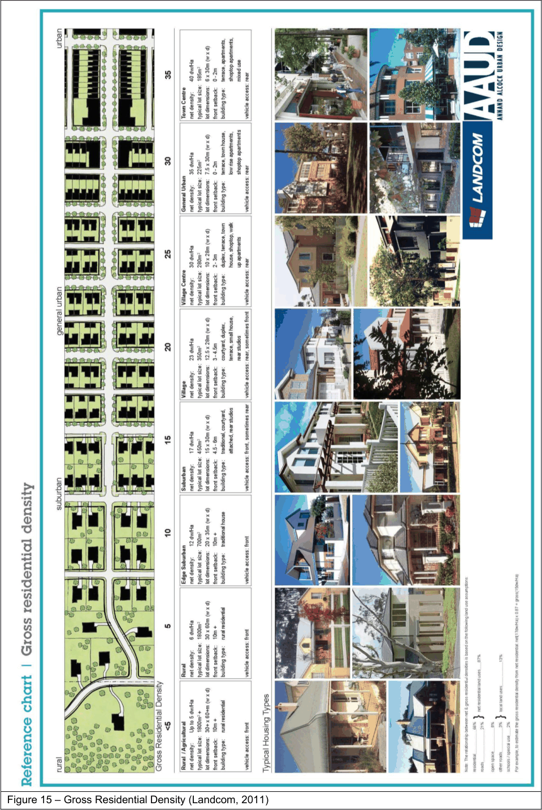

### 13.1 Principle 1 – Encourage Housing Diversity

Diversity can be delivered through different products at different stages of planning by promoting and providing a range of density and lot size and shapes to offer a range of choice to better meet changing community needs.

Mixture of density low to high, single dwellings, dual occupancy, town houses and apartments in appropriate locations should all be considered in neighbourhood planning and subdivision design stages.

Promote increased densities and innovative design types close to town and village centres and

transport infrastructure where possible.

A variety of lot sizes and dimensions must be provided to achieve diversity in products to suit a range of household structures and to meet the density targets relating to the residential zones (Refer to Figure 14).

> [Picture on page 47: a picture, saved as a picture (images/chapter-d16-west-dapto-release-area-page-47-5.gif, 150 dpi).]

Figure 14 – Net Residential Density Chart (Landcom, 2011)

> [Picture on page 48: a picture, saved as a picture (images/chapter-d16-west-dapto-release-area-page-48-1.gif, 150 dpi).]

Figure 15 – Gross Residential Density (Landcom, 2011)
