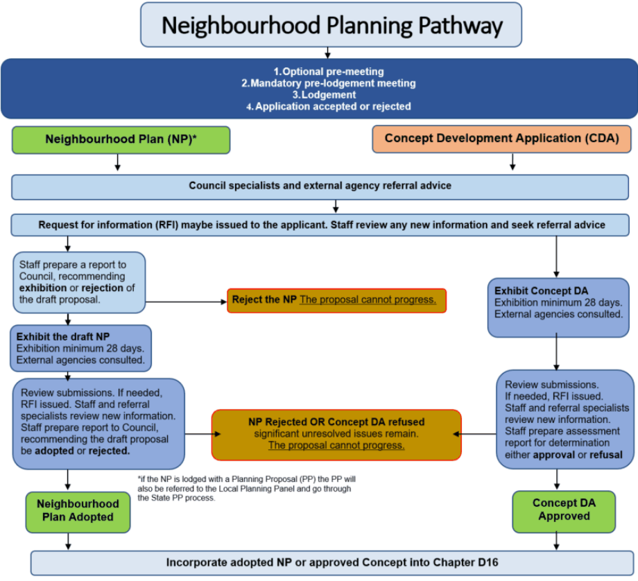

### 14.2 Pathways to Neighbourhood Plans

There are two options for neighbourhood planning in the West Dapto Urban Release Area:

• Preparing a Neighbourhood Plan (lodged with or without a Planning Proposal), or

• Lodging a Concept Development Application (CDA).

In West Dapto, the preparation of a Neighbourhood Plan has traditionally been pursued and is Council’s preferred option, however the Environmental Planning and Assessment Act, 1979 also identifies CDAs as an option.

#### 14.2.1 Pre-Lodgement and Lodgement Pathway

The following steps apply to all draft Neighbourhood Plans and Concept Development Applications:

a) Optional Pre-meeting Discuss the site with Council staff to gauge the general acceptability of the overall proposal. Council will consider the current Sequencing Plan, Staging Plan and planned infrastructure delivery. This discussion is offered to support a holistic approach to planning and to streamline the process.

b) Mandatory Pre-lodgement meeting held with the applicant and representatives from relevant Council Divisions to discuss the preliminary neighbourhood plan proposal. Detailed notes from the meeting will generally be given to the applicant within 10 business days. All pre-lodgement advice will include as a minimum reference to the matters to be addressed in a Neighbourhood Plan or CDA (Section 14.2.3 below). A fee may be payable to Council subject to Council’s Fees and Charges.

c) Applicant refines their proposal, guided by the pre-lodgement notes.

d) Lodgement: The draft neighbourhood plan or concept development proposal is lodged with Council, accompanied by the applicable assessment fee. The application must also include

the completed lodgement checklist, confirming that the necessary information accompanies the application.

e) Council will process the application within 14 days. If an application is incomplete or inadequate it will be rejected. If this occurs, Council will return the rejected application to the applicant, with a letter outlining the reasons for rejection.

#### 14.2.2 Neighbourhood Planning Assessment Pathway

The following steps apply only to Neighbourhood Plans:

a) Assessment period: If an application is accepted, the draft neighbourhood plan’s assessment period will begin. A Council officer will seek expert advice from various internal staff. Together, they will review the proposal to decide if it is supportable or if more information is required. Council staff are generally given 21 days to provide referral comments.

If more information is needed, a request for information (RFI) will be sent to the applicant. The applicant’s response must be made, in full to Council, within 21 days. When the new information is received, it will be reviewed to determine its completeness. The new information will be re-referred to Council staff for review and comments. The assessment period should include only one RFI.

A report to Council will be prepared, at the end of the assessment period, recommending that the proposal be:

i) Exhibited. This will occur if the draft plan is considered generally supportable to progress. Any outstanding RFI issues that can be resolved post exhibition would also be detailed in the Council report.

ii) Rejected. If significant outstanding issues remain unresolved after the RFI process, a recommendation to reject the draft plan will be made. If it is rejected, it cannot progress further, and the applicant will be notified.

An alternate resolution may also be made by the Council.

Where a Neighbourhood Plan is lodged with a concurrent Planning Proposal the Planning Proposal will be subject to Local Planning Panel review before the report to Council for exhibition is prepared.

a) Exhibition: If the proposal is supported by Council for exhibition, the draft Neighbourhood Plan will be exhibited for a minimum 28 days. External referral agencies will be directly notified of the proposal and given copies of the draft plan with the relevant supporting documents.

b) Post-exhibition period: Council will review all submissions received at the end of the exhibition period. An RFI will be forwarded to the applicant, if required, to allow the resolution of any issues raised.

A report to Council will be prepared at the end of the post exhibition period, outlining any issues raised in submissions. The report will recommend adoption of the proposal, or rejection. An alternate resolution may also be recommended by the Council. If the proposal is rejected, it will not progress any further, and the applicant will be notified. Council staff will be available to discuss the reasons for an application’s rejection, where necessary.

#### 14.2.3 Concept Development Applications Assessment (CDA) Pathway

Division 4.4 of the Environmental Planning and Assessment Act (EP&A Act) 1979 sets out the statutory requirements for making concept development applications. Section 4.23 of the EP&A Act 1979 provides that a concept development application can satisfy the requirement that a DCP must be prepared before land can be developed, as required by Part 6 of Wollongong LEP 2009.

Therefore, Council can consider a CDA as an alternative to a Neighbourhood Plan.

A CDA sets out concept proposals for the development of a site, similar to a Neighbourhood Plan. Detailed proposals for the site or for separate parts of the site are to be the subject of a subsequent development application, or applications. These subsequent applications must be consistent with the original consent.

A concept development application must also:

• demonstrate consistency with the West Dapto Vision 2018 and all relevant chapters of Wollongong DCP 2009.

• be proposed at a Neighbourhood scale consistent with the defined Neighbourhood applying to the land, or larger, as shown in Figure 17 Defined Neighbourhoods.

• be compliant with the relevant planning controls, or where there are non-compliances these are either minor or satisfactorily justified.

The following steps apply only to CDAs:

• Exhibition: If the proposal is supported for exhibition, the CDA will be exhibited for a minimum 28 days in accordance with Council’s Community Participation Plan. External referral agencies will be directly notified of the proposal.

• Assessment period: Council will collaborate with internal specialist staff to review the proposal to decide if the proposal is supportable, or if more information is required.

If more information is needed, a request for additional information will be sent to the applicant. An applicant’s response must be made, in full to Council, within 21 days. When the information is received, it will be reviewed to determine its completeness.

• Post-exhibition period: Council will review all submissions received, including agency submissions, at the end of the exhibition period. An RFI will be forwarded to the applicant, if required, to allow the resolution of any issues raised.

A report to Council will be prepared, at the end of the post-exhibition period, recommending adoption of the proposal into this chapter of the DCP, or rejection. An alternate resolution may also be recommended by the Council. If the proposal is rejected, it will not progress any further, and the applicant will be notified.

• Determination: Following the end of the assessment period, Council staff, where possible under delegations, will determine the CDA.

• Post determination: In the event that a CDA has been approved in accordance with Section

4.23 of the EP&A Act 1979 and is deemed to have satisfied the requirements of Part 6 of WLEP 2009, Council can consider that approval as an alternative to a Neighbourhood Plan. The Concept Approval shall be adopted into this chapter of the DCP as soon as practical.

See Figure 16 below:

> [Picture on page 54: a picture, saved as a picture (images/chapter-d16-west-dapto-release-area-page-54-1.gif, 150 dpi).]

Figure 16 – Neighbourhood Planning Pathways Flowchart
