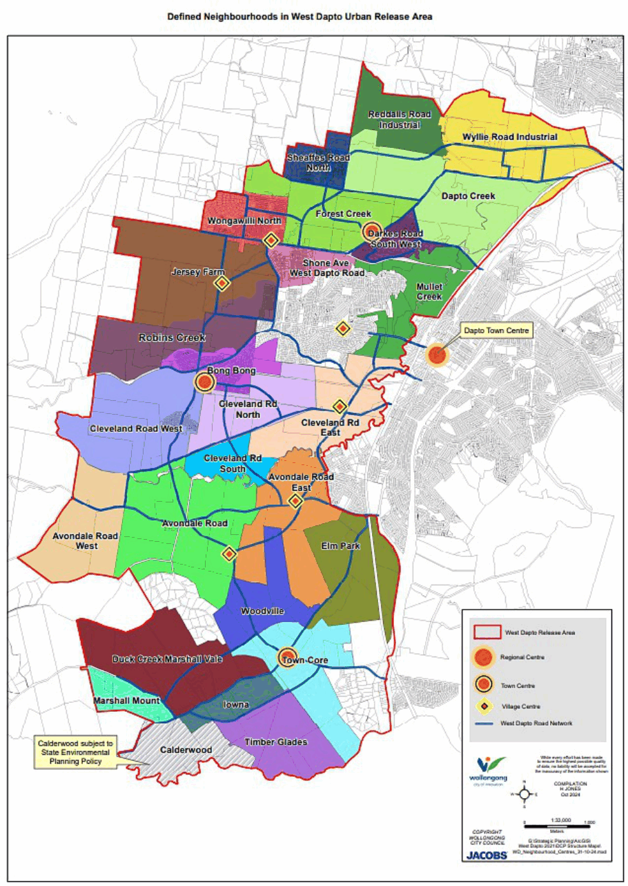

### 14.3 Matters to be Addressed in Neighbourhood Planning Applications

An application for a Neighbourhood Plan must include:

a) Site location and description, and general land capability assessment, addressing existing issues such as:

i) Wollongong LEP 2009 provisions (including Zoning, Minimum Lot Size, FSR, Building Height, Flooding, Heritage, Acid Sulfate Soils, riparian corridors, etc)

ii) other relevant legislation

iii) the setting within West Dapto, for example the proximity to commercial centres, main roads, community services

iv) flooding and bush fire constraints

v) topography, known geotechnical constraints, known contamination constraints

vi) biodiversity (EECs, bushland, significant trees, habitat)

vii) heritage - historical land use, heritage sites, including Indigenous Heritage cultural issues and visual character

viii) existing road network

ix) available utilities, services and existing easements

x) need for community and recreation facilities

xi) noise impacts (e.g. from main roads, industrial areas, or public and private railways).

b) A concept Neighbourhood Plan and supporting documentation, showing the proposed:

i) land use areas including, but not limited to, residential, retail, employment, recreation and conservation areas

ii) road layout and hierarchy

iii) indicative dwelling density (Figure 15) and yield

iv) public transport, bicycle and pedestrian routes demonstrating walkability

v) drainage management concept plan based on modelling (water quantity, quality, and flood behaviour) inclusive of indicative locations and sizing of infrastructure

Note – where a drainage/water quality solution is developed at a catchment or neighbourhood level, Council will consider acquisition where the agreed detention basin site is consistent with the West Dapto Development Contributions Plan

vi) buffers to heritage items or other proposed heritage conservation management measures

vii) riparian corridors, buffers and proposed future uses

viii) location of schools, community facilities, recreation facilities and parks, including any proposed public land

ix) conceptual Bulk Earthworks Plan is required. The Bulk Earthworks Plan shall also demonstrate the feasibility of the drainage (stormwater) infrastructure and road layout plans. Justification will be required where there are changes to the existing landform.

x) the outcomes identified in a Centre Master Plan where a Centre Master Plan has been adopted into Section 14.6 of this Chapter.

c) In collaboration with Council advice, a staging or sequencing plan supporting the concept Neighbourhood Plan showing:

i) all existing site boundaries within the neighbourhood, and

ii) proposed development staging within the planned area, taking into consideration delivery of essential infrastructure, access and logical progression as a development front.

d) Submission in electronic and PDF form

i) All the above data layers are required to be presented in electronic form. The electronic Neighbourhood Plan package will include either a set of Shapefiles, a Geodatabase or set of CAD files or be provided in another form as required by Council. The applicant shall also seek advice regarding Council’s specific naming conventions, coordinate system and metadata requirements prior to lodgement of the Neighbourhood Plan.

ii) Council also requires the Neighbourhood Plan and supporting plans (staging, infrastructure plan, etc) to be provided in PDF form.

> [Picture on page 56: a picture, saved as a picture (images/chapter-d16-west-dapto-release-area-page-56-1.gif, 150 dpi).]

Figure 17 – Defined Neighbourhoods in West Dapto Urban Release Area The transport network displayed in Figure 17 is correct as at the time of adoption and represents the overall transport structure depicted through the West Dapto Development Contributions Plan. The West Dapto Development Contributions Plan provides additional information relating to infrastructure requirements and should be read in conjunction with the Wollongong DCP 2009 Chapter - for example, apportionment, infrastructure costed in the plan, and infrastructure not included in the plan. The West Dapto Development Contributions Plan is available on Council’s website.
