### 14.5 Adopted Neighbourhood Plans

Section 14.5 outlines all neighbourhood plans that have been adopted into the DCP for the purposes of this Part.

All adopted Neighbourhood Plans remain in force until such time as they are superseded by a subsequent Neighbourhood Plan.  In some circumstances, adopted Neighbourhood Plans represent part of the larger defined neighbourhood shown in Figure 17.

The table below lists adopted Neighbourhood Plans and identifies how these relate to Defined Neighbourhoods depicted in Figure 17.

#### DCP Adopted Neighbourhood Plans - Table 2

| Defined Neighbourhood (Error! Reference source not found.) | Neighbourhood Plans Plans adopted before 1 October 2021 form part of the Defined Neighbourhood area. | Submitted by | Adoption Date |
|---|---|---|---|
| Bong Bong | 14.5.1. Bong Bong East and North | Stockland | 14 December 2010 |
| Bong Bong | 14.5.2. Bong Bong Town Centre | Vinta Group / Bong Bong Town Centre | 14 Dec 2010 |
| Wongawilli North | 14.5.3. Wongawilli north | Cardno Forbes Rigby and Jones Flint and Pike | 26 Nov 2012 |
| Jersey Farm | 14.5.5. Shone Avenue south | KF Williams | 26 Jul 2011 |
| Reddalls Road Industrial and Dapto Creek | 14.5.6. Reddalls Road Industrial | Beadnell | 9 Dec 2013 |
| Sheaffes Road North | 14.5.7. Sheaffes Road North | SMEC Urban | 8 Apr 2013 |
| Darkes Road South West | 14.5.8. Darkes Road South West | Don Fox Planning | 24 Mar 2014 |
| Avondale Road West | 14.5.9. Avondale Road North, Huntley | Urbis | 3 Aug 2015 |
| Shone Avenue West Dapto Road | 14.5.10. Shone Avenue / West Dapto Road | KF Williams | 24 Aug 2015 |
| Forest Creek | 14.5.11. West Dapto Road / Sheaffes Road (south) | Watts Consulting for Wollongong City Council | 19 Oct 2015 |
| Cleveland Road West | 14.5.12. Bong Bong South | Stockland | 19 Nov 2018 |
| Robins Creek | 14.5.13. Hayes Lane and Iredell Road | Cardno | 6 Apr 2020 & 2 Aug 2021 |
| Woodville, Duck Creetk Marshall Vale, Town Core, Timber Glades | 14.5.14. Stage 5 Yallah, Marshall Mount future neighbourhood precincts | Neighbourhood Plans yet to be planned | 9 Dec 2019 |
| Elm Park | 14.5.15. Elm Park | GDS | 27 May 2024 |
| Bluescope | 14.5.16. Bluescope Woods Residential Estate and Employment hub, Kembla Grange | Stantec | 27 Nov 2023 |
| Iowna | 14.5.17. Iowna Neighbourhood Plan | Malcolm Group | 29 Jul 2024 |
| Cleveland Road | 14.5.18. Cleveland Road Precinct Controls |  | 26 May 2025 |
| Cleveland Road East | 14.5.19. Cleveland Road East Neighbourhood Plan | Cleveland Road Developments | 26 May 2025 |
| Duck Creek and Marshall Vale | 14.5.20. Duck Creek Marshall Vale Neighbourhood Plan | Urbanco | 26 May 2025 |

#### 14.5.1 Bong Bong East and North

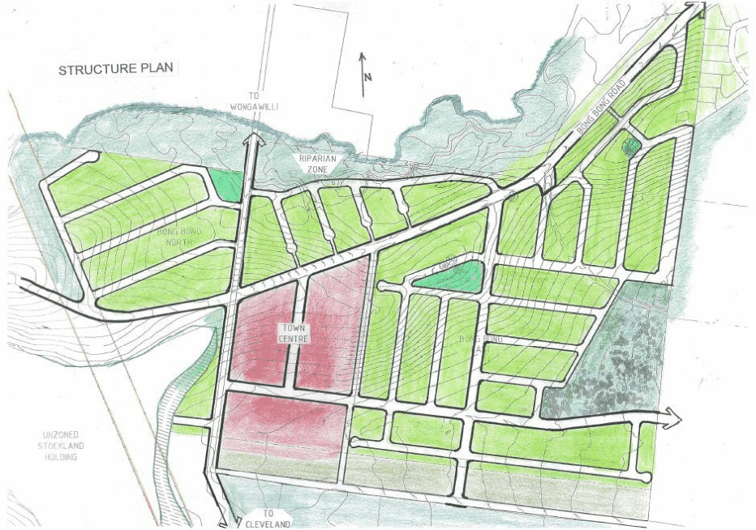

> [Picture on page 59: a picture, saved as a picture (images/chapter-d16-west-dapto-release-area-page-59-2.gif, 150 dpi).]

Figure 18 – Neighbourhood Plan – Bong Bong East and North

The following variations to development controls have been accepted:

Chapter B1 Residential Development - Section 4.25 Front Setbacks – Controls 1 and 2 are replaced with:

1\) The following setback requirements apply from the primary street frontage to the front façade of the building:

i) Front building line: 4.5m minimum setback, except for garages which must be setback at least 5.5m from the property boundary on the primary road.

ii) Articulation zone: An articulation zone up to a maximum of 1.5m measured from the foremost edge of the building line may be incorporated within the front setback zone. The following building elements are permitted in the articulation zone:

a. an entry feature or portico

b. a balcony, deck, patio, pergola, terrace or verandah

c. a window box treatment

d. a bay window or similar feature

e. an awning or other feature over a window

f. a sun shading feature.

iii) A building element must not extend above the eave gutter line, other than a pitched roof to an entry feature or portico that has the same pitch as the roof on the dwelling house.

iv) The maximum area of all building elements within the articulation zone, other than a building element listed in (v) or (vi) above, must not be more than twenty five percent of the area of the articulation zone, measured through the horizontal plane of the elements.

2\) For corner allotments a 2m minimum setback requirement applies from the secondary street frontage to the façade of the building.

Chapter B1 Residential Development – Section 4.3 Side and Rear Setbacks – Controls 1 to 3 are replaced with:

1\) A dwelling house and any carport, garage, balcony, deck, patio, pergola, terrace or verandah that is attached to the dwelling house with a building height at any point up to 3.8m on an allotment with an area greater than or equal to 450m2 must have a setback from a side boundary of at least 900mm. This control does not apply to a secondary street frontage.

2\) Any part of a dwelling house that has a building height in excess of 3.8m and any carport, garage, balcony, deck, patio, pergola, terrace or verandah that is attached to a dwelling house on an allotment with an area greater than or equal to 450m2 must have a setback from a side boundary of at least the sum of 900mm and an amount that is equal to one quarter of the additional building height above 3.8m. This control does not apply to a secondary street frontage.

Note - A two storey dwelling house may have its ground floor component (up to 3.8m in height) setback 900mm from the side boundary with the second storey setback further as required by the formula in 2).

A dwelling house that is part two storey and part single storey may have the single storey portion of the dwelling house (up to 3.8m) setback 900mm from the side boundary and the two storey portion of the dwelling house setback further as required by the formula in 2).

3\) On an allotment with an area less than 450m2 and a lot width 10m or less, where an easement for access and maintenance as well as driveway crossing locations (which are located so as not to adversely impact on-street parking capacity) are provided on title, a zero side setback may be applied to one side for the single storey component of the dwelling. The two storey component of the dwelling is to be setback further as required by the formula in 2). This control does not apply to a secondary street frontage.

The following additional Controls to apply:

1\) A dwelling house and any carport, garage, balcony, deck, patio, pergola, terrace or verandah that is attached to the dwelling house with a building height at any point up to 3.8m must have a setback from the rear boundary of at least 3m.

2\) A dwelling house with a building height of more than 3.8m and any carport, garage, balcony, deck, patio, pergola, terrace or verandah that is attached to the dwelling house must have a setback from the rear boundary of at least 3m, plus an amount that is equal to three times the additional building height above 3.8m up to a maximum setback of 8m.

3\) Despite (6) and (7), an allotment that has a rear boundary with a laneway may have a building line that abuts that boundary for up to 50 per cent of the length of that boundary.

Chapter B2 Residential Subdivision – Section 13 Cut and Fill Land Reshaping Works – does not apply to master planning of land and precinct subdivision applications.

#### 14.5.2 Bong Bong Town Centre

In the area where Bong Bong Road adjoins the north-south arterial route a new district town centre is to be established, based on a north-south orientated main street (see Figure 18 Bong Bong East and North Neighbourhood Plan). The Bong Bong Town Centre is to be the primary town centre in the release area. The Bong Bong Town Centre is to be a supermarket based centre with a range of shops and would accommodate around 15,000m2 of retail floor space.

#### 14.5.3 Wongawilli – North

Wongawilli North will provide a mix of housing densities from large lot housing towards the escarpment and becoming denser towards the east and surrounding the village centre. The riparian corridor will create some structural form for passive recreation and active transport links along shared paths between the residential pockets.

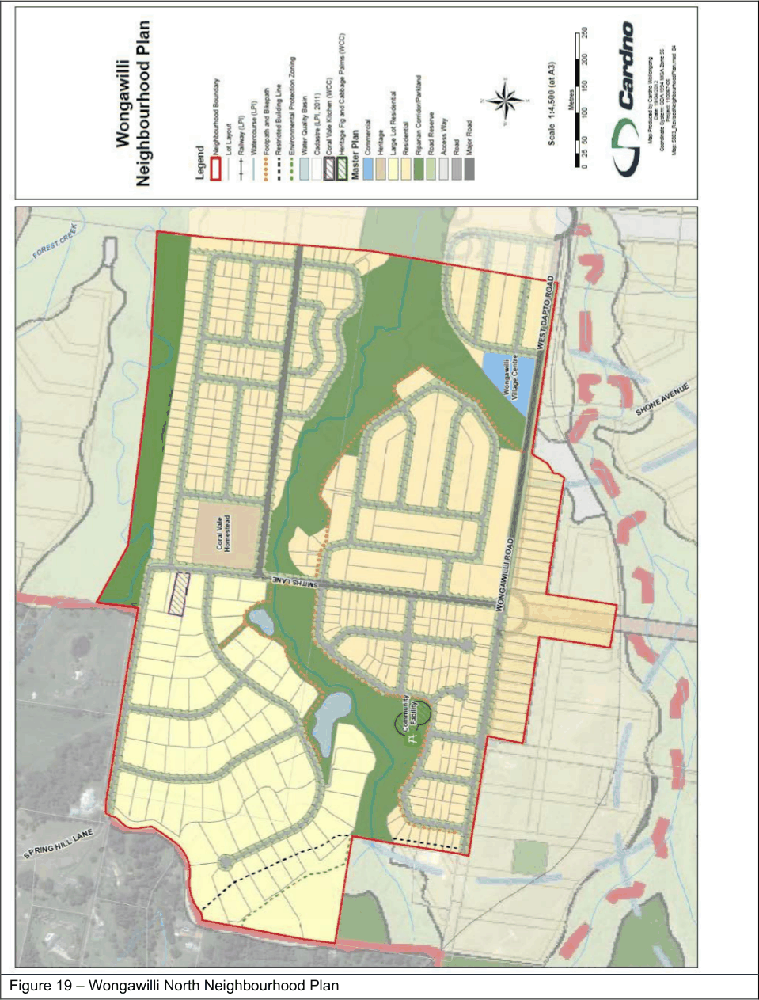

> [Picture on page 61: a picture, saved as a picture (images/chapter-d16-west-dapto-release-area-page-61-6.gif, 150 dpi).]

Figure 19 – Wongawilli North Neighbourhood Plan

The following modified and additional Controls to apply:

1\) Minimum lot width fronting Wongawilli Road and Smiths Lane of 15m;

2\) Minimum front building line setback of 4.5m for all lots fronting Wongawilli Road and Smiths Lane;

3\) The maximum length of cul-de-sacs that provide access to lots fronting Wongawilli Road Should not exceed 130m;

4\) For lots with a dual road frontage:

i) Wongawilli Road and Smiths Lane is considered to be the primary road frontage and the internal unnamed road is considered to be the secondary road frontage and the rear of the lots;

ii) All dwellings must face, address and activate the primary road frontage of Wongawilli Road and Smiths Lane;

iii) Carports or garages must be located and accessed from the secondary road frontage rear of the lots;

iv) Minimum rear setbacks are to remain in accordance with DCP Chapter B1: Residential Development, garages and carports are to have a minimum rear setback of 5.5m in accordance with the principles shown in Figure 20;

v) Fencing and landscaping treatment of the secondary road frontage is in accordance with the principles shown in Figure 20. Examples of Articulated fencing include, but are not limited to:

a. Masonry to 1.2m high with open type lattice or slats above with masonry elements no wider than 150mm;

b. Timber Lap and Cap;

c. Colorbond solid to 1.2m with Colorbond lattice style top sections.

5\) For lots backing onto or adjoining the Rural Fire Service (RFS) property:

i) Dwelling house, secondary dwelling and any habitable areas must be setback at least 10m from the rear or common property boundary that adjoins the RFS property.

ii) Outbuildings and garages must be setback at least 5m from the rear of common boundary that adjoins the RFS property.

> [Picture on page 63: a picture, saved as a picture (images/chapter-d16-west-dapto-release-area-page-63-1.gif, 150 dpi).]

PRIMARY ROAD

(No vehicle access)

Figure 20 – Dual Frontage Property Secondary Frontage Treatment

Wongawilli Village centre will provide a small convenience centre with a small grocer and some mixed retail shops. The centre will be designed focusing on activating the interface with the riparian boundary and its West Dapto Road frontage. Parking will be included in the village design with street parking along the secondary street and a parking lot area provided along the north, generally not visible from West Dapto Road, allowing built form to perform a clear street defining urban function. The village form will be guided by the concept design presented in Figure 21.

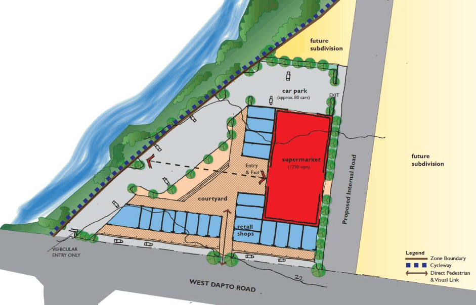

> [Picture on page 64: a picture, saved as a picture (images/chapter-d16-west-dapto-release-area-page-64-1.gif, 150 dpi).]

Figure 21 – Wongawilli Village Centre – Conceptual Design

#### 14.5.4 Wongawilli Mine Spur Rail Line

It is anticipated that the Wongawilli Mine will continue to operate for the next 30 years, or longer. Coal is transported from the mine to Port Kembla via the rail network. Future urban development should be designed to recognise the continued use of the rail spur line and include measure to mitigate noise and other potential impacts. Division 15 of SEPP Infrastructure 2007 applies to development near the spur line.

#### Objectives

a) To facilitate the transport of coal from Wongawilli Mine to Port Kembla by rail transport.

b) To minimise rail noise, vibration and other impacts on dwellings near the rail spur line.

#### Controls

1\) Development Applications for subdivision and dwelling houses within the rail buffer area (Refer to Figure 22), must satisfy the requirements of SEPP Infrastructure Division 15, and are to include:

i) sound attenuation measures that achieve a maximum of 35dBA within the dwelling.

ii) Consideration of vibration impacts and includes mitigation measures.

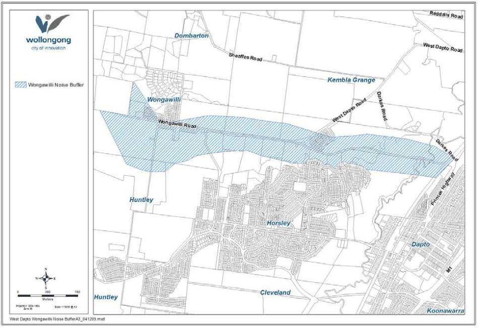

> [Picture on page 65: a picture, saved as a picture (images/chapter-d16-west-dapto-release-area-page-65-1.gif, 150 dpi).]

Figure 22 – Wongawilli Rail Noise Area

#### 14.5.5 Shone Avenue – South

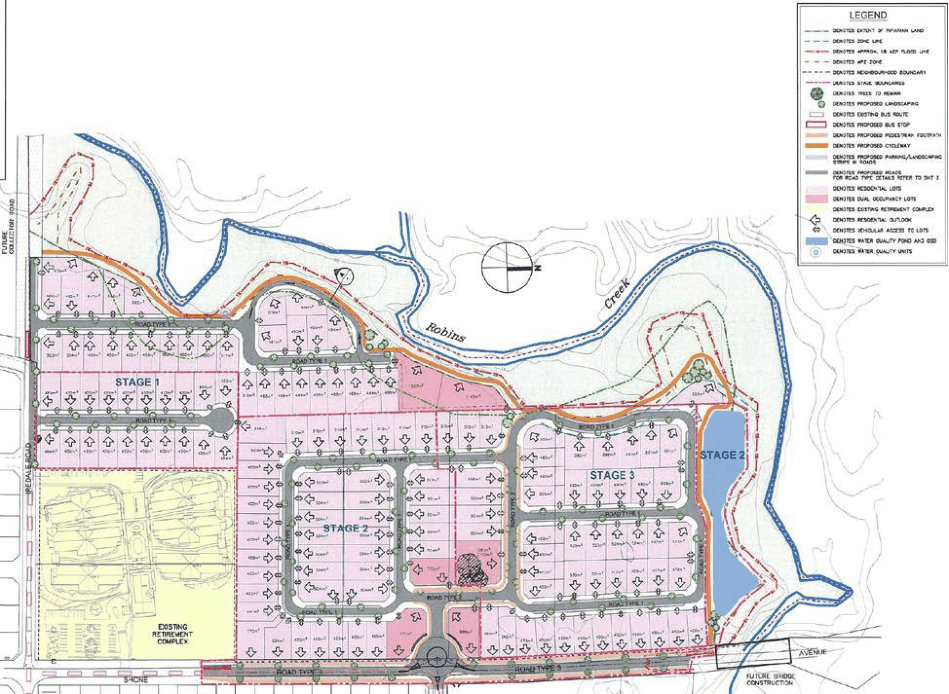

> [Picture on page 66: a picture, saved as a picture (images/chapter-d16-west-dapto-release-area-page-66-2.gif, 150 dpi).]

Figure 23 – Shone Avenue South Neighbourhood Plan

The following modified and additional Controls to apply:

1\) For lots with a dual road frontage:

i) Shone Avenue and Iredell Road are considered to be the primary road frontage and the internal unnamed road is considered to be the secondary road frontage and the rear of the lots;

ii) all dwellings must face, address and activate the primary road frontage of Shone Avenue and Iredell Road;

iii) carports or garages must be located and accessed from the secondary road frontage rear of the lots;

iv) minimum rear setbacks are to remain in accordance with DCP Chapter B1: Residential Development, garages and carports are to have a minimum rear setback of 5.5m in accordance with the principles shown in Figure 24;

v) fencing and landscaping treatment of the secondary road frontage is in accordance with the principles shown in Figure 24. Examples of Articulated fencing include, but are not limited to:

a. Masonry to 1.2m high with open type lattice or slats above with masonry elements no wider than 150mm;

b. Timber Lap and Cap;

c. Colorbond solid to 1.2m with Colorbond lattice style top sections

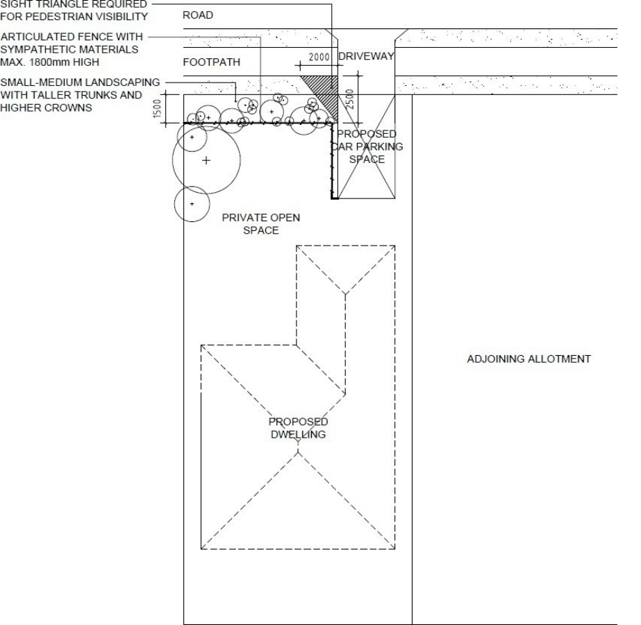

> [Picture on page 67: a picture, saved as a picture (images/chapter-d16-west-dapto-release-area-page-67-1.gif, 150 dpi).]

PRIMARY ROAD

(No vehicle access)

Figure 24 – Dual Frontage Property Secondary Frontage Treatment

#### 14.5.6 Reddalls Road Industrial

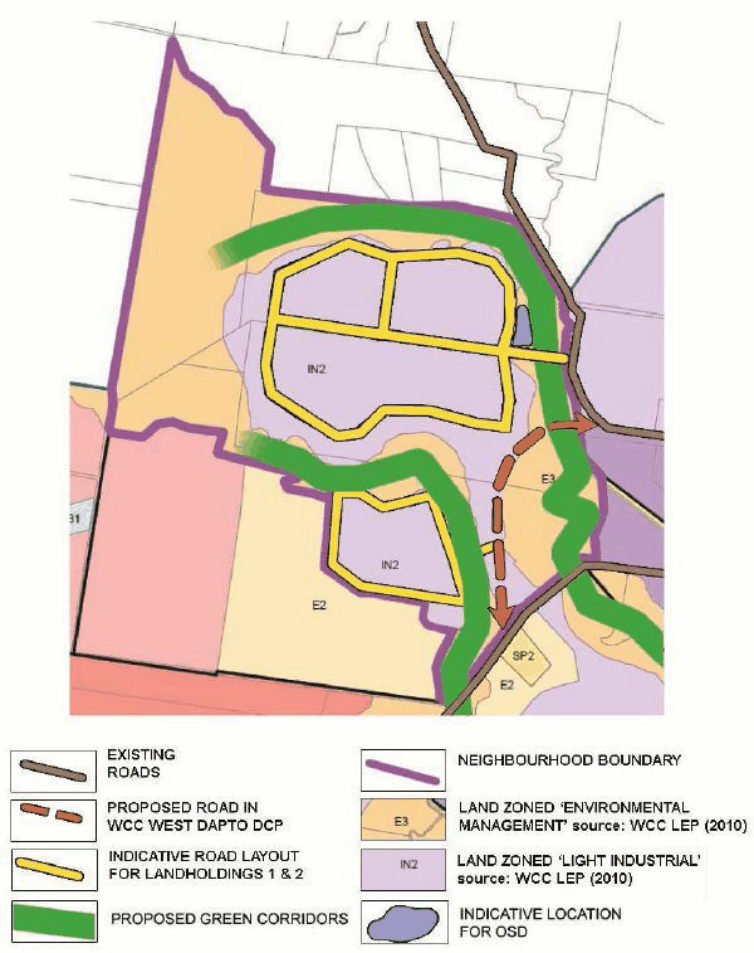

> [Picture on page 68: a picture, saved as a picture (images/chapter-d16-west-dapto-release-area-page-68-2.gif, 150 dpi).]

Figure 25 – Reddalls Road Industrial Neighbourhood Plan

The following additional controls to apply:

1\) The proposed cycleway must have adequate passive surveillance to ensure safety by design.

2\) Indicative future bus stop locations should be identified and shown on road types capable of handling bus routes. A minimum number of stops should be located in a manner to ensure that the majority of lots are within 400m of a bus stop.

3\) Any proposed development of the neighbourhood will require the applicant upgrading the relevant section of Reddalls Road to a standard that is suitable for the normal range of Heavy vehicles at no cost to Council. These upgrade works would also include any required intersection treatment to Reddalls Road and the new proposed Access Road as well as any necessary road safety works.

4\) In the event of any inconsistency between the controls in this Section and those in Section

14.5.16 BlueScope Woods Residential Estate and Employment Hub: Kembla Grange, controls in Section 14.5.16 prevail.

#### 14.5.7 Sheaffes Road North

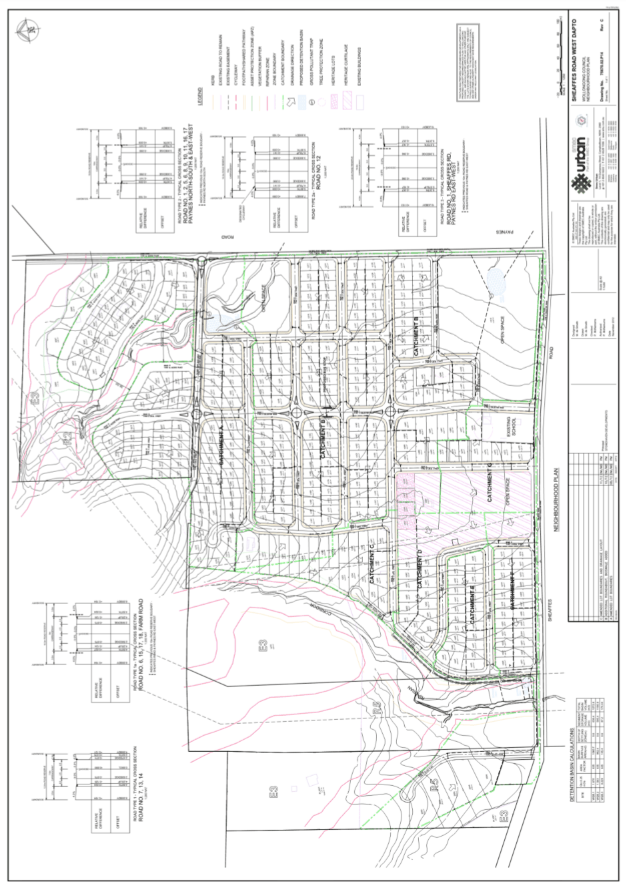

> [Picture on page 69: a picture, saved as a picture (images/chapter-d16-west-dapto-release-area-page-69-2.gif, 150 dpi).]

Figure 26 – Sheaffes Road North Neighbourhood Plan

The following modified and additional controls to apply:

1\) For lots with a dual road frontage:

i) Sheaffes Road and Paynes Road are considered to be the primary road frontage and the internal unnamed road is considered to be the secondary road frontage and the rear of the lots;

ii) All dwellings must face, address and activate the primary road frontage of Sheaffes Road and Paynes Road;

iii) Carports or garages must be located and accessed from the secondary road frontage rear of the lots;

iv) Minimum rear setbacks are to remain in accordance with DCP Chapter B1: Residential Development, garages and carports are to have a minimum rear setback of 5.5m in accordance with the principles shown in Figure 27;

v) Fencing and landscaping treatment of the secondary road frontage is in accordance with the principles shown in Figure 27. Examples of articulated fencing include, but are not limited to:

a. Masonry to 1.2m high with open type lattice or slats above with masonry elements no wider than 150mm.

b. Timber Lap and Cap;

c. Colorbond solid to 1.2m with Colorbond lattice style top sections.

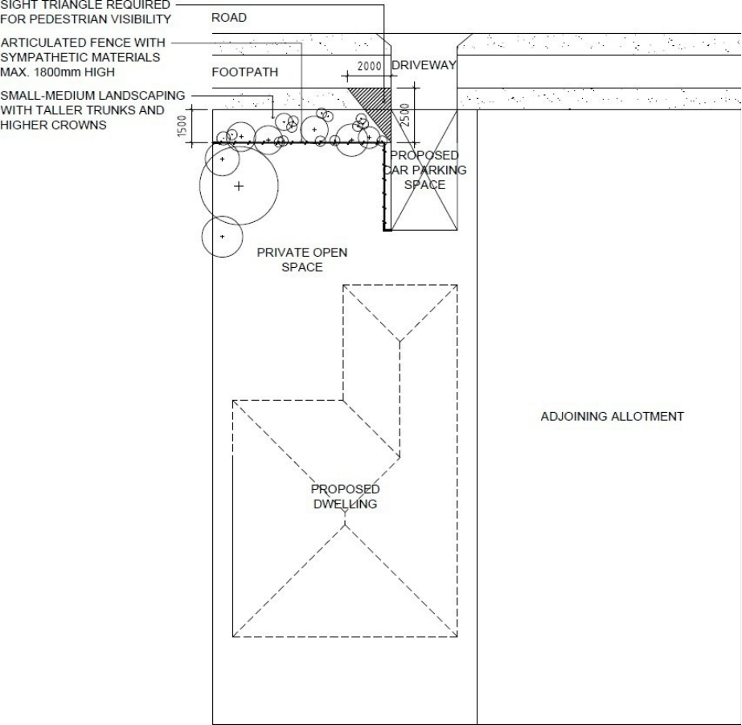

> [Picture on page 71: a picture, saved as a picture (images/chapter-d16-west-dapto-release-area-page-71-1.gif, 150 dpi).]

PRIMARY ROAD (No vehicle access)

Figure 27 – Dual Frontage Property Secondary Frontage Treatment

#### 14.5.8 Darkes Road South West

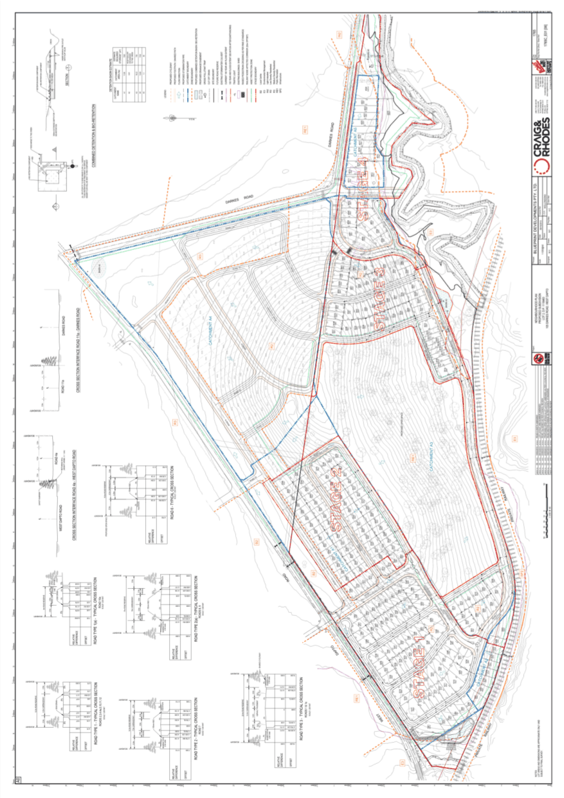

> [Picture on page 72: a picture, saved as a picture (images/chapter-d16-west-dapto-release-area-page-72-2.gif, 150 dpi).]

Figure 28 – Darkes Road South West Neighbourhood Plan

The following modified and additional controls to apply:

1\) Lot width, depth and aspect are to be in accordance with Figure 28 above and are not required to comply with DCP Chapter B2: Residential Development, Section 6 Subdivision Lot Layout – Aspect & Solar Access Orientation as well as Section 8 Lot Width & Depth Requirements. The relevant issues have been considered and the lot layout and details shown are considered acceptable. Should the lot layout depart substantially from that shown then compliance with DCP Chapter B2 is required unless variation is sought in accordance with DCP Chapter A1: Ecologically Sustainable Development.

2\) On an allotment with an area less than 450m2 and a lot width 10m or less, where an easement for access and maintenance as well as driveway crossing locations (which are located so as not to adversely impact on-street parking capacity) are provided on title, a zero side setback may be applied to one side for the single storey component of the dwelling. The two storey component of the dwelling is to be setback further as required by the formula in 2). This control does not apply to a secondary street frontage.

3\) For lots with a dual road frontage:

i) West Dapto Road and Darkes Road is considered to be the primary road frontage and the internal unnamed road is considered to be the secondary road frontage and the rear of the lots;

ii) All dwellings must face, address and activate the primary road frontage of West Dapto Road and Darkes Road;

iii) Carports or garages must be located and accessed from the secondary road frontage rear of the lots;

iv) Minimum rear setbacks are to remain in accordance with DCP Chapter B1: Residential Development, garages and carports are to have a minimum rear setback of 5.5m in accordance with the principles shown in Figure 29 below;

v) Fencing and landscaping treatment of the secondary road frontage is in accordance with the principles shown in Figure 29. Examples of articulated fencing include, but are not limited to:

a. Masonry to 1.2m high with open type lattice or slats above with masonry elements no wider than 150mm;

b. Timber Lap and Cap;

c. Colorbond solid to 1.2m with Colorbond lattice style top sections.

> [Picture on page 74: a picture, saved as a picture (images/chapter-d16-west-dapto-release-area-page-74-1.gif, 150 dpi).]

PRIMARY ROAD (No vehicle access)

Figure 29 – Dual Frontage Property Secondary Frontage Treatment

1\) For all development applications outside of the area denoted as Stage 1:

i) An Aboriginal Heritage Assessment is to be undertaken in accordance with the Wollongong Development Control Plan 2009 Chapter E10: Aboriginal Heritage.

ii) Additional archaeological investigations are required to be undertaken to the previously recorded archaeological sites and three (3) potential archaeological deposits (PADs) identified. This work is required in order to better determine the significance and extents of these areas.

iii) In-principle support for the intended mitigation or Aboriginal Heritage Impact Permit (AHIP) proposals is to be gained from the NSW Office of Environment and Heritage (OEH) prior to the determination of the associated development application.

iv) Further consultation with Local Aboriginal Groups is to be undertaken within the assessment of any future Development Applications.

v) Consideration of the impacts of the proposal on identified Non-Indigenous Archaeological Deposits located on the site during the preparation of the Heritage reports and which are

subject to Section 140 of the NSW Heritage Act 1977.

vi) Conservation planning related to any retained structures or features on the site (e.g. The Silo and gardens).

vii) Interpretation planning relating to the history and heritage significance of the development area.

2\) Bush Fire Matters

i) Certain construction standards apply for development on Bush Fire Prone Land. The applicable Construction Standards for proposed development are to reflect the Bushfire Attack Level (BAL) as identified at Figure 30 below.

ii) Given that the site is identified as Bush Fire Prone Land, when a development application for subdivision is made, the development will require a Bush Fire Safety Authority to be issued by the NSW RFS under Section 100B of the Rural Fires Act 1997. The RFS has indicated that it is likely that by condition of the Bush Fire Safety Authority, restriction on the titles of the lots requiring the provision and maintenance of the necessary APZ’s will be required.

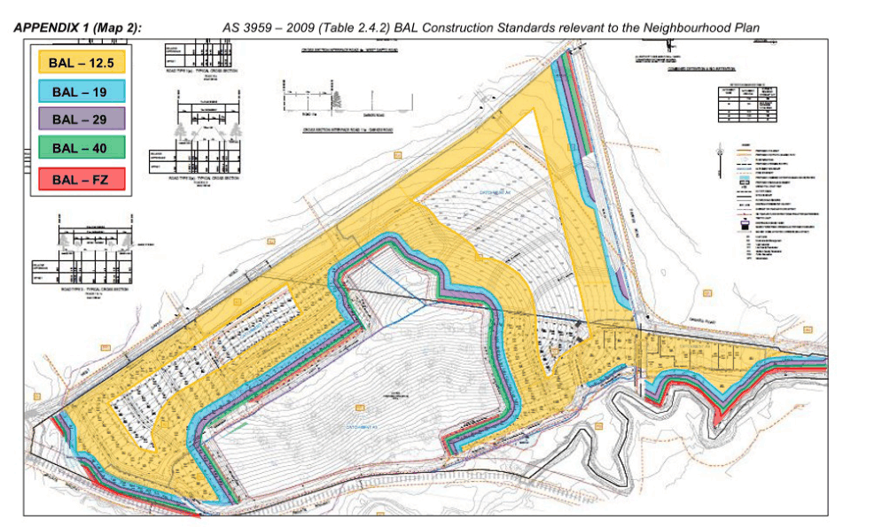

> [Picture on page 75: a picture, saved as a picture (images/chapter-d16-west-dapto-release-area-page-75-16.gif, 150 dpi).]

Figure 30 – BAL Construction Standards Relevant to the Neighbourhood Plan

1\) Access

i) An appropriate access track is to be provided to the Detention Basin A1 to facilitate sufficient maintenance access for Council.

ii) Appropriate access is also to be provided to the Wongawilli Rail Spur Line from the Detention Basin A1 and from Road 01.

iii) The final form of the access track is to be determined in conjunction with Council Engineering Officers within the assessment of future Development Applications. Hardstand access will be required.

2\) There may be scope to amend the current Council Drainage Acquisition Maps to reflect more

up to date flood mapping of the area. This is to be further investigated within future Voluntary Planning Agreements (VPAs) and assessment of development applications.

#### 14.5.9 Avondale Road North Huntley

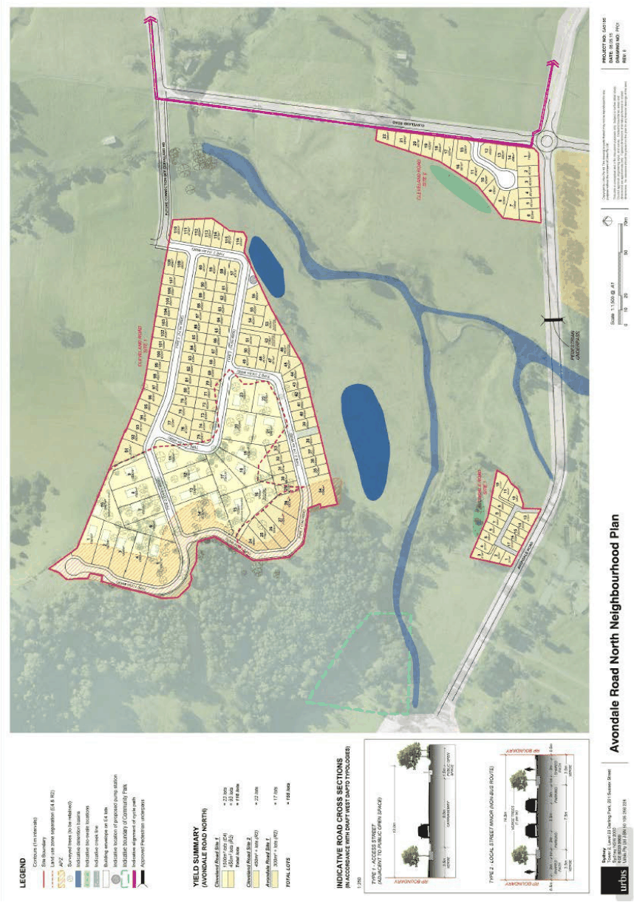

> [Picture on page 76: a picture, saved as a picture (images/chapter-d16-west-dapto-release-area-page-76-4.gif, 150 dpi).]

Figure 31 – Avondale Road North Huntley Neighbourhood Plan

#### 14.5.10 Shone Avenue / West Dapto Road

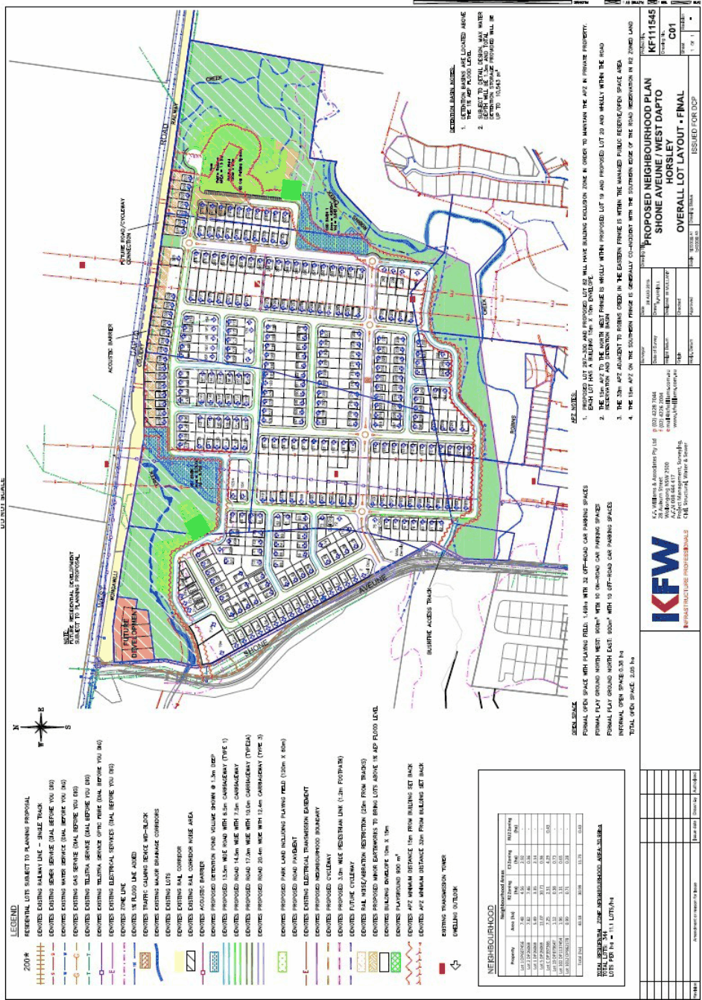

> [Picture on page 77: a picture, saved as a picture (images/chapter-d16-west-dapto-release-area-page-77-2.gif, 150 dpi).]

Figure 32 – Shone Avenue and West Dapto Road Neighbourhood Plan

The following modified and additional Controls apply:

1\) For lots with a dual road frontage:

i) Shone Avenue is considered to be the primary road frontage and the internal unnamed road is considered to be the secondary road frontage and the rear of the lots.

ii) All dwellings must face, address and activate the primary street frontage of Shone Avenue

– this is the main address of the dwelling.

iii) The minimum front setback on Shone Avenue is 4m (being a greenfield site) and the minimum setback from the secondary road is 4m.

iv) No car access to residential lots is permitted from Shone Avenue (i.e. lots are access denied). Carports or garages must be located and accessed from the secondary road frontage rear of the lots.

v) Garages and carports must be setback a minimum of 5.5m from the property boundary on the secondary road to enable a vehicle to park or stand in front of the garage or carport (i.e. allow off street parking that does not impede the footpath) and in order to be a non-dominant component of the streetscape.

vi) Fencing controls for the primary street frontage of Shone Avenue are outlined in DCP Chapter B1: Residential Development and are designed to complement the objectives of passive surveillance.

vii) Fencing and landscaping treatment of the secondary road frontage must ensure that clear lines of sight are maintained for motorists and pedestrians to and from the lot, and ensure the design complements the objectives of passive surveillance. To help soften the visual impact and improve the streetscape appearance of the fence and allow visual connection between the dwelling and the street, any fence will be required to be well articulated and landscaped with appropriate planting. Articulated fencing should be provided to a maximum height of 1.8m.

Examples of articulated fencing include, but are not limited to:

a. Masonry to 1.2m high with open type lattice or slats above with masonry elements no wider than 150mm;

b. Timber Lap and Cap

c. Colorbond solid to 1.2m with Colorbond lattice style top sections.

NB. Fences in bush fire prone areas shall be of a metal or masonry construction only.

viii) Any gates associated with the secondary street fence should open inwards and not obstruct the road reserve.

ix) Where garage door openings face the secondary road, they shall be a maximum of 50% of the width of the dwelling. Refer to Chapter B1: Residential Development for other car parking and access controls.

2\) For lots backing onto West Dapto Road:

i) An acoustic building exclusion zone of 25m applies along the length of the rail corridor to reflect Noise Report recommendations.

ii) A sound wall is to be erected by the developer along the length of the rail corridor, as indicated in the Neighbourhood Plan.

#### 14.5.11 West Dapto Road / Sheaffes Road (South)

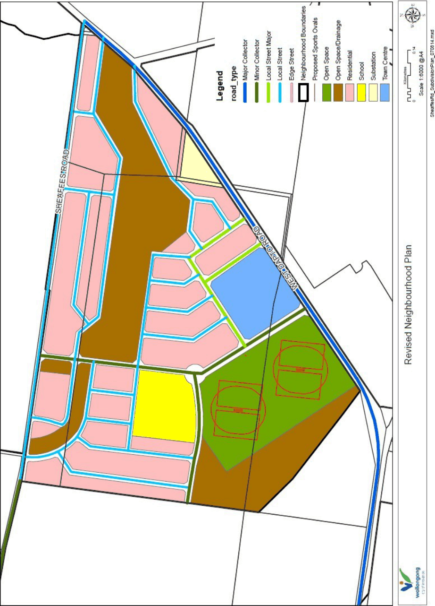

> [Picture on page 79: a picture, saved as a picture (images/chapter-d16-west-dapto-release-area-page-79-2.gif, 150 dpi).]

Figure 33 – West Dapto Road / Sheaffes Road (south) Neighbourhood Plan

#### 14.5.12 Bong Bong Road South

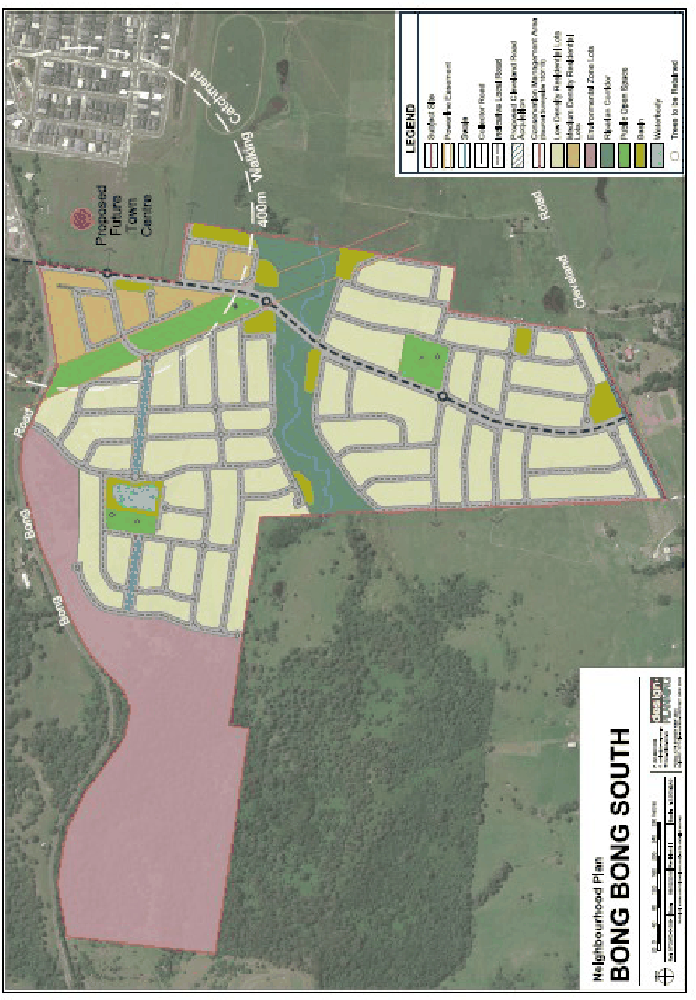

> [Picture on page 80: a picture, saved as a picture (images/chapter-d16-west-dapto-release-area-page-80-2.gif, 150 dpi).]

Figure 34 – Bong Bong Road South Neighbourhood Plan

#### 14.5.13 Hayes Lane and Iredell Road

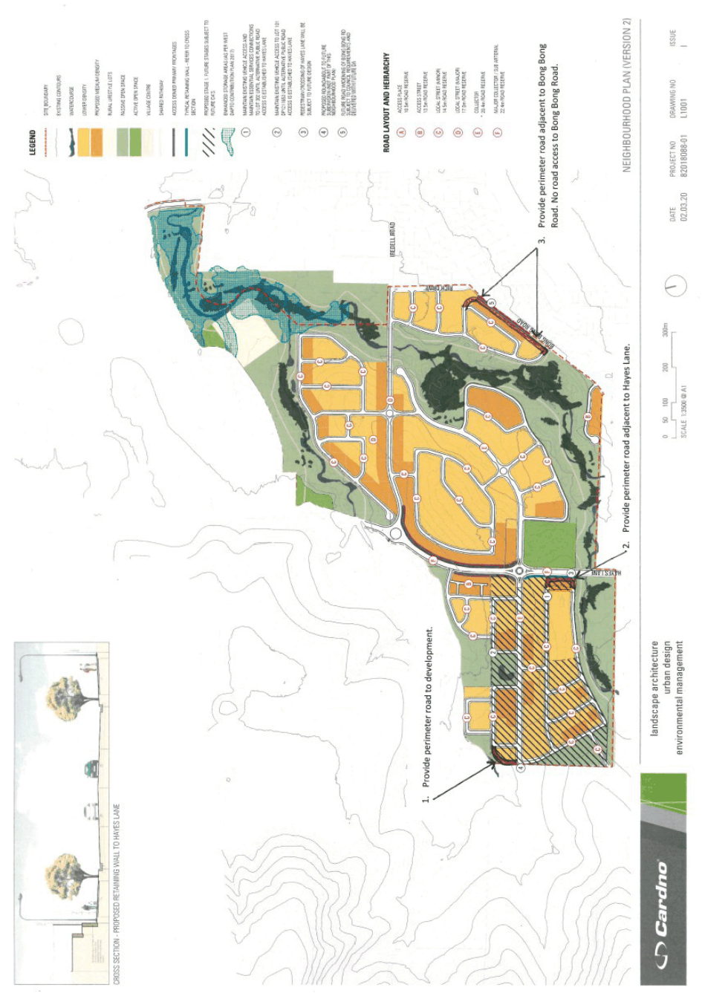

> [Picture on page 81: a picture, saved as a picture (images/chapter-d16-west-dapto-release-area-page-81-2.gif, 150 dpi).]

Figure 35 – Hayes Lane and Iredell Road Neighbourhood Plan

1\) The future subdivision of the land should be generally in accordance with Figure 35 and Figure 36.

2\) Future residential development on the land shall be in accordance with DCP Chapter B1: Residential Development, except where variations or additional controls are identified below.

3\) A development application for subdivision shall demonstrate the manner in which it is compatible with the current and likely future orderly and economic development of adjoining lands including:

i) Connectivity to pedestrian, cycling and public road networks

ii) Earthworks, retaining walls and future cut/fill requirements

iii) Stormwater management including any necessary works on adjoining land

iv) A construction management plan maintaining connections to all essential services and public road network during and post-construction

v) Management of Asset Protection Zones and connectivity to public roads for bushfire emergency and evacuation

4\) Minimum setback of four metres from primary road frontage, except for garages which must be setback at least five metres from the property boundary on the primary road.

5\) Minimum setback of two metres from a secondary road on a corner lot.

6\) For lots with more than one road frontage, the primary frontage is that which is adjacent to the road with the widest reserve width [internal roads/laneway are considered to be the secondary road frontage and the rear of the lots].

i) All dwellings must face, address and activate the primary road frontage

ii) Car ports, garages and on-site parking must not be located within the setback to the primary frontage and not be accessed from the primary frontage.

iii) Fencing and retaining walls fronting controlled access roads are to present a consistent streetscape and should be constructed prior to the issue of a Subdivision Certificate to ensure consistency of materials, construction and delivery.

7\) Residential development on lots less than 300sqm must be developed as Integrated Housing.

8\) If developed in an integrated manner, a zero side setback will be considered for attached dwellings.

9\) Fencing and landscaping treatment of a road frontage that is not the primary road frontage must ensure that clear lines of sight are maintained for motorists and pedestrians and ensure the design achieves passive surveillance. Any fence will be required to be well designed and landscaped.  The maximum fence height is 1.8 metres of which a maximum 1.5m from the ground is solid form and elements above 1.5m are open form. Any gates should open so as not to obstruct the road reserve.

These fencing requirements are to be included as a Restriction-as-to-user on the title of affected lots.

10\) Fencing to ‘Access Denied’ primary frontages (as shown in the Neighbourhood Plan) shall be constructed prior to the issue of a Subdivision Certificate. Where retaining walls are required, they are to be constructed in stepped design of masonry blocks or Council-approved equivalent and fencing as indicated in the Neighbourhood Plan and DCP controls.

These fencing requirements are to be included as a Restriction-as-to-user on the title of affected lots.

11\) Where rear or side boundary fences adjoin land to be dedicated as open space, fences are to be of a design and materials which allow for passive surveillance between the private lot and the open space.

These fencing requirements are to be included as a Restriction-as-to-user on the title of affected lots.

12\) Where garage door openings face the secondary road they shall be a maximum of 50% of the width of the dwelling façade.

13\) Western lots inclusive of transmission easement should have rural, timber style fences fronting the new road.

14\) Parts of the site are identified as bushfire prone land.  Certain construction standards apply for development on Bushfire Prone Land.  The applicable Construction Standards for proposed development are to reflect the applicable Bushfire Attack Level (BAL).  The BAL will be finalised at DA stage.

15\) The north and south edges of the Neighbourhood Plan interface with existing vegetation.  This requires the provision of an Asset Protection Zone (APZ) in accordance with Rural Fire Service (RFS) requirements.  There is sufficient space within each development site fronting the riparian and woodland areas to ensure the provision of an APZ.  The final location of any required APZ will be identified at the DA design stage.

16\) Design of local parks must integrate with the proposed OSD.  The design and relationship will be finalised as a part of the subdivision DA.

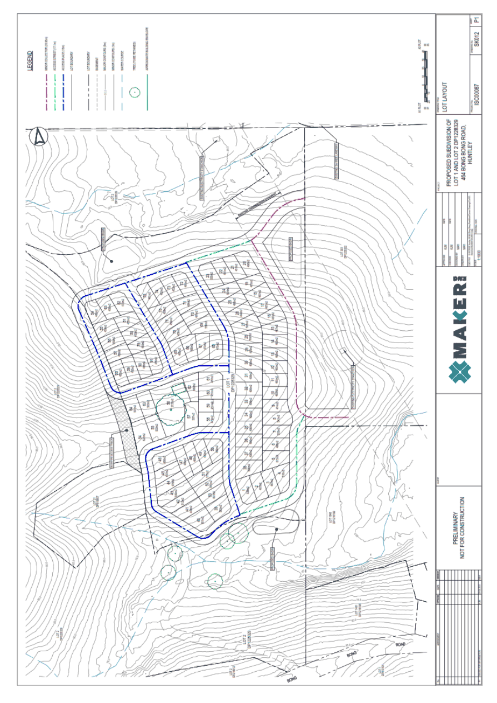

> [Picture on page 84: a picture, saved as a picture (images/chapter-d16-west-dapto-release-area-page-84-1.gif, 150 dpi).]

Figure 36 – Hayes Lane and Iredell Road Neighbourhood Plan – Western End

17\) The future subdivision of the land should be generally in accordance with Figure 35 and Figure 36.

18\) Future residential development on the land shall be in accordance with DCP Chapter

B1: Residential Development.

#### 14.5.14 Stage 5 – Yallah / Marshall Mount

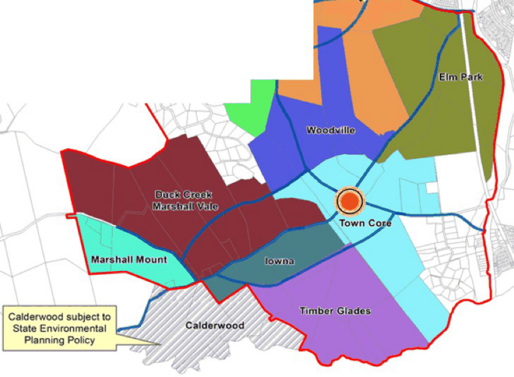

> [Picture on page 85: a picture, saved as a picture (images/chapter-d16-west-dapto-release-area-page-85-3.gif, 150 dpi).]

Figure 37 –  Boundaries of future Neighbourhoods in Stage 5 to be planned

There are a number of defined neighbourhoods that make up Stage 5 Yallah/Marshall Mount. During the rezoning process, visions and strategic decisions were made to provide strategic level structure to future development in the area (see Page 8 summary of structure).  The Neighbourhood plans will all be required to deliver against the strategic intents established during these processes. Applicants planning in Stage 5 can obtain a copy of the West Dapto Centres Master Plan under the West Dapto Page on Council’s website.

#### Marshall Mount Town Centre

The new town centre will be focused around the intersection of Yallah Road and Marshall Mount Road on lower lying land adjacent to Duck Creek. The Stage 5 Yallah/Marshall Mount visions proposes that the focal point of the new community will be in this neighbourhood. Other developable land near this central intersection will be available for development for a mixture of housing types, with densities ranging from 50-75 dwellings per hectare near the town centre, with 20-30 dwellings per hectare further away. The vision needs to achieve these higher densities to create a critical mass of population within a walkable catchment of the proposed town centre to assist in economic viability of the centre and reduced car dependence.

There are opportunities for smaller lot housing and terraces to take advantage of future public transport routes along Marshall Mount Road.  Duck Creek provides opportunities for passive open space and walking and cycling tracks, but also includes land with significant flood hazard and is not suitable for development.  The corner of Marshall Mount Road and North Marshall Mount Road contains heritage items, including a community hall, which provides opportunities for a community focus around this point.  Flat land adjacent to the town centre may have potential for a school and playing fields. Land further from the main public transport routes will be for low density residential and rural-residential development.

The steeper slopes and more timbered areas provide a scenic green backdrop to the Duck Creek

valley and provide a bushland link along the ridgelines from the escarpment to Lake Illawarra.

Refer to Section 14.6.8 for specific Marshall Mount Town Centre characteristic detail.

#### 14.5.15 Elm Park

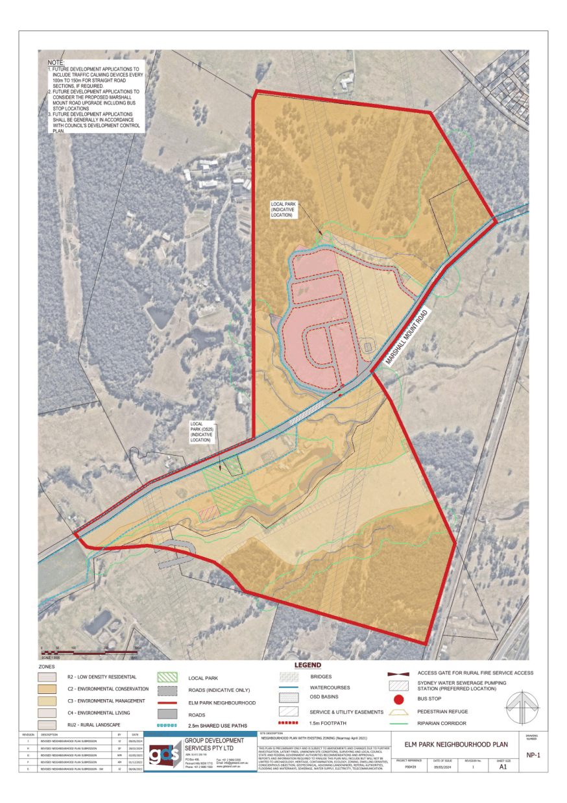

> [Picture on page 86: a picture, saved as a picture (images/chapter-d16-west-dapto-release-area-page-86-4.gif, 150 dpi).]

Figure 38 – Elm Park Neighbourhood Plan

1\) The proposed footprint of the Neighbourhood Plan will result in impacts on known Aboriginal Cultural Heritage Sites protected under the NSW National Parks and Wildlife Act 1974 as well as areas identified as having Moderate to High Aboriginal Archaeological Potential. Future development applications which have the potential to impact directly or indirectly on these areas identified within the Ecological Aboriginal Cultural Heritage Assessment Report dated 20 March 2024 will require an Aboriginal Cultural Heritage Impact Permit under Section 90 of the NSW National Parks and Wildlife Act 1974 and should be lodged as Integrated Development. These applications must be supported by updated Aboriginal Cultural Heritage Assessment Documentation that addresses the recommendations of the Ecological Report, and responds to the advice of Heritage NSW dated 3 August 2023.

2\) An Aboriginal Cultural Heritage Assessment Report (ACHAR) will be required for the land southeast of Marshall Mount Road zoned C4 Environmental Living, prior to any development application.

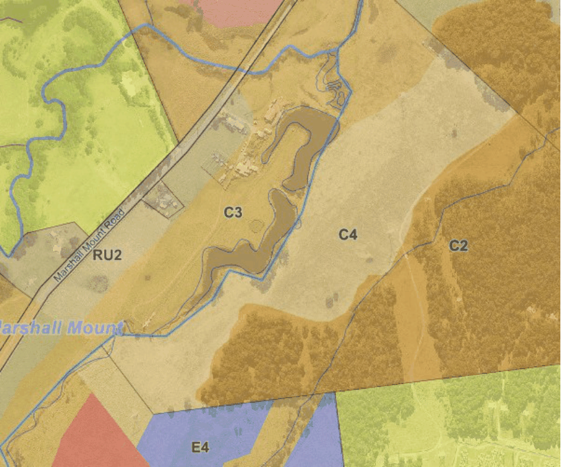

> [Picture on page 87: a picture, saved as a picture (images/chapter-d16-west-dapto-release-area-page-87-14.gif, 150 dpi).]

Figure 39 – C4 Environmental Living Areas, Requiring Aboriginal Cultural Heritage Assessment Report

3\) Any future proposed development that will require impacts or works within the areas identified as moderate or high within Figure 10 of the Austral Archaeology Preliminary Historical Heritage Assessment dated 28 April 2021 will require additional archaeological investigations and considerations in line with the recommendations of that report (see Figure 40 below).

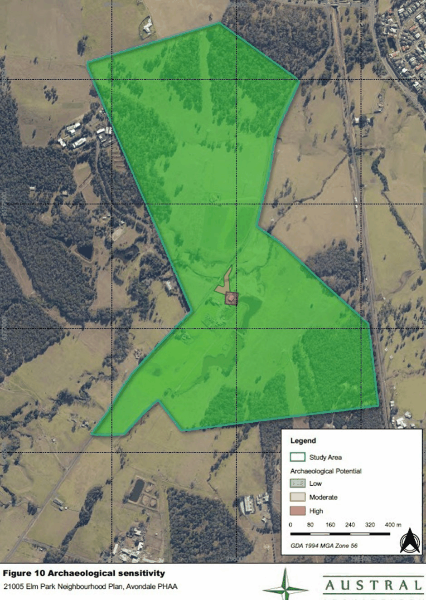

> [Picture on page 88: a picture, saved as a picture (images/chapter-d16-west-dapto-release-area-page-88-1.gif, 150 dpi).]

Figure 40 – Austral Archaeological Sensitivity Map

#### 14.5.16 BlueScope Woods Residential Estate and Employment Hub Kembla Grange

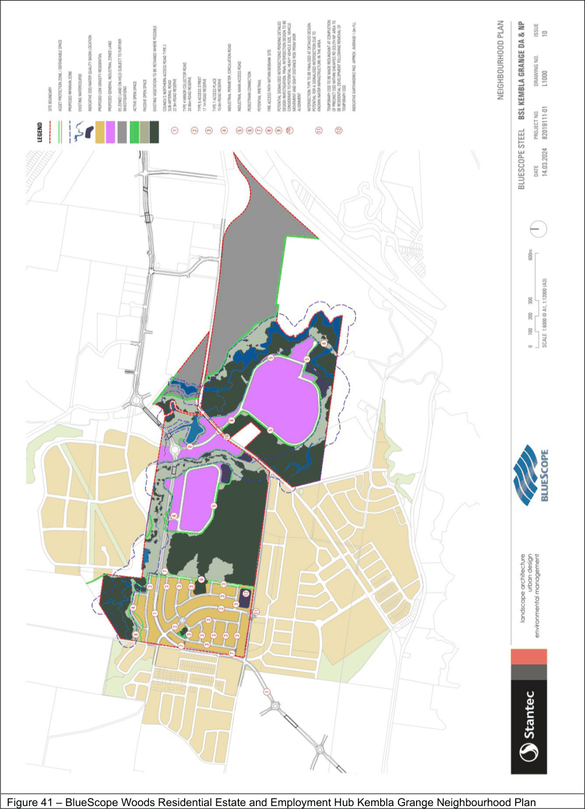

> [Picture on page 89: a picture, saved as a picture (images/chapter-d16-west-dapto-release-area-page-89-2.gif, 150 dpi).]

Figure 41 – BlueScope Woods Residential Estate and Employment Hub Kembla Grange Neighbourhood Plan

1\) Where the Neighbourhood Plan interfaces with existing vegetation, an Asset Protection Zone (APZ) is required. Provisions for APZ are to be in accordance with the Peterson Bushfire Report, dated June 2020 and the Rural Fire Service (RFS) requirements. Where development sites front the riparian and woodland areas APZs of sufficient size are to be provided. The final location of any required APZ will be identified at the Development Application Stage.

2\) The riparian balance will be further assessed as part of future Development Applications. As part of the subdivision design the following applies:

i) A surplus riparian offset is to be achieved and in a manner that is consistent with objectives of Wollongong Development Control Plan E23: Riparian Land Management.

ii) Riparian offset areas should not be within the already mapped Biobank sites as these locations already provide a conservation outcome under Biobanking Agreement BA

00421\.  Any required offsetting area is to be outside of the floodway areas.

iii) Riparian buffer encroachments are not to occur adjacent to bends in the water course or near the top of watercourse bank. Any proposed riparian buffer encroachments are to achieve the DCP objective for a Category 1 watercourse and provide sufficient riparian buffer widths to the urban interface and for habitat / wildlife corridors.

iv) Additional riparian offsets along Dapto Creek, must not extend beyond the minimum riparian buffer and are not to be located within the Defined Flood Event floodway.

v) Stormwater detention basins should not encroach into Category 1 Riparian Corridors. The location and design of stormwater detention basins are to be consistent with Chapter E23: Riparian Land Management.

vi) Stormwater detention basin(s) are to be effective for events up to and including the 1% AEP event and designed to be consistent with the Water Management Principle of Chapter D16: West Dapto Urban Release of the Wollongong DCP 2009.

3\) Prior to the submission of the first development application in the BlueScope Kembla Grange Neighbourhood Plan area, for paper subdivision of super lots or otherwise the following is to occur:

i) The ownership of the western Biobank Site and proposed Biodiversity Stewardship Site are to be clarified as per the 19 July 2021 Council resolution.

a. If to be retained by BlueScope, then a Vegetation Management Plan will be a future Development Application condition to guide the restoration and enhancement of the site.

b. If proposed to be transferred to Council, then details of in-perpetuity funding for the restoration and enhancement of the site will be required. Further discussions with Council are required.

4\) Development is to be excluded from the southwest corner of the Neighbourhood Planning area currently identified by Council’s 2023 Mullet Creek Floodplain Risk Management Study and Plan as high-risk flood risk precinct and should not be developed until flooding issues have been resolved.

#### 14.5.17 Iowna Neighbourhood Plan

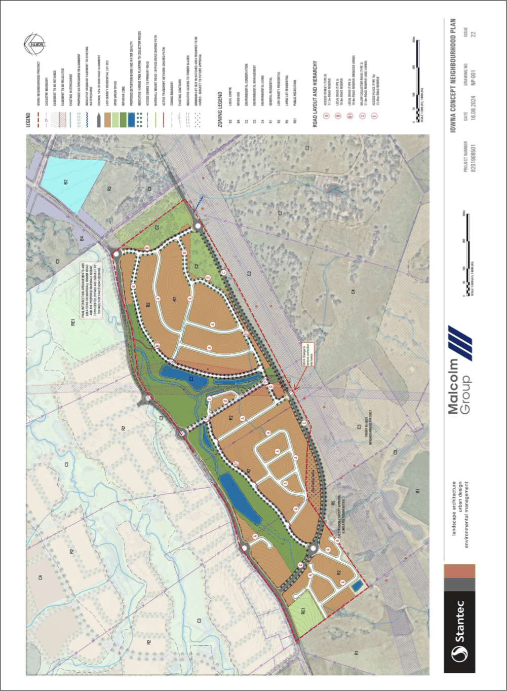

> [Picture on page 91: a picture, saved as a picture (images/chapter-d16-west-dapto-release-area-page-91-2.gif, 150 dpi).]

Figure 42 – Iowna Neighbourhood Plan

1\) The future subdivision of the land shall be generally in accordance with the adopted into the DCP for the purposes of this Part. Adopted Neighbourhood Plan.

2\) Future residential development on the land shall be in accordance with DCP Chapter B1: Residential Development, and other relevant Chapters, except where variations or additional controls are identified below, which will prevail.

3\) A development application for subdivision shall demonstrate the manner in which it is compatible with the current and likely future orderly and economic development of adjoining lands including

-

i) Connectivity to pedestrian, cycling and public road networks. This includes provision of the north-south share way within the West Dapto Centres Master Plan packages are available on Council’s website under Development Contributions Plan linking Marshall Mount Road to the proposed By-Pass Road, via local road east of the riparian corridor.

ii) Earthworks, retaining walls and future cut/fill requirements.

iii) Stormwater management including any necessary works on adjoining land.

iv) A construction management plan maintaining connections to all essential services and public road network during and post-construction.

v) Management of Asset Protection Zones and connectivity to public roads for bushfire emergency access and evacuation.

4\) Minimum setback of 2-metres from secondary road on a corner lot, except for garages, which require a 5.5m setback.

5\) Lots with more than one frontage:

For lots with more than one road frontage, the primary frontage is that which is adjacent to the road with the widest reserve width.

i) All dwellings must face, address and activate the primary road frontage.

ii) Car ports, garages and on-site parking must not be located within the setback to the primary frontage and not be accessed from the primary frontage.

iii) Fencing and retaining walls fronting controlled access roads are to present a consistent streetscape (including landscape treatment with interface to road) and should be constructed prior to the issue of a Subdivision Certificate to ensure consistency of materials, construction and delivery. Refer also to Control No. 7 below which requires dwellings to address Access Denied Road.

6\) Dwellings must address Marshall Mount Road and wherever possible to any other Access Denied Roads to maximise passive surveillance and shall include including appropriate landscape treatment with interface to road.

7\) If developed in an integrated manner, a zero side setback will be considered for attached dwellings or dwellings on adjoining lots.

8\) Fencing and landscaping treatment of a road frontage that is not the primary frontage must ensure that clear lines of sight are maintained for motorists and pedestrians and to achieve passive surveillance from the dwelling.

9\) Any fence fronting a street that is not the primary frontage will be well designed and landscaped with appropriate planting. The maximum fence height is 1.8 metres of which a maximum 1.5m from the ground is solid form and elements above 1.5m are open form.

Examples of fencing include, but are not limited to -

i) Masonry to 1.2m high with open form type lattice or slats above with masonry support elements no wider than 150mm.

ii) Timber Lap and Cap.

iii) Colourbond solid to 1.2m with Colourbond lattice style top sections. NB. Fences in bush fire prone areas shall be of a metal or masonry construction only.

iv) Any gates associated with the secondary street fence should open inwards so as to not obstruct the road reserve.

These fencing requirements are to be included as a Restriction-as-to-user on the title of affected lots.

10\) Fencing to ‘Access Denied’ primary frontages shall be constructed prior to the issue of a Subdivision Certificate. Where retaining walls are required, they are to be constructed in stepped design of masonry blocks or Council-approved equivalent and fencing as indicated in the Neighbourhood Plan and DCP controls.

These fencing requirements are to be included as a Restriction-as-to-user on the title of affected lots.

11\) Where rear or side boundary fences adjoin land to be dedicated as passive open space, fences are to be of a design and materials which allows for passive surveillance between the private lot and the passive open space.

These fencing requirements are to be included as a Restriction-as-to-user on the title of affected lots.

12\) Where garage door openings face the secondary road, they shall be a maximum of 50% of the width of the dwelling facade.

13\) Parts of the site are identified as bushfire prone land. Certain construction standards apply for development on Bushfire Prone Land. The applicable Construction Standards for proposed development are to reflect the applicable Bushfire Attack Level (BAL). The BAL will be finalised at Development Application stage.

14\) Design of the riparian areas must be presented in a Vegetation Management Plan for all the C3 land riparian corridors in the Iowna Neighbourhood prior to determination of the first construction subdivision development application of the Iowna Neighbourhood. The vegetation management plan must -

i) Demonstrate how an overall improved environmental function outcome for the riparian land will be achieved. Which will seek to reinstate native riparian vegetation consistent with Illawarra Lowland Grassy Woodlands and River-flat Eucalypt Forest on Coastal Floodplains and will further enhance the ecological value of the proposed riparian corridor.

ii) Integrate with proposed stormwater management.

iii) Be supported by compatible engineering solutions and designs consistent with DCP Chapter E23: Riparian Land Management, Section 10.8 Restoration Works for any engineering works including channel realignment.

iv) Provide details for the future maintenance and ongoing management.

Implementation of a Vegetation Management Plan should only commence once all construction works that will impact the riparian corridors are complete throughout the entire Iowna Neighbourhood. It may be necessary to defer the implementation of a Vegetation Management Plan and where a proposed riparian land dedication to Council occurs as a whole, rather than in stages.

15\) Stormwater Harvesting outcomes are to be provided for subdivision applications and may

include, but not be limited to provision of rainwater tanks at a lot level, and passive irrigation at a streetscape level via either self-irrigating street trees or bioretention tree pits.

16\) Riparian Corridors

i) DCP Chapter E23: Riparian Land Management applies, except where the Neighbourhood Plan shows Council agreed encroachments. Filling within existing floodway areas (and high flood risk) is generally not supported.

ii) The proposed Riparian setbacks shall be generally in accordance with the Iowna Neighbourhood Plan.

iii) This includes, but is not limited to: realignment of the watercourse and location of online basin within the riparian corridors generally in accordance with locations designated in Neighbourhood Plan and returning the watercourses to their naturalised state in accordance Vegetation Management Plan required at Control 14. Realignment of the creeks must adopt or consider the following –

a. Reintroduction of a meander in Tributary 1.

b. Removal of existing farm dams.

c. Civil works associated with the proposed Marshall Mount Town Centre bypass road.

d. Provision of adequate floodplain storage.

e. Provide a suitable interface between the riparian area and urban areas of the development. Steep retaining wall interfaces will not be accepted.

f. Ensure on-site detention and water quality treatment is provided in a suitable location with further investigation for the three (3) detention basins proposed on the northern side of the Bypass Road consolidated into one (1) online and one (1) offline combined detention/bioretention basin to service the upslope catchment during detailed design for the first construction development application in the Iowna Neighbourhood.

iv) The total riparian corridor area of the Iowna Neighbourhood subject to the implementation of a Vegetation Management Plan and ecological restoration works will be not less than .89 hectares but may be greater once development is complete.

17\) Lots suitable for dual occupancy or multi-dwelling housing shall be identified in subdivision plans, including those capable as Complying Development.

18\) Open Space: Subdivision Development Applications involving open space land, including OS24, shall be supported by a Landscape Concept Plan. Landscape Concept Plans shall be prepared in accordance with the West Dapto Open Space Design Manual and Chapter E6: Landscaping of Wollongong DCP, 2009.

19\) Maintaining predevelopment flows at northern discharge point - The peak flow from the northern catchment shall be restricted to predevelopment flows.

20\) Bulk Earthworks - The proposed earthworks along the south-western boundary are revised at Development Application stage to match the adjacent existing ground levels. This outcome will ensure a uniform urban interface and minimal impact on the natural topography along this boundary.

21\) If the landowner proposes dedication of Lot 7 DP 626078 C2 Environmental Conservation land to Council, this must be negotiated prior to the lodgement of any Development Application including for super Lots or for subdivision and enabling civil works construction.

i) Dedication of C2 Environmental Conservation land on Lot 7 DP 626078 will require the preparation of a Vegetation Management Plan to be submitted with the first Development Application for the lot.

ii) An approved Vegetation Management Plan for the C2 Environmental Conservation land must be implemented and to the satisfaction of Council prior to accepting handover.

iii) The indicative Asset Protection Zones in Peterson Bushfire (2024) adjoining the C2 lands, consistent with WDCP 2009 Chapter E16: Bush Fire Management, Council will not accept dedication of land that needs to be managed as an Asset Protection Zone.

#### 14.5.18 Cleveland Road Precinct

#### Cleveland Road Precinct General Controls

1\) Any development of the Cleveland Road Precinct must not create impacts greater than that permitted in Wollongong DCP Chapter E13 Floodplain Management.

2\) New roads and associated batters are to be located at a sufficient distance from the top of banks of creek areas to ensure they are out of high hazard areas (being within 10m of the top of bank of a watercourse).

3\) Water sensitive urban design facilities and on-site detention facilities (including batters) are located outside of high hazard/floodway areas and perform their required function in events such as the defined flood event without requiring repair/replacement of those facilities.

#### 14.5.19 Cleveland East Neighbourhood Plan

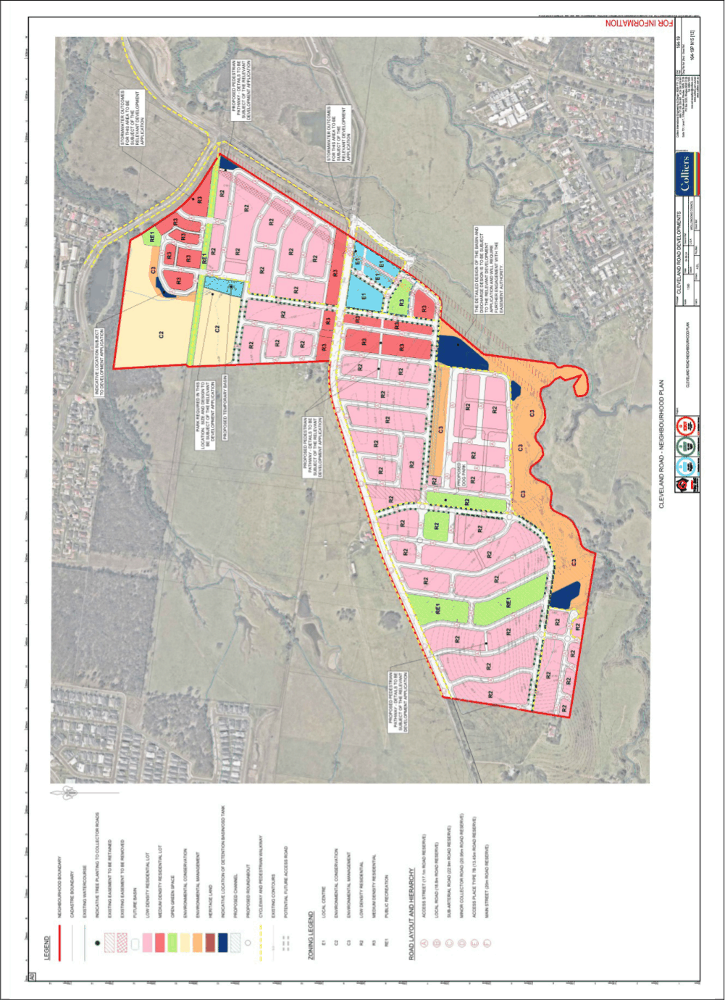

> [Picture on page 97: a picture, saved as a picture (images/chapter-d16-west-dapto-release-area-page-97-2.gif, 150 dpi).]

Figure 43 – Cleveland Road East Neighbourhood Plan

1\) The future subdivision of the land shall be generally in accordance with the adopted Neighbourhood Plan.

2\) A development application for subdivision shall demonstrate the manner in which it is compatible with the current and likely future orderly and economic development of adjoining lands including

–

i) Connectivity to pedestrian, cycling and public road networks. This includes provision of the north-south shareway within the West Dapto Development Contributions Plan linking Marshall Mount Road to the proposed By-Pass Road, via local road east of the riparian corridor.

ii) Earthworks, retaining walls and future cut/fill requirements.

iii) Stormwater management including any necessary works on adjoining land.

iv) A construction management plan maintaining connections to all essential services and public road network during and post-construction.

v) Management of Asset Protection Zones and connectivity to public roads for bushfire emergency access and evacuation.

3\) Final intersection location and arrangement on Cleveland Road will be subject to detailed design by Council.

Final design around the town centre will be consistent with the Fowlers Village Centre Master Plan.

4\) Cut and fill is to be minimised at the interface of Cleveland Road East Neighbourhood Plan with adjoining parcels to allow smooth transition between land holdings.

5\) Development Applications within the R3 zone are required to demonstrate they will meet a minimum residential density of 25 dwellings per hectare.

6\) Prior to issue of the first subdivision certificate for residential development, or other timing agreed with Council, open spaces are required to be embellished to a level acceptable to Council staff.

7\) Dwellings must address Cleveland Road, Fowlers Road and the interface to the Eastern Gas Pipeline.

8\) If developed in an integrated manner, a zero side setback will be considered for attached dwellings or dwellings on adjoining lots.

9\) Fencing and landscaping treatment of a road frontage that is not the primary frontage must ensure that clear lines of sight are maintained for motorists and pedestrians and to achieve passive surveillance from the dwelling.

10\) Where rear or side boundary fences adjoin land to be dedicated as passive open space, or public laneway, fences are to be of a design and materials which allows for passive surveillance between the private lot and the passive open space and/or laneway.

These fencing requirements are to be included as a Restriction-as-to-user on the title of affected lots.

Fencing to primary frontages to the Shareway along the east-west RE1 land shall be constructed prior to the issue of a Subdivision Certificate. Where retaining walls are required, they are to be constructed in stepped design of masonry blocks or Council-approved equivalent and fencing as indicated in the Neighbourhood Plan and DCP controls. These fencing requirements are to be included as a Restriction-as-to-user on the title of affected lots.

11\) For lots with more than one road frontage -

i) All dwellings must face, address and activate the primary road frontage.

ii) Car ports, garages and on-site parking must not be located within the setback to the primary frontage and not be accessed from the primary front.

iii) Fencing and retaining walls fronting controlled access roads are to present a consistent streetscape and should be constructed prior to the issue of a Subdivision Certificate to ensure consistency of materials, construction and delivery. Note: the primary frontage is that which is adjacent to the road with the widest reserve width (internal roads/laneway are considered to be the secondary road frontage and the rear of the lots).

12\) Council future acceptance of any proposed land dedication would be subject to satisfactory resolution of boundary treatments, use of land and ongoing maintenance at the DA stage.

13\) As part of the future development of Lot A DP 156446, compliant pedestrian access is to be provided to the TransGrid easement area.

14\) Development applications adjacent to Local heritage Item 61069 are to demonstrate how the development will interface with the park and include details of recommended heritage interpretation.

15\) Prior to Development Application approvals in the southern area, additional Aboriginal Cultural Heritage Assessment Report are to be completed for Lot A DP 156446 and Lot 313 DP 1188000 which include -

i) Additional survey work along existing creek and drainage lines.

ii) A map of the site locations, previous subsurface testing and flood extents.

iii) Additional commentary which confirms the scientific values and significance assessment.

iv) Provides additional commentary on Ecologically Sustainable Development principles.

16\) An Aboriginal Cultural Heritage Management Plan (ACHMP) is to be developed in consultation with relevant RAPs and Heritage NSW, prior to the commencement of works on the site. It is important that the ACHMP should provide provisions for the surrounding Aboriginal sites, so that development does not unintentionally create wider impacts.

17\) At any future Development Application stage, a detailed field survey will need to be undertaken to assess flora and fauna and the impacts of any future development. A Construction Environment Management Plan should be prepared with any future Development Application.

18\) The riparian corridor areas in the Cleveland Rd East Neighbourhood Plan and subject to ecological restoration works under a Vegetation Management Plan (VMP) are to achieve fully structured native plant communities once established and mature and excluding areas of road batters, stormwater detention basins and other infrastructure will be -

i) No less than 2.388 hectares or greater in the Reid Creek catchment north of Cleveland Rd and accounting for WDCP Chapter E23 Riparian Land Management mapped Table 1

-

a. 16,680 sqm of Category 3 watercourse including channel and 10m core riparian zone either side of the channels.  A no net loss outcome requires compensatory areas to be on either a Category 3, 2 or 1 watercourse or extending into C2, C3 or other zoned land capable of ecological restoration works.

b. 7,200 sqm of Category 2 watercourse including channel, core riparian zone and 10m buffer either side of the channel. A no net loss outcome requires compensatory areas to be on either a Category 2 or 1 watercourse or extending into C2, C3 or other zoned land capable of ecological restoration works

ii) No less than 6.754 hectares or greater in the Mullet Creek catchment south of Cleveland

Rd and accounting for WDCP Chapter E23 Riparian Land Management mapped Table 1

-

a. 26,200 sqm of Category 3 watercourse including channel and 10m core riparian zone either side of the channels. A no net loss outcome requires compensatory areas to be on either a Category 3, 2 or 1 watercourse or extending into C2, C3 or other zoned land capable of ecological restoration works.

b. 41,340 sqm of Category 1 watercourse including 50% of the channel width (north side of centre line), core riparian zone (north side) and 10m buffer, north side.  A no net loss outcome requires compensatory areas to only be on a Category 1 watercourse or extending into C2, C3 or other zoned land capable of ecological restoration works.

Design of the riparian corridor areas must be presented in a Vegetation Management Plan for -

i) All the C2, C3 or other zoned land riparian corridors for the first construction subdivision development application in the Reid Creek catchment north of Cleveland Road.

ii) All the C3 or other zoned land riparian corridors for the first construction subdivision development application in the Mullet Creek catchment south of Cleveland Road.

Ecological restoration works are to be undertaken as part of any application which proposes subdivision construction works immediately adjoining a riparian corridor.

A Vegetation Management Plan, prepared in accordance with the requirements of Chapter E23 of the Wollongong Development Control Plan 2009 is required to be provided as part of each development application which involves works adjoining and/or within riparian land.

In addition to the requirements of Chapter E23, the VMP’s must contain -

i) A plan which aligns with the subdivision staging proposed and clearly demonstrates at what stage of works the VMP works are to be commenced.

ii) Information demonstrating how an overall improved environmental function outcome for the riparian land will be achieved.

iii) Provide for the reinstatement of native riparian vegetation consistent with a plant community type that likely occurred prior to being cleared for agriculture or other land use.

iv) Alignment with proposed stormwater management measures.

v) Be supported by compatible engineering solutions and designs consistent with WDCP Chapter E23 Section 10.8 Restoration Works for any engineering works including channel realignments.

vi) Details for the future maintenance and ongoing management.

vii) Implementation of a Vegetation Management Plan for either the northern Reid Creek or southern Mullet Creek riparian corridors should only commence once all construction works that will impact the riparian corridors are complete. It may be necessary to defer the implementation of a Vegetation Management Plan and where a proposed riparian land dedication to Council occurs as a whole, rather than in stages.

19\) Biodiversity Certification of the West Dapto Urban Release Area

No direct or indirect impact will occur to areas relied on for generation of biodiversity credits for Councils Biodiversity Certification of the West Dapto Urban Releases Area either within or outside the Cleveland Road East Neighbourhood Plan and as described and presented in the final Biodiversity Certification Assessment Report and Conservation Strategy – West Dapto Urban Release Area (Ecoplanning 2023).  This includes –

i) For development planning and applications for subdivisions.

ii) For construction and in perpetuity operation phases of any development.

iii) Habitat, natural processes and buffer areas to plant community types in areas mapped in Ecoplanning (2023) Figure 1.4 as ‘Land proposed for conservation measures 25%’ and where -

a. Habitat includes adjoining native plant communities mapped in Ecoplanning (2023).

b. Natural processes include but are not limited to existing surface water flows in watercourses and existing groundwater regimes.

c. Buffer areas include WDCP Chapter E23 Riparian Corridor, Table 1 ‘Minimum Core Riparian Zone Width’ and ‘Minimum Vegetated Buffer Width’ where there is a mapped WDCP Chapter E23 Riparian Corridor along with adjacent open spaces.

20\) The Lake Illawarra Risk Based Framework stormwater performance targets shall be used as a minimum for all water quality modelling and are to be determined using the software MUSIC in the detailed design phase.

• Total Nitrogen (TN) – 67%

• Total Phosphorus (TP) – 78%

• Total Suspended Solids (TSS) – 82%

• Gross Pollutants (GP) – 90%

(Note: This control is consistent with Wollongong DCP chapter E15: Water Sensitive Urban Design which states that Developments in the Lake Illawarra may have targets adjusted by Council.)

21\) Consistent with WDCP Chapter E16 Bush Fire Management, Section 7 Asset Protection Zones on Council Managed Lands, Council will not accept dedication of land that needs to be managed as an Asset Protection Zone including in riparian corridors. Where revegetation is to occur and where remnant vegetation is to be restored, planning for Asset Protection Zones must take into account the vegetation formation of a fully structured mature established plant community type.

#### 14.5.20 Duck Creek and Marshall Vale Neighbourhood Plan

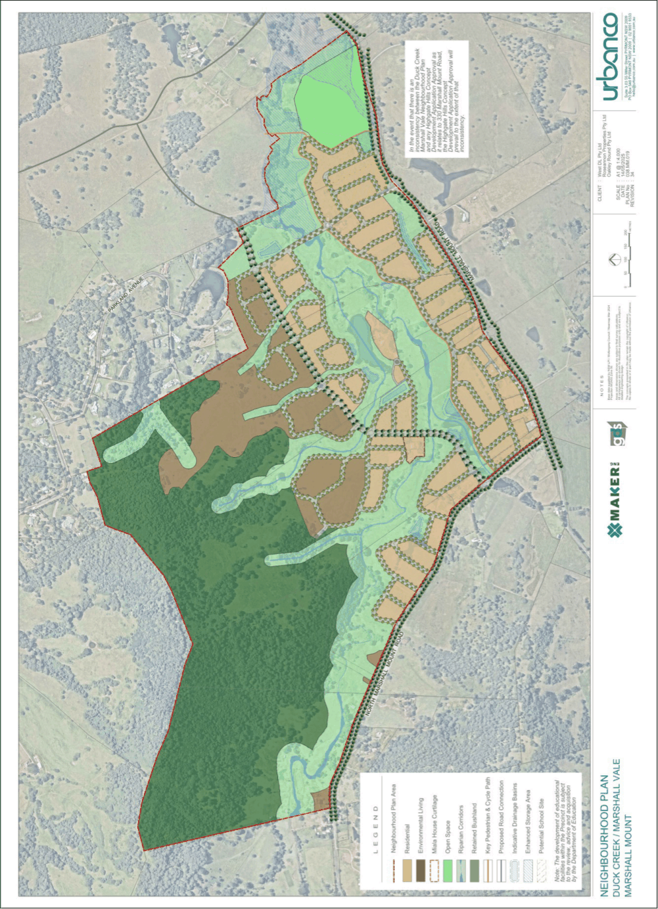

> [Picture on page 102: a picture, saved as a picture (images/chapter-d16-west-dapto-release-area-page-102-2.gif, 150 dpi).]

Figure 44 – Duck Creek and Marshall Vale Neighbourhood Plan

1\) The future subdivision of the land shall be generally in accordance with the adopted Neighbourhood Plan.

2\) Roads and associated batters will not be located within C2 zones. Indicative road and development locations will need to be adjusted to comply with riparian controls.

3\) The development of public school facilities within the precinct is subject to the review, advice and acquisition by the Department of Education.

4\) Final intersection location and arrangement on Yallah Marshall Mount Road will be subject to design.

All Type 7A and 7B roads to have one footpath consistent with Chapter B2 of Wollongong DCP, 2009. DCP should include a control requiring that where a Type 7 access place requiring subdivision DA's involving a Type 7 Access Place and where no footpath is proposed is to clearly address pedestrian movement to ensure safe access.

All roundabouts to be designed in accordance with Wollongong Council Engineering specifications and details of pedestrian crossing facilities to be submitted as part of the Development Application.

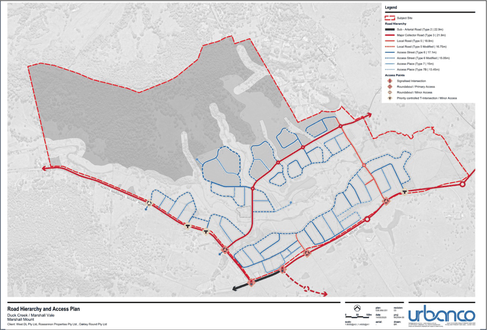

> [Picture on page 103: a picture, saved as a picture (images/chapter-d16-west-dapto-release-area-page-103-16.gif, 150 dpi).]

Figure 45 – Proposed Road Layout and Hierarchy

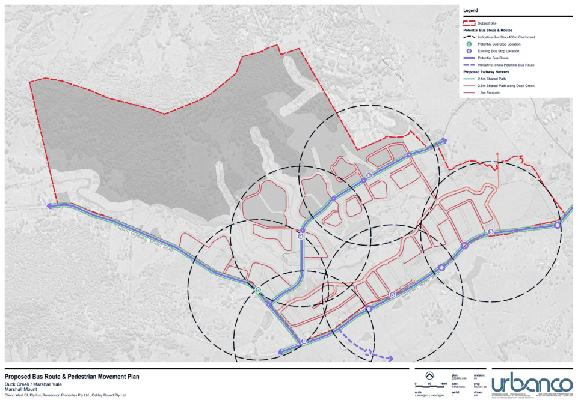

> [Picture on page 104: a picture, saved as a picture (images/chapter-d16-west-dapto-release-area-page-104-1.gif, 150 dpi).]

Figure 46 – Proposed Pathway Network

5\) Cut and fill is to be minimised at the interface of Neighbourhood Plan with adjoining parcels to allow smooth transition between land holdings.  Fill to be located outside of floodways and any fill within the flood storage and flood fringe areas to be compensated for as per points 4, 5, 6 in Section 7.11 'Other General Requirements of Ch D16.

There will be no net increase in fill within the floodplain and compensatory excavation.

6\) An assessment of existing dams will be undertaken at DA stage for potential failure and impact upon future downstream residential areas.

7\) There will be no increase in pre-development flows for all storm events across the neighbourhood plan.

Designated overland flow paths are to be created in event of structure blockages such that they do not impact upon future residential development areas.

8\) The Lake Illawarra Risk Based Framework stormwater performance targets shall be used as a minimum for all water quality modelling and are to be determined using the software MUSIC in the detailed design phase.

• Total Nitrogen (TN) – 67%

• Total Phosphorus (TP) – 78%

• Total Suspended Solids (TSS) – 82%

• Gross Pollutants (GP) – 90%

(Note: This control is consistent with Wollongong DCP Chapter E15: Water Sensitive Urban Design which states that Developments in the Lake Illawarra may have targets adjusted by Council.)

9\) Any development on land within the C3 zoned lands in the northern portion of the site will need to demonstrate compliance with Planning for Bushire Protection requirements.

Consistent with WDCP Chapter E16 Bush Fire Management, Section 7 Asset Protection Zones on Council Managed Lands, Council will not accept dedication of land that needs to be managed as an Asset Protection Zone including in riparian corridors. Where revegetation is to occur and where remnant vegetation is to be restored, planning for Asset Protection Zones must take into account the vegetation formation of a fully structured mature established plant community type.

#### 14.5.20.1 Duck Creek Riparian Corridor Urban Encroachment Management

This control should be considered in conjunction with the objectives of Chapter E23 Riparian Management of Wollongong DCP, 2009.

#### Objectives

a) Ensure new development (with the exception of waterway crossings and associated structures and works) does not encroach within the Neighbourhood Plan identified riparian corridors.

b) To address and avoid any impacts of development on the Duck Creek macro channel.

#### Development Controls

1\) For any development application in the Duck Creek/Marshall Vale neighbourhood proposing works on land within or adjoining the Duck Creek corridor, shown in Figure 47 below the development application must -

i) Be accompanied by ground truthed mapping of the Duck Creek Macro Channel, 1% AEP event, Defined Flood Event and Probable Maximum Flood (PMF) extents on the land being the subject of the development application; and

ii) Notwithstanding anything contained in this Neighbourhood Plan, demonstrate adequate riparian corridor widths for each watercourse, having regard to –

a. The mapping set out in section 1(a) of this control.

b. The neighbourhood plan identified riparian corridors.

c. An appropriate setback to the macro-channel to address risks of channel erosion, migration, bank failure and slumping under present and climate change conditions to 2100 (which is to be not less than 10m).

d. Item (iii) above shall be undertaken by a qualified person in the field of geology, environmental science or hydrology, with demonstrated experience in fluvial geomorphology assessment and projects.

2\) Hard engineering solutions will not be supported by Council to resolve potential scour and erosion of the Duck Creek Micro and Macro Channel.

3\) The management of edge effects, bank stability and scour and / or erosion protection shall only be achieved through soft engineering solutions. Soft engineering is defined in Chapter

E23 Riparian Management of Wollongong DCP, 2009.

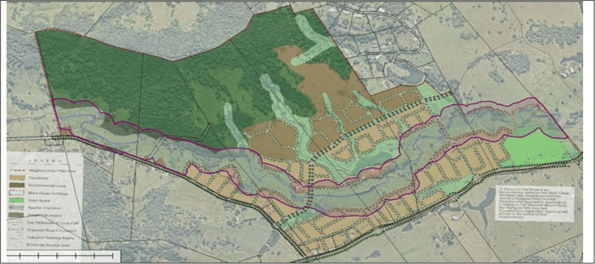

> [Picture on page 106: a picture, saved as a picture (images/chapter-d16-west-dapto-release-area-page-106-1.gif, 150 dpi).]

Figure 47 – Duck Creek Corridor

#### 14.5.21 Aboriginal and European Heritage

#### Objectives

a) To manage Aboriginal heritage values to ensure enduring conservation outcomes.

b) To ensure areas identified for non-Aboriginal cultural heritage sites or archaeological sites are managed appropriately.

#### Controls

1\) Prior to DA approvals in the precinct, additional ACHAR are to be completed for -

i) Lot 2 DP 1184741.

ii) Lots 2021 & 2022 DP 810874.

iii) Lot 100 DP 712786.

iv) Lot 1 DP 396100.

v) Lot 1 DP 396101.

vi) Lot 11 DP 790746.

vii) Lot 1 DP 1039888.

viii) Lot 101 DP 170817.

ix) Undeveloped Road Reserve bisecting 42 North Marshall Mount Road, Marshall Mount.

2\) Development Applications must identify any areas of Aboriginal heritage value that are within or adjoining the area of the proposed development, including any areas within the development site that are to be retained and protected (and identify the management protocols for these).

3\) Developments or other activities that will impact on Aboriginal heritage may require consent from the Office of Environment and Heritage (OEH) under the National Parks and Wildlife Act 1974 and consultation with the relevant Aboriginal communities.

4\) An AHIP issued under Part 6 of the National Parks and Wildlife Act 1974 (NPW Act 1974) is

required for any works which impact Known Aboriginal archaeological sites.

5\) Areas of high archaeological sensitivity warrant a full Aboriginal cultural heritage assessment prior to any development works. If impacts to any Aboriginal objects identified through these assessments cannot be avoided, an AHIP issued under Part 6 of the National Parks and Wildlife Act 1974 (NPW Act 1974) will be required.

6\) Areas of moderate archaeological sensitivity warrant an Aboriginal archaeological due diligence assessment prior to any development works.  This assessment is to be conducted in accordance with DPIE’s Due Diligence Code of Practice for the protection of Aboriginal Objects in New South Wales. Depending on the results of the due diligence assessment undertaken, a full Aboriginal cultural heritage assessment may be required.

7\) Areas of low archaeological sensitivity do not contain any known Aboriginal heritage constraints.

8\) Where the necessary consents under the National Parks and Wildlife Act, 1974 have been obtained, the development application must demonstrate that the development will be undertaken in accordance with any requirements of that consent.

Within or adjoining the area of the proposed development, including any areas within the development site that are to be retained and protected (and identify the management protocols for these).

9\) Developments or other activities that will impact on Aboriginal heritage may require consent from the Office of Environment and Heritage (OEH) under the National Parks and Wildlife Act 1974 and consultation with the relevant Aboriginal communities.

Should additional heritage items be identified within the study area Statements of heritage Impact (SoHI) should be prepared for these items in accordance with the NSW Heritage Branch’s guidelines: Statements of Heritage Impact (NSW Heritage Office, 2002) prior to any impacts. A copy of the SoHI and details of the proposed works will be provided to Council for review and response prior to impacts.
