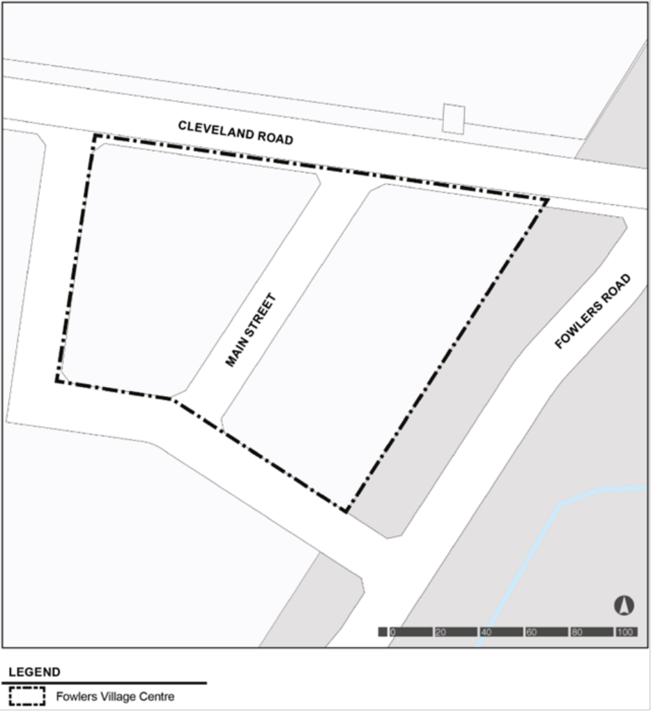
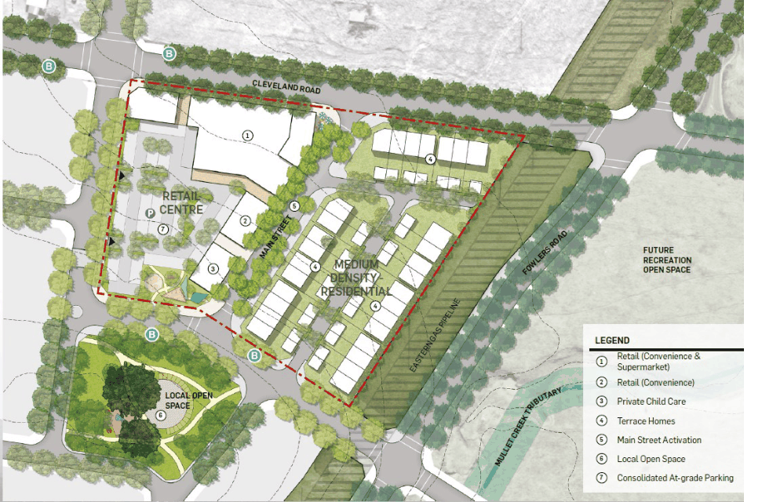
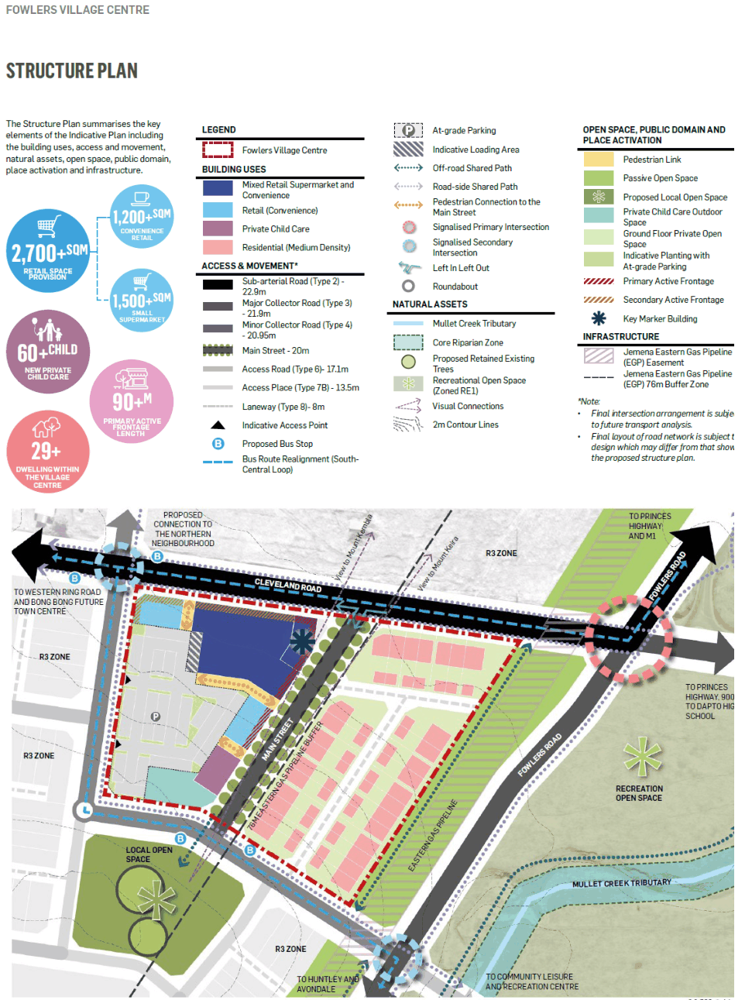
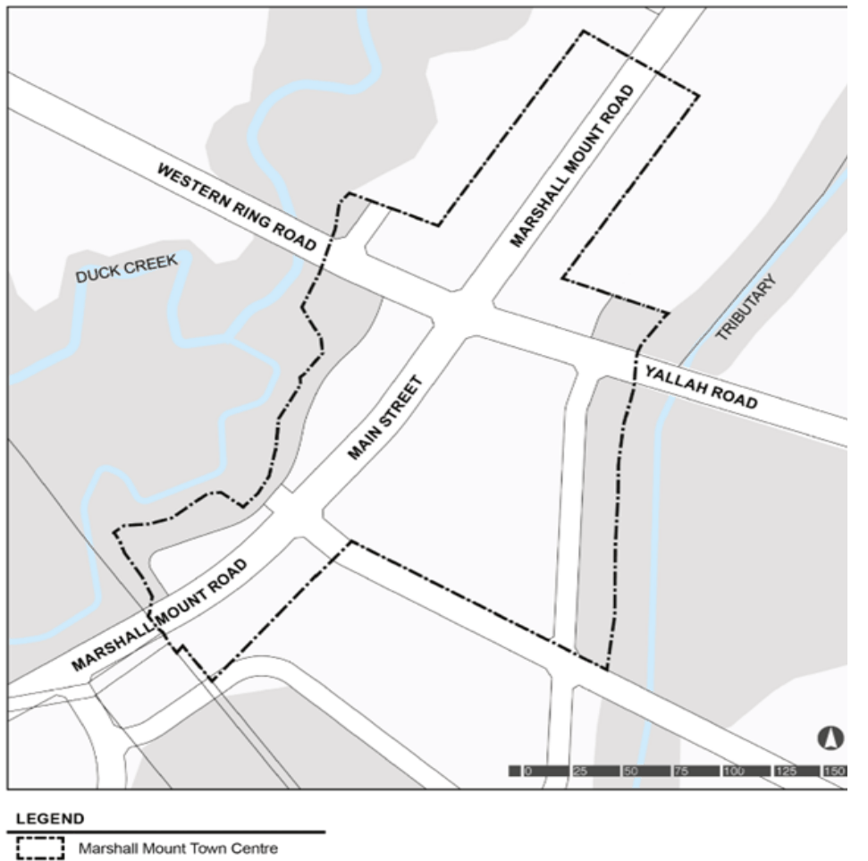
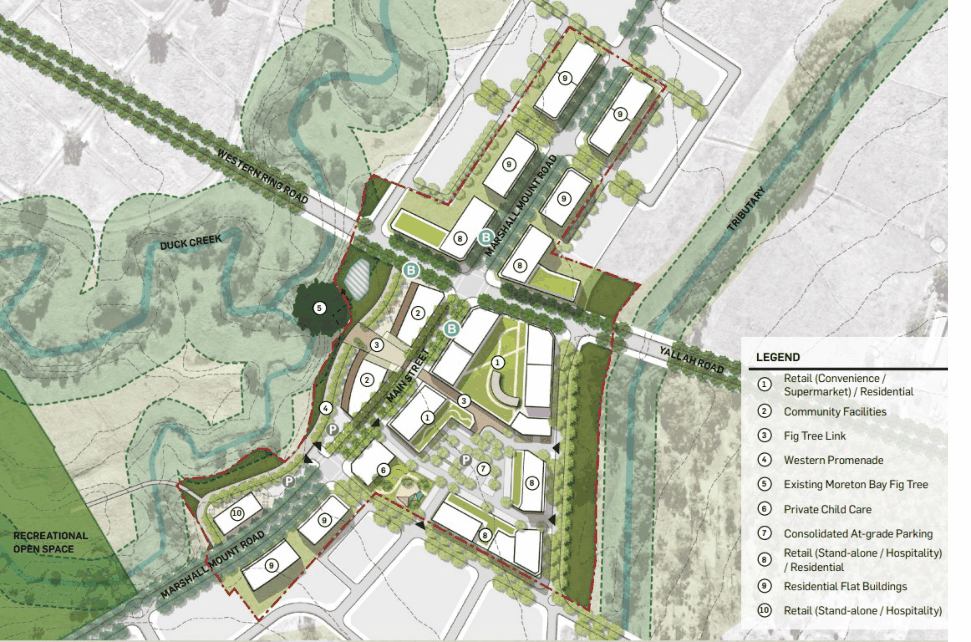
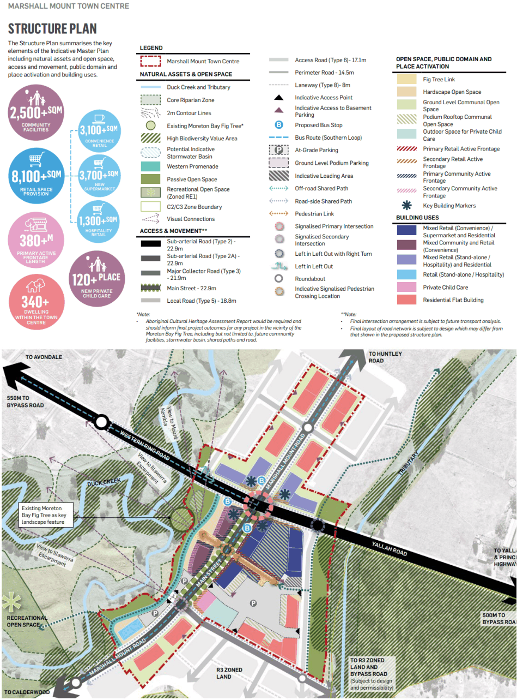

### 14.6 West Dapto Centres Master Plans

Section 14.6 outlines the West Dapto Centres Master Plans that have been adopted into the DCP for the purposes of this Part. Adopted West Dapto Centres Master Plan packages are available on Council’s website under the West Dapto Project Page.

The West Dapto Centres Master Plans intend to deliver the overarching DCP Chapter D16: Residential Development objective:

a) enabling the development of the West Dapto Urban Release Area for residential, employment, industrial and environmental conservation areas in a manner consistent with the Wollongong LEP 2009, the West Dapto Vision 2018 and the West Dapto Structure Plan (Figure 2).

This Section provides structure and guidance for the future development of the West Dapto Town and Village Centres. It is aimed at achieving the vision for West Dapto: West Dapto will grow and develop as a series of integrated and connected communities. Set against the spectacular Illawarra Escarpment and a landscape of riparian valleys, these communities will integrate the natural and cultural heritage of the area with the new urban form. The communities will be healthy, sustainable, and resilient with active and passive open space accessible by walkways, cycleways, and public transport. To support these new communities, local centres will provide shopping services, community services and jobs while employment lands will facilitate further opportunities for the region. West Dapto will be supported by a long-term strategy to oversee the timely implementation of infrastructure to deliver sustainable and high-quality suburbs with diverse housing choices.

Where a Centre Master Plan has been adopted into this Chapter, that Centre Master Plan must be incorporated into the relevant defined neighbourhood or concept development application.

Note: The Centre Master Plans do not predetermine final development approvals. Centre Master Plans will guide the development assessment process and identify desired outcomes for those centres. The final development outcome is subject to the merit assessment of Development Applications.

#### 14.6.1 Darkes Town Centre

Subject to future planning

Located within the Forest Creek Defined Neighbourhood.

#### 14.6.2 Wongawilli Village Centre

Located within the Wongawilli Defined Neighbourhood.

Wongawilli Village centre will provide a small convenience centre with a small grocer and some mixed retail shops. The centre will be designed focusing on activating the interface with the riparian boundary and its West Dapto Road frontage. Parking will be included in the village design with street parking along the secondary street and a parking lot area provided along the north, generally not visible from West Dapto Road, allowing built form to perform a clear street defining urban function. The village form will be guided by the concept design presented in Figure 21.

#### 14.6.3 Jersey Farm Village Centre

Subject to future planning.

Located within the Jersey Farm Defined Neighbourhood.

#### 14.6.4 Bong Bong Town Centre

Located within the Bong Bong Defined Neighbourhood.

In the area where Bong Bong Road adjoins the north-south arterial route a new district town centre is to be established, based on a north-south orientated main street (see Figure 18 Bong Bong East and North Neighbourhood Plan). The Bong Bong Town Centre is to be the primary town centre in the release area. The Bong Bong Town Centre is to be a supermarket-based centre with a range of shops and would accommodate around 15,000m2 of retail floor space.

#### 14.6.5 Fowlers Village Centre

Within the Cleveland Road East Defined Neighbourhood the Fowlers Village Centre is a 1.9 ha site characterised by a local foothill and low-lying land. It is located on the southern side of Cleveland Road, approximately adjoining the intersection of Fowlers and Cleveland Road and is well connected to the Dapto Regional Centre to the east via Fowlers Road into Cleveland Road.

It is located within Stage 3 of West Dapto and intends to deliver:

• A well-connected village centre providing approximately 2,700sqm of local convenience shops and urban focal points within the residential areas.

• 29 Dwellings within the Village Centre (subject to supporting Local Environmental Plan planning controls).

> [Picture on page 109: a picture, saved as a picture (images/chapter-d16-west-dapto-release-area-page-109-1.gif, 150 dpi).]

Figure 48 – Fowlers Village Centre - Boundary

#### Objectives

The key objectives of the Fowlers Village Centre Master Plan are:

a) To align streets along views to the Illawarra Escarpment including Mount Keira and Mount Kembla.

b) To create a walkable and compact centre that is accessible to the community via various transport modes.

c) To concentrate retail activities and support retail frontage along the Main Street.

d) To create a village character with a safe pedestrian environment.

e) To facilitate connectivity to the future Leisure and Recreational Centre and recreational open spaces along Fowlers Road.

f) To provide increased housing density and mix close to the Village Centre to support the Centre's viability.

g) To comply with the requirement of development siting adjacent to the Eastern Gas Pipeline.

h) To maintain efficient traffic movement whilst enhancing pedestrian amenity along Main Street.

i) To provide a consolidated parking strategy for retail uses.

j) To acknowledge and celebrate Aboriginal and Torres Strait Islander people’s contribution and connection to country.

#### Relationship to other parts of the DCP

• Part B applies to development in centres, mixed, and residential uses within the Site. DCP Chapter B4: Development in Centres and Peripheral Sales Precincts identifies Fowlers as a village centre and outlines the desired characteristics for these centres.

• Parts A and E of the DCP generally apply to all lands contained within the Fowlers Village Centre.

• In the event that the provisions contained in the Fowlers Village Centre Master Plan are inconsistent with the provisions of any other part of the DCP, the provisions of the Fowlers Village Centre Master Plan shall prevail to the extent of the inconsistency.

#### Future Desired Character of Fowlers Village Centre

The vision for Fowlers Village Centre is to create:

“A compact and local scale retail precinct, conveniently located for daily needs and accessible via public and active transport. Characterised by a main street which is aligned to capture views to Mount Keira and Mount Kembla, it celebrates place and balances pedestrian and vehicle movement.”

To enable this vision, the Village Centre is to deliver:

a) Celebrate the scenic landscape character: Align the Main Street along view lines to Mount Keira and Mount Kembla.

b) Active and healthy lifestyles: Provide seamless pedestrian and cyclist connections into the village centre from the adjacent roadways, open space, and key destinations.

c) Day-to-day convenience: Concentrate supermarket, retail, and services along the Main Street with visibility and access from Cleveland Road.

d) Housing mixes close to the centre: Locate medium-density housing typologies close to the Village Centre providing housing choice with convenience.

e) A high-quality main street: that is vibrant and active by providing wide and comfortable areas for walking and staying and welcoming building frontages that allow visual and physical access to the goods and activities within.

• public domain areas with visual links to the escarpment, Mount Keira and Mount Kembla through orientation of streets, breaks in buildings and distribution of building height.

• development of an appropriate scale for a Village Centre, noting its place in the Centres Hierarchy and taking into account the impact of heights, setbacks and building separation on the surrounding public and private domain.

• a clear and efficient movement network for people, public transport, freight movements and private cars through clear roles and functions for streets.

• Physical and visual connections within the broader precinct between the Village Centre and the

future West Dapto Leisure and Recreation Centre, Sports fields, and local park.

• A main street named to acknowledge and celebrate Aboriginal and Torres Strait Islander contribution and connection to country.

The indicative master plan for Fowlers Village Centre is Illustrated in Figure 49.

> [Picture on page 111: a picture, saved as a picture (images/chapter-d16-west-dapto-release-area-page-111-5.gif, 150 dpi).]

Figure 49 – Fowlers Village Centre – Illustrative Master Plan

The Structure Plan for Fowlers Village Centre is shown at Figure 50.

> [Picture on page 112: a picture, saved as a picture (images/chapter-d16-west-dapto-release-area-page-112-1.gif, 150 dpi).]

Figure 50 – Fowlers Village Centre – Structure Plan

#### 14.6.6 Huntley Village Centre

Subject to future planning.

Located within the Avondale Road East Defined Neighbourhood (see Figure 17).

#### 14.6.7 Avondale Village Centre

Subject to future planning.

Located within the Avondale Road East Defined Neighbourhood (see Figure 17).

#### 14.6.8 Marshall Mount Town Centre

Located within the Town Core Defined Neighbourhood (see Figure 17).

Marshall Mount Town Centre is an 8.2 ha site in between Duck Creek and its tributary, nestled amongst local undulating hills and located at the intersection of Yallah Road and Marshall Mount Road.

It is located within Stage 5 of West Dapto and intends to deliver:

• 343 Dwellings within the Town Centre (some dwelling outcomes would be subject to supporting Local Environmental Plan planning controls). Note: Council staff would consider alternative approaches to achieve this dwelling density outcome within the Town Centre only when they are demonstrated to be consistent with the planning controls in this Chapter and overall principles in the Master Plan.

• Marshall Mount Town Centre comprising approximately 8,100sqm of retail floor space in a traditional main street format providing retail shops, local convenience needs, local services, community facilities and the like.

• Protection of significant vegetation and unique landscape features of the area.

• Utilisation of Duck Creek as a focal feature of the community.

> [Picture on page 114: a picture, saved as a picture (images/chapter-d16-west-dapto-release-area-page-114-1.gif, 150 dpi).]

Figure 51 – Marshall Mount Town Centre – Boundary

#### Objectives

The key objectives of the Marshall Mount Town Centre Precinct Plan are:

a) To retain key views and orientate development to capture key views to the Illawarra Escarpment and existing Moreton Bay Fig Tree.

b) To protect the biodiversity value along Duck Creek, its tributaries and riparian corridor.

c) To minimise flood risk to the centre.

d) To create a walkable and compact town centre that is accessible to the community via various transport modes.

e) To encourage a viable Town Centre through a variety of uses and activities.

f) To concentrate retail and community activities to support active frontages on both sides of the Main Street.

g) To facilitate visual and physical connectivity to the adjacent recreational open space.

h) To provide increased housing density and choice within and adjacent to the Town Centre to support the Centre's viability.

i) To maintain efficient traffic flows whilst enhancing pedestrian amenity along the Main Street.

j) To provide a consolidated parking strategy within the Town Centre Core Precinct.

k) To acknowledge and celebrate Aboriginal and Torres Strait Islander contribution and connection to country.

#### Relationship to other parts of the DCP

• Part B applies to development in centres, mixed, and residential uses within the Site. Chapter B4: Development in Centres and Peripheral Sales Precincts identifies Marshall Mount as a town centre and outlines the desired characteristics for these centres.

• Parts A and E of the DCP generally apply to all lands contained within the Marshall Mount Town Centre.

• Part C of the DCP relates to Development within the E1– Local Centre and hence, applies to the lands contained within the Marshall Mount Town Centre.

• In the event that the provisions contained in the Marshall Mount Town Centre Master Plan are inconsistent with the provisions of any other part of the DCP, the provisions of the Marshall Mount Town Centre Master Plan shall prevail to the extent of the inconsistency.

#### Future Desired Character of Marshall Mount Town Centre

The vision for Marshall Mount Town Centre is to create:

“A compact, mixed retail and community precinct with housing choice, conveniently located and accessible by active and public transport. It is characterised by a vibrant main street that balances pedestrian and vehicular movements, and local places for people that celebrate views to the scenic Illawarra Escarpment and the existing Moreton Bay Fig Tree.”

To enable this vision, the Town Centre:

a) Celebrates the local and scenic landscape character: Establish visual connections to the existing Moreton Bay Fig Tree along the Fig Tree Link and a distant view to the Illawarra Escarpment including Mount Kembla from the Western Promenade.

Aboriginal Cultural Heritage Assessment Report would be required and should inform final project outcomes for any project in the vicinity of the Moreton Bay Fig Tree.

The Fig Tree Link Public Plaza will be named to acknowledge and celebrate Aboriginal and Torres Strait Islander people contribution and connection to country.

b) Encourages active and healthy lifestyles: Provide seamless pedestrian and cyclist connections into the Town Centre from the adjacent roadways, open space and key destinations.

c) Provide day-to-day convenience: Concentrate the supermarket and convenience retail along the Main Street and Fig Tree Link with visibility and access from Yallah Road.

d) Become the community heart: Deliver community facilities including a multi-purpose hall and a potential library within the Town Centre Core precinct co-located with the outdoor public plaza fronting the Moreton Bay Fig Tree.

e) Provides a mix of housing choice close to the centre: Medium to high-density housing typologies of shop top housing and residential flat building (apartments) providing housing

choice with convenience.

The indicative master plan for Marshall Mount Town Centre is illustrated in Figure 52.

> [Picture on page 116: a picture, saved as a picture (images/chapter-d16-west-dapto-release-area-page-116-3.gif, 150 dpi).]

Figure 52 – Marshall Mount Town Centre – Illustrative Master Plan

> [Picture on page 117: a picture, saved as a picture (images/chapter-d16-west-dapto-release-area-page-117-1.gif, 150 dpi).]

Figure 53 – Marshall Mount Town Centre – Structure Plan
