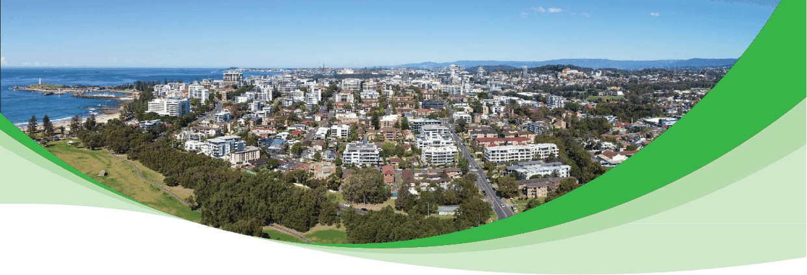

# Wollongong Development Control Plan 2009 - Chapter D16 West Dapto Release Area

> This chapter is split into 66 section file(s), one per numbered heading, in the order they appear in the PDF.

Source PDF: [Wollongong-DCP-2009-Chapter-D16-West-Dapto-Release-Area.pdf](https://planfortomorrow.sharepoint.com/sites/Planfortomorrow/Shared%20Documents/00%20NSW-Planning-Resources/dcp/wollongong-development-control-plan-2009/chapter-d16-west-dapto-release-area/Wollongong-DCP-2009-Chapter-D16-West-Dapto-Release-Area.pdf)

> [Picture on page 1: a picture, saved as a picture (images/chapter-d16-west-dapto-release-area-page-1-1.gif, 150 dpi).]

### •

### Part D – Locality Based DCP/Precinct Plans Chapter D16: West Dapto Release Area

> The PDF's contents list (page numbers of the printed document) is not repeated here - see Sections below.

7.9 Principle 9 – Preserve the Natural Environment and Enhance Where Possible in Keeping with Stormwater Quantity and Quality Management Objectives and Targets ................................................................................................................................ 25

7.10 Principle 10 – Promote Liveability and Amenity for the Community by Using Water in All Environments ...................................................................................................... 26

7.11 Other General Requirements ................................................................................... 26

8\. CONSERVATION PRINCIPLES ...................................................................................... 28

8.1 Environment Conservation ....................................................................................... 28

8.2 Heritage Conservation ............................................................................................. 29

8.3 Riparian Corridors .................................................................................................... 31

9\. OPEN SPACE PRINCIPLES ........................................................................................... 31

9.1 Open Space ............................................................................................................. 32

9.2 Hierarchy and Catchments ....................................................................................... 32

10\. COMMUNITY AND EDUCATION PRINCIPLES .......................................................... 35

10.1 Principle 1 – Healthy, Diverse and Resilient ............................................................. 35

10.2 Principle 2 – Efficient ............................................................................................... 35

10.3 Principle 3 – Safety, Security and Adding to Civic Identity and Sense of Place ........ 35

10.4 Principle 4 – Self-Sufficient and Resilient Community .............................................. 35

10.5 Principle 5 – Vibrant and Accessible ........................................................................ 35

10.6 Principle 6 – Equitable ............................................................................................. 36

10.7 Principle 7 – Diversity .............................................................................................. 36

10.8 Principle 8 – Viable and Sustainable ........................................................................ 36

11\. TOWN CENTRES PRINCIPLES .................................................................................. 38

11.1 Principle 1 – Hierarchy ............................................................................................. 38

11.2 Principle 2 – Movement Sensitive ............................................................................ 40

11.3 Principle 3 – Diversity and Identity ........................................................................... 40

11.4 Town Centre Development Controls ........................................................................ 40

11.5 Village Centre Development Controls ...................................................................... 41

12\. EMPLOYMENT PRINCIPLES...................................................................................... 41

12.1 Principle 1 – Support Local Sustainable and Accessible Employment...................... 42

12.2 Principle 2 – Attract, Facilitate and Support Industries, Enterprises and Business to Locate in West Dapto ............................................................................................... 42

12.3 Principle 3 – Ensure Town and Village Centre Employment Outcomes are Prioritised . ................................................................................................................................ 42

12.4 Principle 4 – Protect Existing Employment Land ...................................................... 42

12.5 Principle 5 – Take Advantage of and Encourage Employment Innovations .............. 42

12.6 Principle 6 – Improve Employment Opportunities and Ensure a High Standard ....... 43

13\. HOUSING PRINCIPLES .............................................................................................. 43

13.1 Principle 1 – Encourage Housing Diversity .............................................................. 43

13.2 Principle 2 – Promote Housing Affordability ............................................................. 46

13.3 Principle 3 – Establish Sustainable, Energy Efficient, Appealing and Functional Residential Living ..................................................................................................... 46

13.4 Principle 4 – Creating Local Amenity and a Sense of Place ..................................... 46

13.5 Principle 5 – Housing transition to the Illawarra Escarpment .................................... 46

14\. NEIGHBOURHOOD PLANS ........................................................................................ 46

14.1 Neighbourhood Plan Requirements ......................................................................... 47

14.2 Pathways to Neighbourhood Plans .......................................................................... 48

14.3 Matters to be Addressed in Neighbourhood Planning Applications .......................... 51

14.4 Transitional Arrangements ....................................................................................... 54

14.5 Adopted Neighbourhood Plans ................................................................................ 54

14.6 West Dapto Centres Master Plans ..........................................................................104

15\. MATTERS TO BE ADDRESSED IN DEVELOPMENT APPLICATIONS .....................115

#### Figures

Figure 29 – Dual Frontage Property Secondary Frontage Treatment ......................................... 71 Figure 30 – BAL Construction Standards Relevant to the Neighbourhood Plan ............... 72 Figure 31 – Avondale Road North Huntley Neighbourhood Plan ........................................ 73 Figure 32 – Shone Avenue and West Dapto Road Neighbourhood Plan .............................. 74 Figure 33 – West Dapto Road / Sheaffes Road (south) Neighbourhood Plan ............................ 76 Figure 34 – Bong Bong Road South Neighbourhood Plan ........................................ 77 Figure 35 – Hayes Lane and Iredell Road Neighbourhood Plan ........................................ 78 Figure 36 – Hayes Lane and Iredell Road Neighbourhood Plan – Western End ............... 81 Figure 37 –  Boundaries of future Neighbourhoods in Stage 5 to be planned ...... 82 Figure 38 – Elm Park Neighbourhood Plan ..... 83 Figure 39 – C4 Environmental Living Areas, Requiring Aboriginal Cultural Heritage Assessment Report.......................................... 84 Figure 40 – Austral Archaeological Sensitivity Map .................................................................. 85 Figure 41 – BlueScope Woods Residential Estate and Employment Hub Kembla Grange Neighbourhood Plan ........................................ 86 Figure 42 – Iowna Neighbourhood Plan .......... 88 Figure 43 – Cleveland Road East Neighbourhood Plan ........................................ 94 Figure 44 – Duck Creek and Marshall Vale Neighbourhood Plan ........................................ 99 Figure 45 – Proposed Road Layout and Hierarchy ........................................................ 100 Figure 46 – Proposed Pathway Network ....... 101 Figure 47 – Duck Creek Corridor ................... 103 Figure 48 – Fowlers Village Centre - Boundary ....................................................................... 106 Figure 49 – Fowlers Village Centre – Illustrative Master Plan .................................................... 108 Figure 50 – Fowlers Village Centre – Structure Plan ................................................................ 109 Figure 51 – Marshall Mount Town Centre – Boundary ........................................................ 111 Figure 52 – Marshall Mount Town Centre – Illustrative Master Plan .................................. 113 Figure 53 – Marshall Mount Town Centre – Structure Plan ................................................ 114

Figure 1 – West Dapto Release Area ................ 3 Figure 2 – West Dapto Structure Plan 2018 ...... 8 Figure 3 – Stages of West Dapto Release Area 9 Figure 4 – Principles and planning tools relationship ...................................................... 10 Figure 5 – Road Typology ............................... 13 Figure 6 – Road Sizes ..................................... 14 Figure 7 – Flood Reliable Roads ..................... 15 Figure 8 – Active Transport Network ............... 16 Figure 9 – Typical Riparian Corridor Cross Section ............................................................. 31 Figure 10 – Planning for open space in West Dapto Urban Release Area ............................. 34 Figure 11 – Community Hub Concept – Co- Location, Joint Use and Multi-Purpose Centres ......................................................................... 35 Figure 12 – Potential school locations (Council to work with NSW Department of Education) .. 37 Figure 13 – Wollongong Town Centres Hierarchy ......................................................... 39 Figure 14 – Net Residential Density Chart (Landcom, 2011) .............................................. 44 Figure 15 – Gross Residential Density (Landcom, 2011) .............................................. 45 Figure 16 – Neighbourhood Planning Pathways Flowchart ......................................................... 51 Figure 17 – Defined Neighbourhoods in West Dapto Urban Release Area ............................. 53 Figure 18 – Neighbourhood Plan – Bong Bong East and North ................................................. 56 Figure 19 – Wongawilli North Neighbourhood Plan .................................................................. 58 Figure 20 – Dual Frontage Property Secondary Frontage Treatment ......................................... 60 Figure 21 – Wongawilli Village Centre – Conceptual Design .......................................... 61 Figure 22 – Wongawilli Rail Noise Area .......... 62 Figure 23 – Shone Avenue South Neighbourhood Plan ........................................ 63 Figure 24 – Dual Frontage Property Secondary Frontage Treatment ......................................... 64 Figure 25 – Reddalls Road Industrial Neighbourhood Plan ........................................ 65 Figure 26 – Sheaffes Road North Neighbourhood Plan ........................................ 66 Figure 27 – Dual Frontage Property Secondary Frontage Treatment ......................................... 68 Figure 28 – Darkes Road South West Neighbourhood Plan ........................................ 69

#### DOCUMENT CONTROL

| Rev No. | Adoption Date 14/12/2010 | In Force Date 17/12/2012 | Revision Details Adopted |
|---|---|---|---|
| 1 | 27/7/2011 | 3/8/2011 | Incorporate Shone Ave Neighbourhood Plan |
| 2 | 26/11/2012 | 8/12/2012 | Update Wongawilli North Neighbourhood Plan |
| 3 | 26/11/2012 | 8/12/2012 | Update Wongawilli North Neighbourhood Plan |
| 4 | 27/5/2013 | 1/6/2013 | Incorporate Sheaffes Rd Neighbourhood Plan |
| 5 | 9/12/2013 | 14/12/2013 | Incorporate Reddalls Rd Industrial Neighbourhood Plan |
| 6 | 24/3/2014 | 2/4/2014 | Incorporate Darkes Rd South West Neighbourhood Plan and updated road network diagrams |
| 7 | 3/8/2015 | 12/8/2015 | Incorporate Avondale Road North, Huntley Neighbourhood Plan |
| 8 | 24/8/2015 | 9/9/2015 | Incorporate Shone Avenue / West Dapto Road Neighbourhood Plan |
| 9 | 19/10/2015 | 24/10/2015 | Incorporate West Dapto Rd / Sheaffes Rd (south) Neighbourhood Plan |
| 10 |  |  | Draft May 2018 |
| 11 | 19/11/2018 | 20/12/2018 | Incorporate Bong Bong South Neighbourhood Plan |
| 12 | 10/12/2018 | 20/12/2018 | Incorporate the West Dapto Vision, Structure Plan 2018 and planning principles |
| 13 | 9/12/2019 | 20/12/2019 | Whole document review and restructure |
| 14 | 6/4/2020 | 27/4/2020 | Incorporate Hayes Lane and Iredell Road Neighbourhood Plan |
| 15 | 2/8/2021 | 30/8/2021 | Incorporate additional area into Hayes Land and Iredell Road Neighbourhood Plan. |
| 16 | 18/10/2021 | 12/11/2021 | Neighbourhood Planning Review |
| 17 | 27/05/2024 | 03/06/2024 | Elm Park Neighbourhood Plan |
| 18 | 27/11/2023 | 19/08/2024 | BlueScope Woods Residential Estate and Employment Hub: Kembla Grange Neighbourhood Plan |
| 19 | 24/6/2024 | 19/08/2024 | Cleveland Road Neighbourhood Plan Boundary Review (Figure 17) |
| 20 | 29/7/2024 | 19/08/2024 | Iowna Neighbourhood Plan |
| 21 | 25/11/2024 | 04/12/2024 | West Dapto Centres Master Plans |
| 22 | 26/05/2025 | 23/06/2025 | Cleveland Road Precinct, Cleveland Road East Neighbourhood Plan and Duck Creek and Marshall Vale Neighbourhood Plan |

<!-- sections -->
## Sections

1. [1 INTRODUCTION](01-introduction.md)
2. [2 LAND TO WHICH THIS CHAPTER APPLIES](02-land-to-which-this-chapter-applies.md)
3. [3 OBJECTIVES](03-objectives.md)
4. [4 STRUCTURE PLAN](04-structure-plan.md)
5. [4.1 Stages 1 and 2](05-4-1-stages-1-and-2.md)
6. [4.2 Stages 5 or Yallah-Marshall Mount Precinct](06-4-2-stages-5-or-yallah-marshall-mount.md)
7. [4.3 Stages 3 and 4](07-4-3-stages-3-and-4.md)
8. [5 PLANNING PRINCIPLES](08-5-planning-principles.md)
9. [6.1 The Road Network](09-6-1-the-road-network.md)
10. [6.2 Bridge and Culvert Design](10-6-2-bridge-and-culvert-design.md)
11. [6.3 Active Transport](11-6-3-active-transport.md)
12. [6.4 Public Transport](12-6-4-public-transport.md)
13. [7 WATER MANAGEMENT](13-7-water-management.md)
14. [7.1 Principle 1 – Integrate Floodplain and Stormwater Management into the Urban Development Process](14-7-1-principle-1-integrate-floodplain-and.md)
15. [7.2 Principle 2 – Improve the Management of Water Quality Relating to Urban Development](15-7-2-principle-2-improve-the-management-of.md)
16. [7.3 Principle 3 – Develop the Floodplain and Surrounding Areas in a Sustainable Way](16-7-3-principle-3-develop-the-floodplain-and.md)
17. [7.4 Principle 4 – Preserve the Natural Function of the Floodplain, Natural Waterways and Riparian Corridors](17-7-4-principle-4-preserve-the-natural.md)
18. [7.5 Principle 5 – Protect People and Property from Flooding in a Strategic Way](18-7-5-principle-5-protect-people-and-property.md)
19. [7.6 Principle 6 – Protect Water Quality of Surface and Groundwater from Urban Development](19-7-6-principle-6-protect-water-quality-of.md)
20. [7.7 Principle 7 – Integrate Stormwater Management into the Natural and Urban Land Form in an Unobtrusive Way](20-7-7-principle-7-integrate-stormwater.md)
21. [7.8 Principle 8 – Provide Efficient and Sustainable Stormwater Infrastructure for the Urban Release Area.](21-7-8-principle-8-provide-efficient-and.md)
22. [7.9 Principle 9 – Preserve the Natural Environment and Enhance Where Possible in Keeping](22-7-9-principle-9-preserve-the-natural.md)
23. [7.10 Principle 10 – Promote Liveability and Amenity for the Community by Using Water in All Environments](23-7-10-principle-10-promote-liveability-and.md)
24. [7.11 Other General Requirements](24-7-11-other-general-requirements.md)
25. [8.1 Environment Conservation](25-8-1-environment-conservation.md)
26. [8.2 Heritage Conservation](26-8-2-heritage-conservation.md)
27. [8.3 Riparian Corridors](27-8-3-riparian-corridors.md)
28. [9 OPEN SPACE PRINCIPLES](28-9-open-space-principles.md)
29. [9.1 Open Space](29-9-1-open-space.md)
30. [9.2 Hierarchy and Catchments](30-9-2-hierarchy-and-catchments.md)
31. [10 COMMUNITY AND EDUCATION PRINCIPLES](31-10-community-and-education-principles.md)
32. [10.1 Principle 1 – Healthy, Diverse and Resilient](32-10-1-principle-1-healthy-diverse-and.md)
33. [10.2 Principle 2 – Efficient](33-10-2-principle-2-efficient.md)
34. [10.3 Principle 3 – Safety, Security and Adding to Civic Identity and Sense of Place](34-10-3-principle-3-safety-security-and-adding.md)
35. [10.4 Principle 4 – Self-Sufficient and Resilient Community](35-10-4-principle-4-self-sufficient-and.md)
36. [10.5 Principle 5 – Vibrant and Accessible](36-10-5-principle-5-vibrant-and-accessible.md)
37. [10.6 Principle 6 – Equitable](37-10-6-principle-6-equitable.md)
38. [10.7 Principle 7 – Diversity](38-10-7-principle-7-diversity.md)
39. [10.8 Principle 8 – Viable and Sustainable](39-10-8-principle-8-viable-and-sustainable.md)
40. [11 TOWN CENTRES PRINCIPLES](40-11-town-centres-principles.md)
41. [11.1 Principle 1 – Hierarchy](41-11-1-principle-1-hierarchy.md)
42. [11.2 Principle 2 – Movement Sensitive](42-11-2-principle-2-movement-sensitive.md)
43. [11.3 Principle 3 – Diversity and Identity](43-11-3-principle-3-diversity-and-identity.md)
44. [11.4 Town Centre Development Controls](44-11-4-town-centre-development-controls.md)
45. [11.5 Village Centre Development Controls](45-11-5-village-centre-development-controls.md)
46. [12 EMPLOYMENT PRINCIPLES](46-12-employment-principles.md)
47. [12.1 Principle 1 – Support Local Sustainable and Accessible Employment](47-12-1-principle-1-support-local-sustainable.md)
48. [12.2 Principle 2 – Attract, Facilitate and Support Industries, Enterprises and Business to Locate in West Dapto](48-12-2-principle-2-attract-facilitate-and.md)
49. [12.3 Principle 3 – Ensure Town and Village Centre Employment Outcomes are Prioritised](49-12-3-principle-3-ensure-town-and-village.md)
50. [12.4 Principle 4 – Protect Existing Employment Land](50-12-4-principle-4-protect-existing-employment.md)
51. [12.5 Principle 5 – Take Advantage of and Encourage Employment Innovations](51-12-5-principle-5-take-advantage-of-and.md)
52. [12.6 Principle 6 – Improve Employment Opportunities and Ensure a High Standard](52-12-6-principle-6-improve-employment.md)
53. [13 HOUSING PRINCIPLES](53-13-housing-principles.md)
54. [13.1 Principle 1 – Encourage Housing Diversity](54-13-1-principle-1-encourage-housing-diversity.md)
55. [13.2 Principle 2 – Promote Housing Affordability](55-13-2-principle-2-promote-housing.md)
56. [13.3 Principle 3 – Establish Sustainable, Energy Efficient, Appealing and Functional Residential Living](56-13-3-principle-3-establish-sustainable-energy.md)
57. [13.4 Principle 4 – Creating Local Amenity and a Sense of Place](57-13-4-principle-4-creating-local-amenity-and-a.md)
58. [13.5 Principle 5 – Housing transition to the Illawarra Escarpment](58-13-5-principle-5-housing-transition-to-the.md)
59. [14 NEIGHBOURHOOD PLANS](59-14-neighbourhood-plans.md)
60. [14.1 Neighbourhood Plan Requirements](60-14-1-neighbourhood-plan-requirements.md)
61. [14.2 Pathways to Neighbourhood Plans](61-14-2-pathways-to-neighbourhood-plans.md)
62. [14.3 Matters to be Addressed in Neighbourhood Planning Applications](62-14-3-matters-to-be-addressed-in-neighbourhood.md)
63. [14.4 Transitional Arrangements](63-14-4-transitional-arrangements.md)
64. [14.5 Adopted Neighbourhood Plans](64-14-5-adopted-neighbourhood-plans.md)
65. [14.6 West Dapto Centres Master Plans](65-14-6-west-dapto-centres-master-plans.md)
66. [15 MATTERS TO BE ADDRESSED IN DEVELOPMENT APPLICATIONS](66-15-matters-to-be-addressed-in-development.md)
