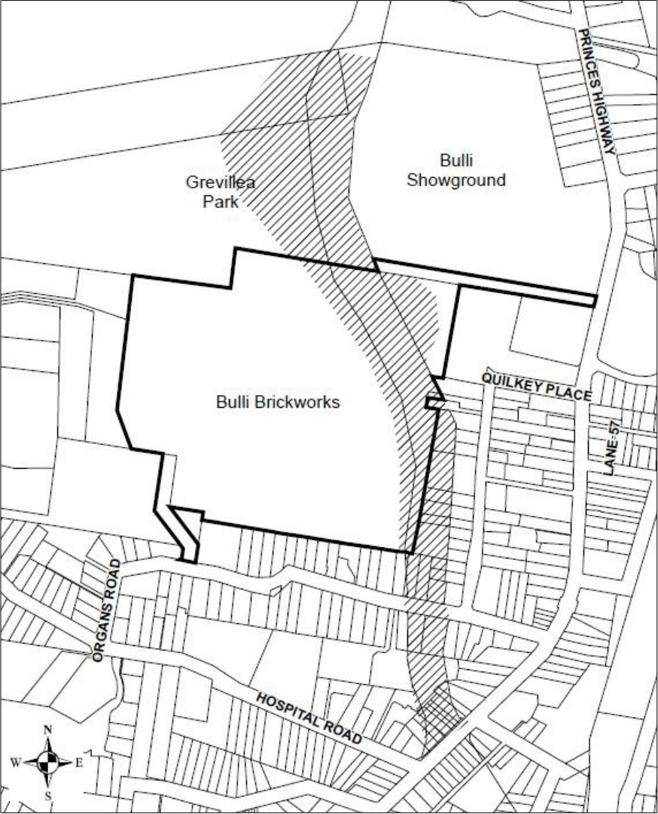

## 2 LAND TO WHICH THIS PLAN APPLIES

This Locality Chapter applies to land identified as the former Bulli Brickworks Site, located off the Princes Highway, Bulli (Lot 2 DP 582940 and Lot 207 DP 228538).

> [Picture on page 3: a picture, saved as a picture (images/chapter-d17-bulli-brickworks-page-3-4.gif, 150 dpi).]

#### Figure 1: Land to which this plan applies
