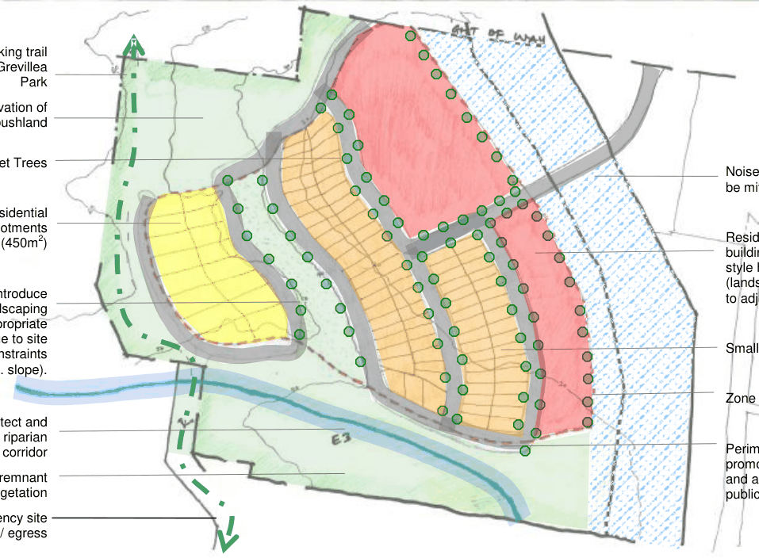

## 5 DEVELOPMENT CONCEPT / MASTER PLAN

The Bulli Brickworks Master Plan has been prepared to demonstrate the key principles guiding the future development of the site and to establish an estimated dwelling yield.  Any future development applications for small lot housing, earthworks, road design etc are to demonstrate how these key principles have been considered and achieved.

> [Picture on page 5: a map, saved as a picture (images/chapter-d17-bulli-brickworks-page-5-6.gif, 150 dpi); the street names and other small labels are on the picture.]
> Words printed on the picture (title and legend, copied from the PDF):
> due to site

linking to Grevillea

Noise impacts to be mitigated

Residential flat buildings/ terrace style housing (landscape buffer to adjacent road)

where appropriate

Small lot housing

Zone boundary

enhance riparian

Conserve remnant

Perimeter road to promote activation and access to public open space

Emergency site access/ egress

#### Figure 5.1 Bulli Brickworks Master Plan

The key principles of the Master Plan include: Built Form

(a) Deliver a range of housing types on a range of lot sizes across the site, resulting in a yield of approximately 260 dwellings.  Housing types to include detached dwelling houses, semi detached dwellings, attached dwellings, small lot housing and apartments.

Natural Environment

(b) Conserve and supplement native vegetation located within the northern, western and southern fringes of the site to provide an appropriate interface with existing adjoining residential development.

(c) Retain, manage and improve the existing natural watercourse and existing riparian vegetation which will provide an effective linkage of existing public lands within the locality.

(d) Ensure that the development does not result in an increase in stormwater runoff so as to cause an adverse flood impact on the site or downstream from the site.

(e) Create a bushland setting for passive and active recreation at the periphery of the site.  This landscape buffer will provide a continuous linkage with the existing public lands to the west of the site (through to Hospital Road) and the extensive public lands associated with the Bulli Showground and Grevillea Park to the north of the site.

(f) Ensure appropriate bushfire protection management (asset protection zones and the management of these) is integrated into the design of the site.

Movement Network

(g) Deliver safe pedestrian and cycle linkages within the site, and from the site to the existing Bulli community by the adoption of appropriate movement systems for traffic, bicycles and pedestrians.

(h) Design a safe and functional road network.

(i) Traffic control and circulation is a primary consideration to ensure the best entry and exit locations for the residential development and to provide connectivity with the surrounding Bulli community. The Master Plan provides for:

- the upgrading of the existing public access arrangements presently servicing the Bulli Showground, Bulli Bowling Club, Bulli Tennis Club and Grevillea Park;

- the signalisation of the access arrangements at the Princes Highway intersection;

- the grade separation of the site access with the future Northern Distributor extension; and

- the adoption of an internal road network that encourages continuity of traffic movements.

(j) To facilitate the appropriate activation and connection with the open space and bushland setting of the site, allow for the use of E3 land to support roads where a clear environmental benefit can be demonstrated.  The use of E3 land is not to compromise significant vegetation.

Amenity

(k) Subdivision layout is to respond to the site’s topography and promotes appropriate lot orientation to maximize the northern aspect.

(l) Site layout to respond appropriately to potential noise impacts resulting from the future Northern Distributor extension that adjoins the site to the east and from the use of the Bulli Showground.

(m) Public open space to be activated by residential development, and where possible, abutted by the local road network.

(n) Access to public open space is to be maximised.

(o) Buildings are to be located to provide an outlook to the public domain.
