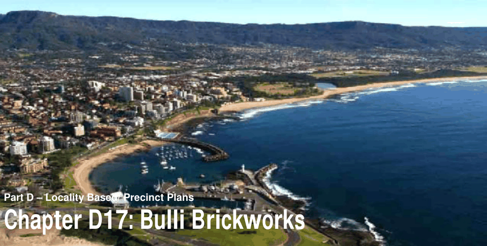

# Wollongong Development Control Plan 2009 - Chapter D17 Bulli Brickworks

> This chapter is split into 8 section file(s), one per numbered heading, in the order they appear in the PDF.

Source PDF: [Wollongong-DCP-2009-Chapter-D17-Bulli-Brickworks.pdf](https://planfortomorrow.sharepoint.com/sites/Planfortomorrow/Shared%20Documents/00%20NSW-Planning-Resources/dcp/wollongong-development-control-plan-2009/chapter-d17-bulli-brickworks/Wollongong-DCP-2009-Chapter-D17-Bulli-Brickworks.pdf)

> [Picture on page 1: a picture, saved as a picture (images/chapter-d17-bulli-brickworks-page-1-1.gif, 150 dpi).]

#### Part D – Locality Based/ Precinct Plans

### Chapter D17: Bulli Brickworks

### Contents

<!-- sections -->
## Sections

1. [7 SMALL LOT HOUSING](01-7-small-lot-housing.md)
2. [1 INTRODUCTION](02-1-introduction.md)
3. [2 LAND TO WHICH THIS PLAN APPLIES](03-2-land-to-which-this-plan-applies.md)
4. [3 AIMS AND OBJECTIVES](04-3-aims-and-objectives.md)
5. [4 DEFINITIONS](05-4-definitions.md)
6. [5 DEVELOPMENT CONCEPT / MASTER PLAN](06-5-development-concept-master-plan.md)
7. [6 GENERAL RESIDENTIAL CONTROLS](07-6-general-residential-controls.md)
8. [7 SMALL LOT HOUSING](08-7-small-lot-housing.md)
