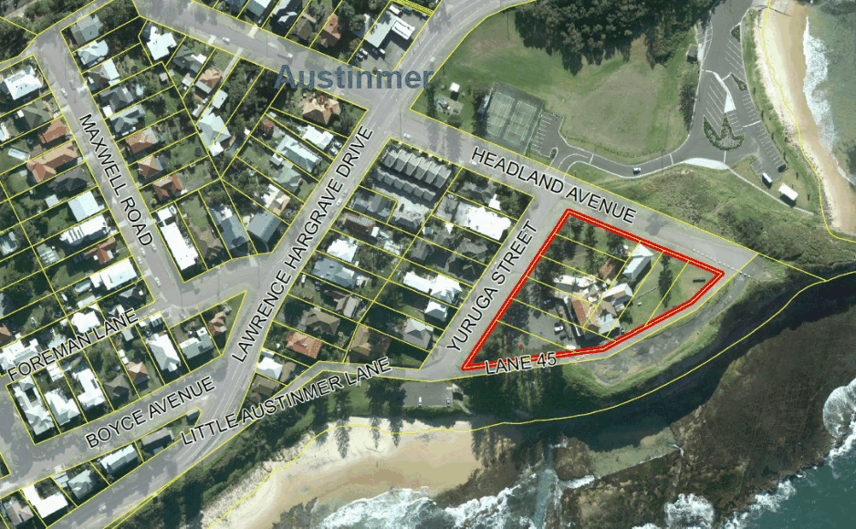

## 2 LAND TO WHICH THIS PLAN APPLIES

This Locality Chapter applies to land known as Brickyard Point on which Headlands Hotel sits and is located at Austinmer. This site consisting of 9 separate allotments is bounded by Headland Ave to the north, Yuruga Street to the west and Lane 45 along the east and south.

> [Picture on page 3: a picture, saved as a picture (images/chapter-d18-brickyard-point-austinmer-page-3-19.gif, 150 dpi).]
