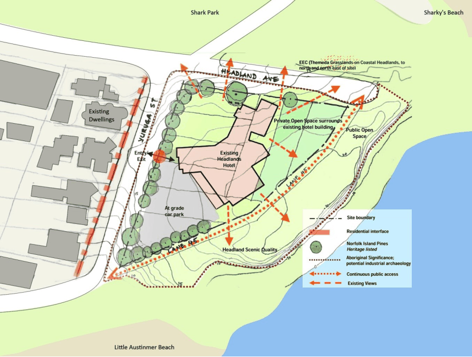

## 4 AIMS

The key objectives for the site are:

a) Provide a tourist oriented iconic development (excluding residential) which is sensitive to the visual, natural and cultural attributes of the site

b) Ensure that future development does not disrupt the visual prominence and character of the headland.

c) Ensure that future built form is distributed appropriately across the site to achieve a sympathetic design to this significant headland location

d) Ensure that open space interface between private and public domain complement one another.

e) Ensure the stability of the headland to protect and restore remnant vegetation on the cliff’s edge and face

f) Retain and protect the existing Norfolk Island Pine trees on the site

g) Ensure that Aboriginal significance of site and potential for industrial archaeology is explored and where appropriate, protected.

h) Maintain public access around the site and provide a strong integration with the future private open.

i) Promote through site link/s to increase permeability along eastern edge of the headland.

> [Picture on page 5: a picture, saved as a picture (images/chapter-d18-brickyard-point-austinmer-page-5-1.gif, 150 dpi).]

#### Above – Site Analysis for Brickyard Point
