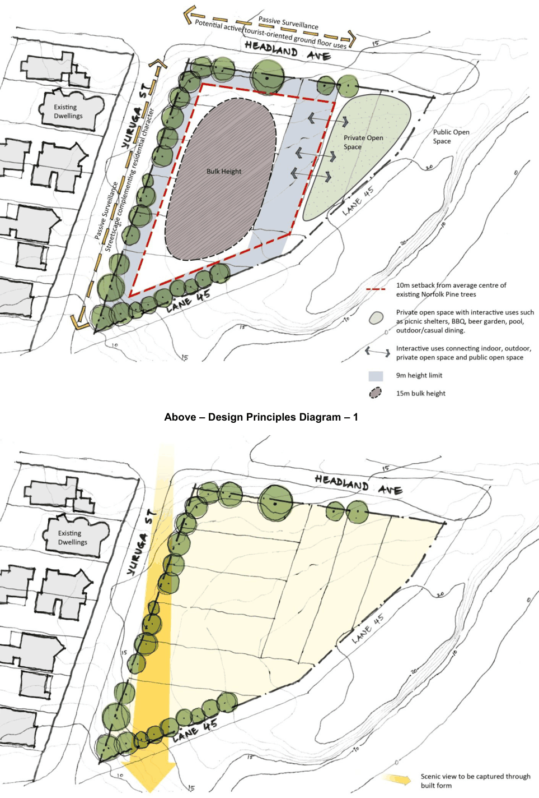

## 5 KEY URBAN DESIGN PRINCIPLES

The key urban design principles in order to achieve the objectives and vision for the site are –

1\. Ensure design excellence to deliver a building of landmark quality.

2\. Provide a unified & holistic approach to the site

3\. Future built form must enhance and not detract from the visual prominence and character of the headland.

4\. Provide a built form that ensures passive surveillance along Yuruga Street & Headlands Avenue.

5\. Create an attractive streetscape that is sensitive and complements the residential character of Yuruga Street.

6\. Ensure building design and function is sympathetic to the Norfolk Pines.

7\. Provide an integrated public and private open space interface which are clearly distinguishable.

> [Picture on page 6: a picture, saved as a picture (images/chapter-d18-brickyard-point-austinmer-page-6-1.gif, 150 dpi).]

#### Above – Design Principles Diagram – 1

#### Above – Design Principles Diagram – 2
