## 6 DEVELOPMENT CONTROLS

The controls to achieve the design aims and vision for the site are –

#### Built form and architectural character

a) No large expanse of blank walls to Yuruga Street or Headlands Ave.

b) Capture scenic views beyond to south of the site through the built form by using

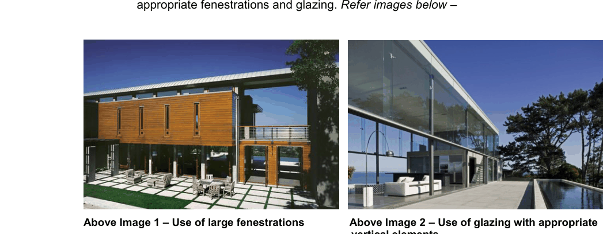

> [Picture on page 7: a picture, saved as a picture (images/chapter-d18-brickyard-point-austinmer-page-7-6.gif, 150 dpi).]
> Words printed on the picture (title and legend, copied from the PDF):
> Above Image 1 – Use of large fenestrations               Above Image 2 – Use of glazing with appropriate

appropriate fenestrations and glazing. Refer images below –

vertical elements

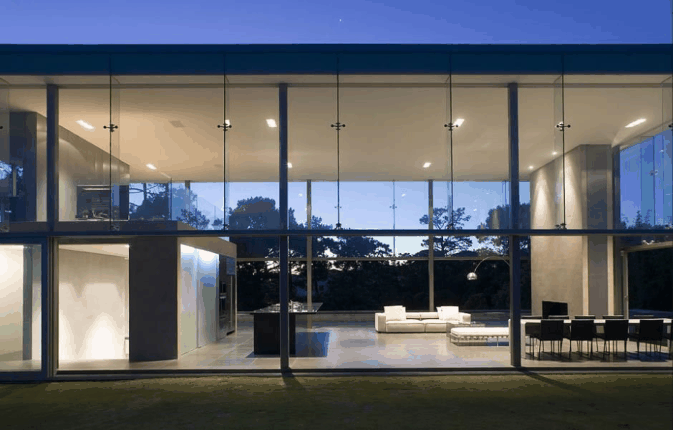

> [Picture on page 7: a picture, saved as a picture (images/chapter-d18-brickyard-point-austinmer-page-7-9.gif, 150 dpi).]

#### Above Image 3 – Use of glazing with strong vertical elements

c) Articulation must be provided through use of a combination of methods including vertical/strong elements, different finishes and materials, breakdown of long facades with smaller design elements. Some imagery of articulation typologies is included below.

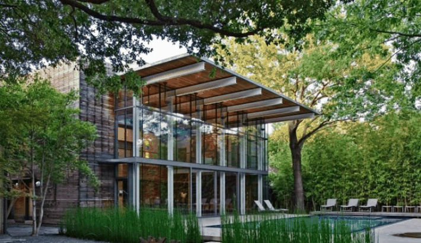

> [Picture on page 8: a picture, saved as a picture (images/chapter-d18-brickyard-point-austinmer-page-8-1.gif, 150 dpi).]

#### Above Image 4 – Strong vertical elements with large overhang

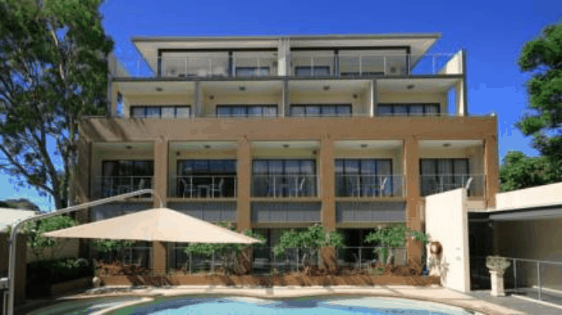

> [Picture on page 8: a picture, saved as a picture (images/chapter-d18-brickyard-point-austinmer-page-8-3.gif, 150 dpi).]

Above Image 5 – Consistent rhythm to break lengthy walls with clever use of masonry as base and lightweight for upper levels – complementing residential character of Yuruga St

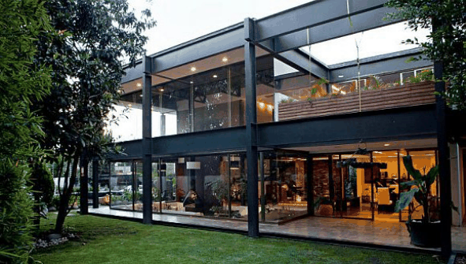

> [Picture on page 8: a picture, saved as a picture (images/chapter-d18-brickyard-point-austinmer-page-8-6.gif, 150 dpi).]

Above Image 6 – Consistent rhythm to break lengthy walls with clever use of masonry as base and

lightweight for upper levels

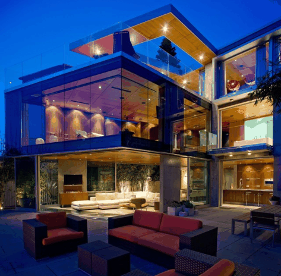

> [Picture on page 9: a picture, saved as a picture (images/chapter-d18-brickyard-point-austinmer-page-9-1.gif, 150 dpi).]

Above Image 7 – Built form with interactive spaces connecting the indoor, outdoor private space & public

open space

d) Future built form must not extend beyond Lot 94. This also applies to any renovation and extension works to the existing Headlands Hotel. Refer Design Principles Diagram - 2.

e) Facade treatment to Yuruga Street to be responsive to the residential development through appropriate scale and architectural design features

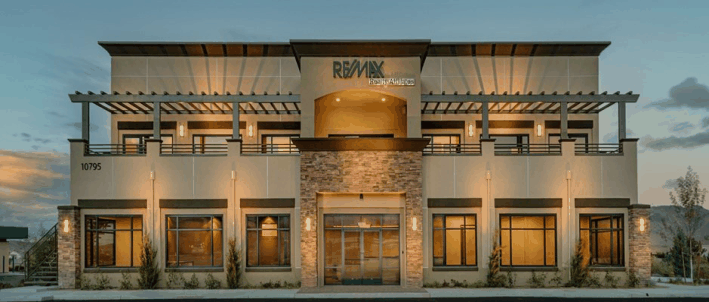

> [Picture on page 9: a picture, saved as a picture (images/chapter-d18-brickyard-point-austinmer-page-9-8.gif, 150 dpi).]

#### Above Image 8 – Example – complementing residential character of Yuruga Street

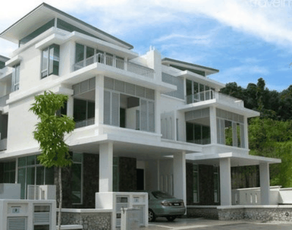

> [Picture on page 9: a picture, saved as a picture (images/chapter-d18-brickyard-point-austinmer-page-9-10.gif, 150 dpi).]

### OR

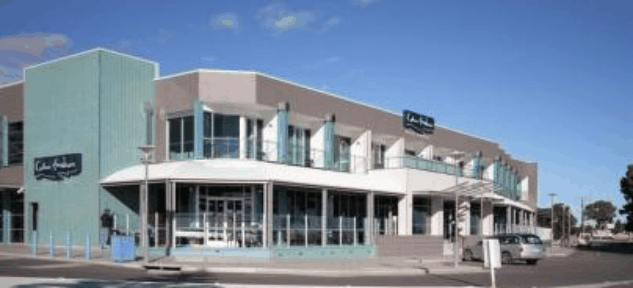

> [Picture on page 10: a picture, saved as a picture (images/chapter-d18-brickyard-point-austinmer-page-10-2.gif, 150 dpi).]

#### Above Image 9 – Example – complementing residential character of Yuruga Street

f) All car parking should be provided in the form of basement with exception of up to a maximum of 8 visitor car spaces above ground car parking.

g) Heights/building mass should be distributed according to the Design Principles diagram.

h) Interactive spaces should be created along the eastern/north eastern part of the site that address both private and public open spaces – i.e pool, bar/restaurant, beer garden, informal seating or similar. Refer images below.

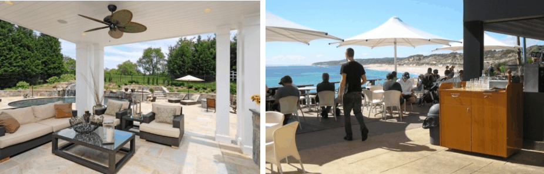

> [Picture on page 10: a picture, saved as a picture (images/chapter-d18-brickyard-point-austinmer-page-10-10.gif, 150 dpi).]

Above Image 10 – Casual seating                                Above Image 11 – Outdoor bar

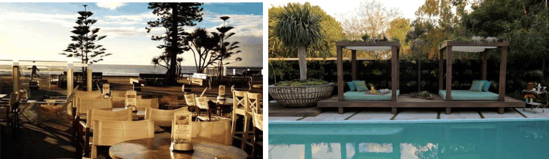

> [Picture on page 10: a picture, saved as a picture (images/chapter-d18-brickyard-point-austinmer-page-10-12.gif, 150 dpi).]

Above Image 12 – Formal function dining                  Above Image 13 – Pool, and picnic shelters

i) Service and utility areas should be screened from open space areas and all public areas

j) Any variation to the massing within the LEP controls under Clause 4.6 will require strong justification and achieving design excellence for the site as per Clause 7.18 of the Wollongong LEP 2009.

#### Setbacks

a) A minimum average 10.0m setback must be provided from the centre of the existing Norfolk Pines to the future building line. Refer Design Principles diagram.

b) Balconies may be allowed to encroach within the setbacks provided they do not restrict the long term growth requirements of the Norfolk Pines.

c) Basement must not protrude outside of the building line.

#### Height

a. Maximum 9.0m building height limit to Yuruga Street, Headland Avenue, public reserve to the east and some part of Lane 45 as shown in the Design Principles Diagram -1.

b. Increased building height of up to 15.0m in middle of the site to reduce bulk and retain visual prominence of the headland from north and south. This would equate to 4 to 5 storeys in the middle.

#### Landscape

a) Open space provided on lots 94 and 95, may contain structures such as picnic shelters, outdoor dining, BBQ, kiosks as transition between the private and public land to the east. Strictly no buildings are to encroach on these lots. Refer images 10 to 13.

b) Private open spaces catering to the patrons of the development must be a combination of soft and hard landscaped areas. These areas may not be deep soil zones.

c) The 10.0m setback buffer zone to Norfolk Pine trees must be deep soil area with appropriate landscaping. No basement carparking to intrude in this buffer zone to Norfolk Pines.

#### Fencing

a) Fencing used to separate private/public land must not be higher than 1.2m. Fencing material must not be colorbond or any other metal fencing. Fencing materials should complement the architectural design elements and features. Transparent materials/glass and landscape elements such as hedging is encouraged. Solid fences must not be higher than 800mm.

#### Lot Consolidation

a) Existing 9 allotments must be amalgamated as part of future redevelopment of the site

#### Design Excellence Criteria

Any Development Application for the subject site will be referred to the Design Review Panel for appropriate assessment, prior to determination of the application.

The Design Review Panel will consider applications at the pre-lodgement stage, in order to provide upfront design advice prior to the formal lodgement of the Development Application.

The Design Review Panel will consider whether the development exhibits design excellence and will have regard to the following matters:

a) Whether a high standard of architectural design, materials and detailing appropriate to the building type and location will be achieved,

b) Whether the form and external appearance of the proposed development will improve the quality and amenity of the public domain,

c) Whether the proposed development detrimentally impacts on view corridors,

d) How the proposed development addresses the following matters:

i. Existing and proposed uses and use mix,

ii. Clever design solutions to retain and integrate the Norfolk Pine trees within the development

iii. Bulk, massing and modulation of buildings,

iv. Street frontage heights,

v. Streetscape design to Yuruga Street

vi. Visual Impact along Headlands Ave from north and along Lane 45 from south

vii. Environmental impacts such as sustainable design, overshadowing, wind and reflectivity,

viii. Pedestrian, cycle, vehicular and service access, circulation and requirements
