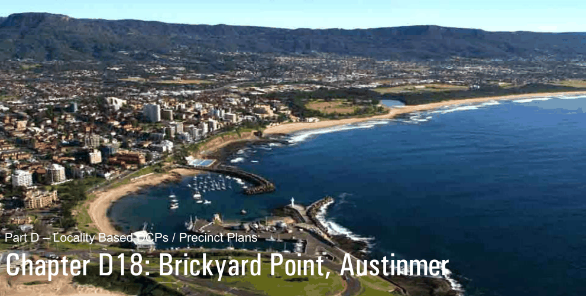
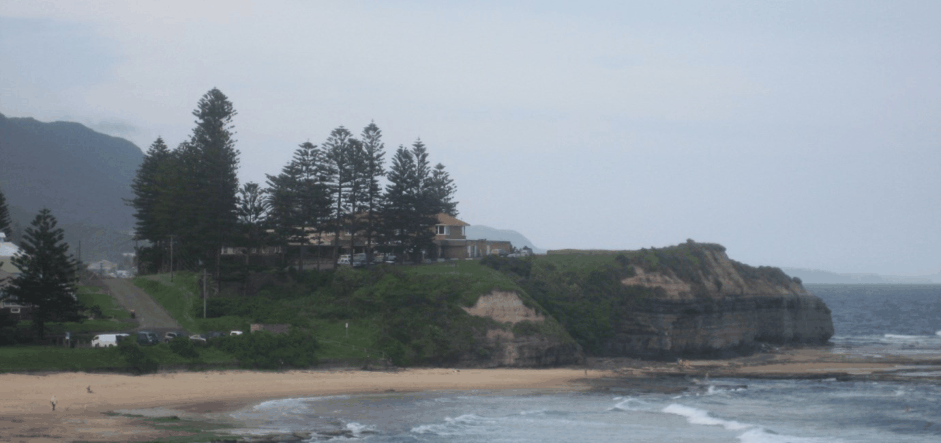
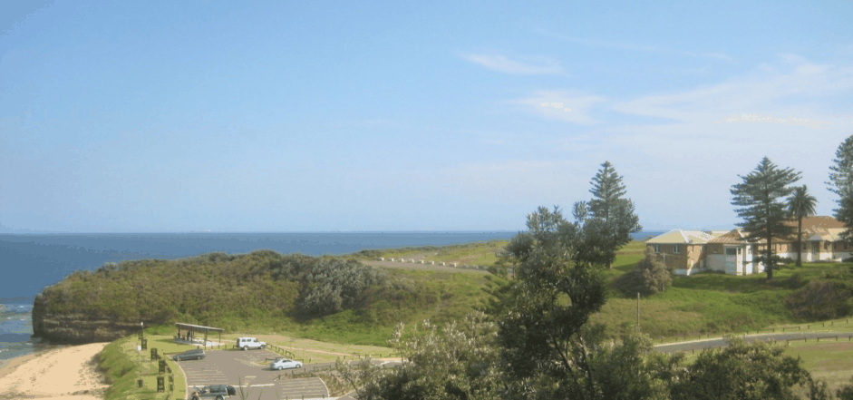

# Wollongong Development Control Plan 2009 - Chapter D18 Brickyard Point, Austinmer

> This chapter is split into 7 section file(s), one per numbered heading, in the order they appear in the PDF.

Source PDF: [Wollongong-DCP-2009-Chapter-D18-Brickyard-Point-Austinmer-in-force-4-March-2015.pdf](https://planfortomorrow.sharepoint.com/sites/Planfortomorrow/Shared%20Documents/00%20NSW-Planning-Resources/dcp/wollongong-development-control-plan-2009/chapter-d18-brickyard-point-austinmer/Wollongong-DCP-2009-Chapter-D18-Brickyard-Point-Austinmer-in-force-4-March-2015.pdf)

> [Picture on page 1: a picture, saved as a picture (images/chapter-d18-brickyard-point-austinmer-page-1-1.gif, 150 dpi).]

Part D – Locality Based DCPs / Precinct Plans

### Chapter D18: Brickyard Point, Austinmer

### CONTENTS

1 INTRODUCTION .................................................................................................................. 2 2 LAND TO WHICH THIS PLAN APPLIES ................................................................................... 2 3 VISION ............................................................................................................................. 3 4 AIMS ................................................................................................................................ 3 5 KEY URBAN DESIGN PRINCIPLES ......................................................................................... 4 6 DEVELOPMENT CONTROLS .................................................................................................. 6 7 ADDITIONAL SITE SPECIFIC REPORTS/INFORMATION ........................................................... 11

#### Document Control

|  |  |  | Document ID: Wollongong DCP 2009 – D18 Brickyard Point, Austinmer |
|---|---|---|---|
| Rev No | Adoption Date | In force date | Revision Details |
| 1 | 23/2/15 | 4/3/15 | Adopted |

#### .

Wollongong Development Control Plan 2009 – Chapter D18 - In force as of 4 March 2015

i

### Brickyard Point – Headlands Hotel, Austinmer

> [Picture on page 2: a picture, saved as a picture (images/chapter-d18-brickyard-point-austinmer-page-2-2.gif, 150 dpi).]

> [Picture on page 2: a picture, saved as a picture (images/chapter-d18-brickyard-point-austinmer-page-2-3.gif, 150 dpi).]

<!-- sections -->
## Sections

1. [1 INTRODUCTION](01-introduction.md)
2. [2 LAND TO WHICH THIS PLAN APPLIES](02-land-to-which-this-plan-applies.md)
3. [3 VISION](03-vision.md)
4. [4 AIMS](04-aims.md)
5. [5 KEY URBAN DESIGN PRINCIPLES](05-key-urban-design-principles.md)
6. [6 DEVELOPMENT CONTROLS](06-development-controls.md)
7. [7 ADDITIONAL SITE SPECIFIC REPORTS/INFORMATION](07-additional-site-specific-reports.md)
