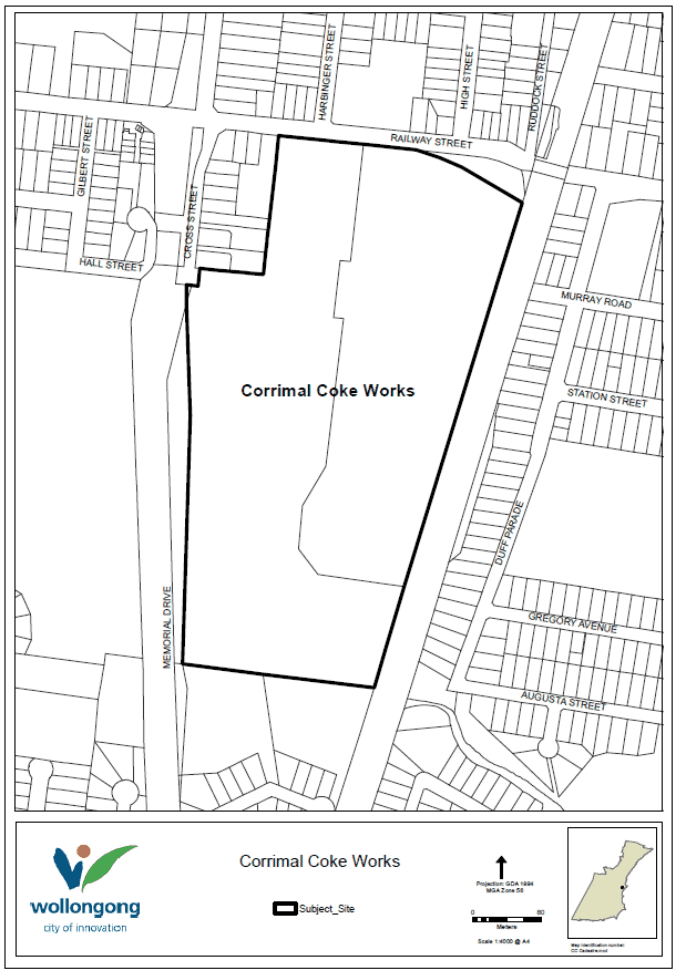

## 1 INTRODUCTION

This Locality Chapter applies to land known as the former Corrimal Coke Works Site, located off Memorial Drive and Railway Street, Corrimal (“the Site”). The Site is legally identified as Lot 1 DP 795791, Lot 5 DP 749492, Lot 126 DP 598190 and Lot 11 DP749492, as shown in Figure 1 below. This Locality Chapter is intended to supplement the land use planning controls applied by Part B of the Wollongong Development Control Plan 2009 to guide any future development at the former Corrimal Coke Works Site. This Chapter recognises the unique qualities of the Corrimal Coke Works site, and the ability to deliver a range of housing types in a high amenity, open space setting which celebrates the heritage of the site and takes advantage of its proximity to Corrimal Railway Station. This Chapter should also be read in conjunction with Part A, B, C, D and E of Wollongong DCP 2009, the Wollongong Local Environmental Plan and relevant State Environmental Planning Policies. In the event of any inconsistency between the provisions of this and any other chapters of Wollongong DCP, the provisions of this Chapter shall prevail to the extent of that inconsistency.

#### Figure 1 - Land to which this plan applies

> [Picture on page 2: a picture, saved as a picture (images/chapter-d19-former-corrimal-coke-works-site-page-2-18.gif, 150 dpi).]
