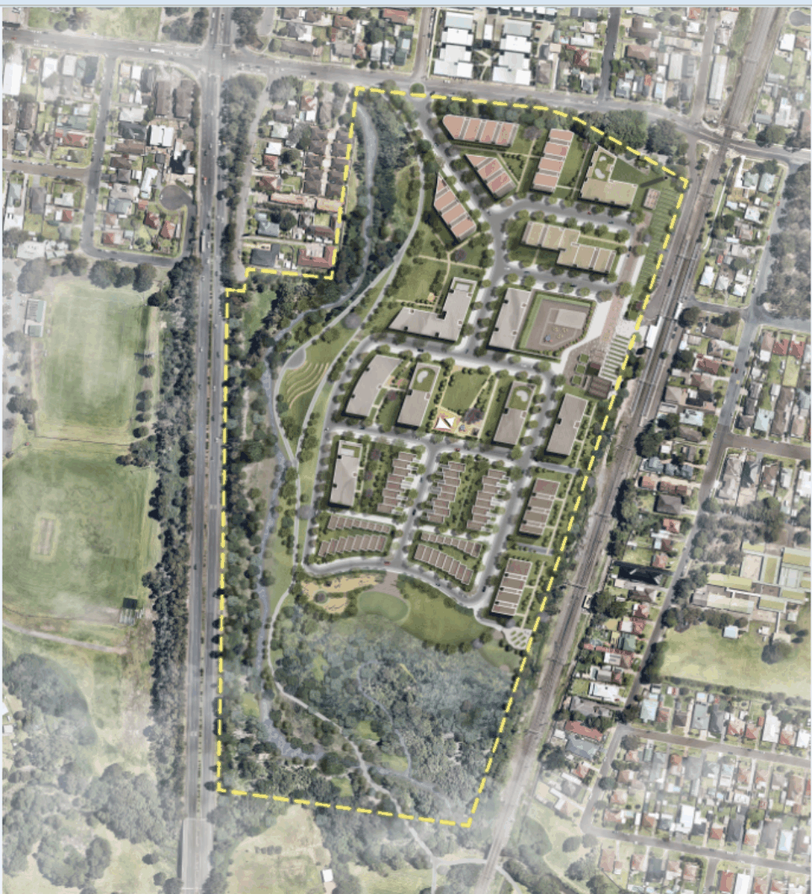

## 4 MASTER PLAN

The former Corrimal Coke Works Site Master Plan has been prepared to demonstrate the holistic vision, key outcomes and principles that will guide the future character and development of the Site (Figure 2). All future development applications must demonstrate that the objectives and development controls in this DCP Chapter  have been considered and will be achieved.

#### Figure 2 - Former Corrimal Coke Works Site Master Plan

> [Picture on page 4: a picture, saved as a picture (images/chapter-d19-former-corrimal-coke-works-site-page-4-7.gif, 150 dpi).]
