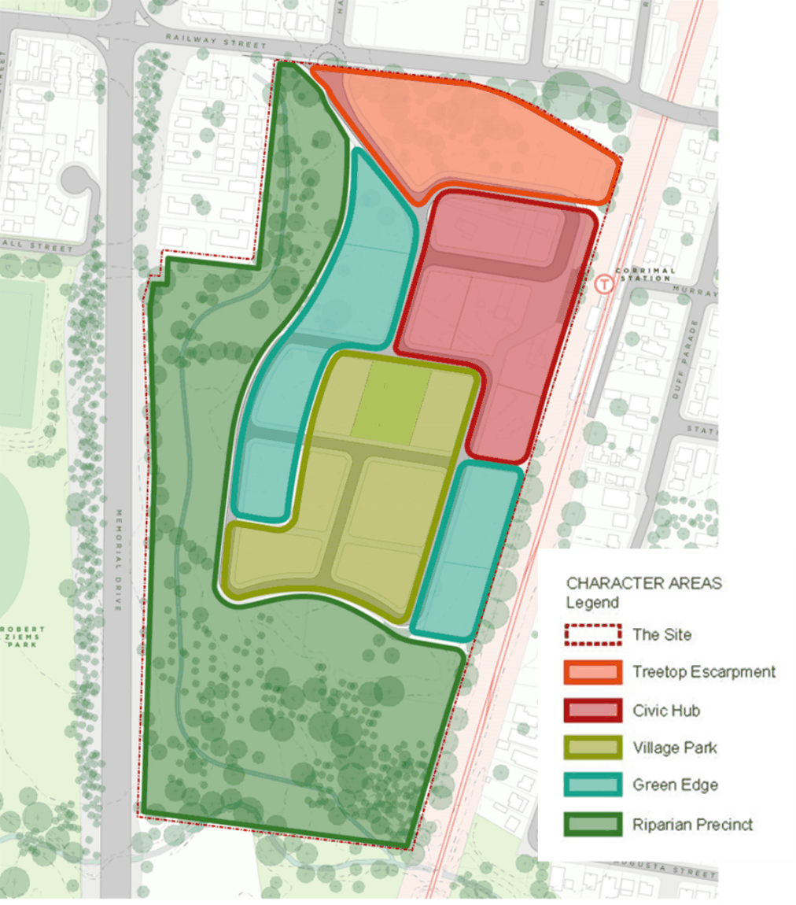

### 4.2 Desired Future Character

#### Overview

The former Corrimal Coke Works Site will be developed as a contemporary urban village, providing a diversity of medium density housing types within a high quality public domain that retains the heritage significance of the place, and reveals and reinforces the role of heritage buildings and sites in their context. The Site will conserve significant industrial elements that are adaptively reused and integrated with innovative heritage interpretations in public spaces and through urban design outcomes to allow the community to engage with the history of the Site. Aboriginal cultural values and significance of the Site will also be acknowledged and celebrated. Built form will be distributed so as to preserve and create key view corridors, as well as providing appropriately scaled interfaces to the heritage plaza precinct. Corrimal Railway Station and the adjacent heritage plaza precinct will be activated with neighbourhood scale retail uses, as well as flexible community and business space. This will create a high quality environment with improved accessibility that promotes public transport use. Provision for a bus loop through the Site will further encourage reduced car use. The development will encourage walking through “green” streets and the provision of key off-road shared paths to Corrimal Station, and also connecting through the Site to the Towradgi Creek corridor. Importantly, the Site will be open and permeable to invite the broader community to use its public spaces and facilities. The environmental values of the Site will be restored and enhanced, including establishing a new riparian corridor with increased biodiversity, and management of retained vegetation areas. Development of the site will ensure a commitment to achieving sustainable processes and outcomes.

#### Character Precincts

The former Corrimal Coke Works Site will be developed with five character precincts that relate to key features of the Master Plan and will deliver diversity and interest in the future built form (Figure 3).

#### Figure 3 - Character Precincts

> [Picture on page 6: a picture, saved as a picture (images/chapter-d19-former-corrimal-coke-works-site-page-6-2.gif, 150 dpi).]

#### Treetop Escarpment

The Treetop Escarpment precinct forms the entrance to the Site from Railway Street, with buildings screened by the established green buffer that is retained in a generous landscape setback. The landscape character will extend with new trees planted between building forms and within private courtyards of residential apartment buildings. The built form is designed with strong vertical elements to emphasise the pattern of surrounding trees, while rooflines vary in order to reflect the character of the Illawarra Escarpment. A simple palette of materials complements the natural context of this precinct.

#### Civic Hub

The Civic Hub will provide an urban and active character due to its proximity to Corrimal Railway Station. Buildings are to activate the street with uses and design elements at ground level that encourage interaction with pedestrians and create interest for all types of passers-by. Buildings are built to the street boundary to create a strong building alignment. The architecture will reflect the industrial history of the site through the use of sympathetic materials such as finer grain metal elements. The Heritage Plaza will provide a high quality public domain at Corrimal Railway Station and a focal point for the conservation, interpretation, and adaptive re-use of key heritage structures. Retail and business uses are located within the Civic Hub to activate the Heritage Plaza and Corrimal Railway Station, and provide amenity for local residents. The main retail and commercial building is of lower scale to respect the views and prominence of the heritage items.

#### Green Edge

The Green Edge precinct fronts the riparian corridor and green open space at the west of the Site, providing a key interface between the natural and built elements of the Site. New buildings will respond to this natural interface, providing a sense of openness and characterised by a lightweight materiality including fine grain timber elements and screens. Buildings will promote passive surveillance of the riparian corridor, while creating appropriate privacy for residential dwellings. Buildings will address both the riparian corridor and any internal roads or adjacent features (such as the Village Park).

#### Village Park

The Village Park precinct provides for a mix of the lower scale and finer grain buildings comprising more townhouse and terrace housing than other precincts, while also including some apartment buildings. The lowest scale dwellings are located in the southern portion of the precinct, providing a transition in scale down from the Village Park to the riparian corridor and Southern Recreation Park. The Village Park precinct provides a visual and physical connection from the Village Park to the Southern Recreation Park, promoting permeability through the Site. The built form reflects an urban village character utilising contemporary materials and architecture, while promoting human scale architecture.

#### Riparian Precinct

The Riparian precinct provides a green edge to the Site and connection with the natural environment. Its natural biodiversity qualities will be retained, restored, and enhanced, while offering opportunities for passive recreation. These outcomes are achieved while satisfying functional flood management, engineering requirements and maintenance. Environmental values, particularly the Endangered Ecological Community and Grey-headed Flying Fox camp in the southern portion of the Site, are protected and complemented by open space functions. Aboriginal cultural values associated with creeklines and riparian vegetation are acknowledged. The Southern Recreation Park provides a dedicated recreation space for community enjoyment, while providing an appropriately defined interface to more ecologically sensitive areas.
