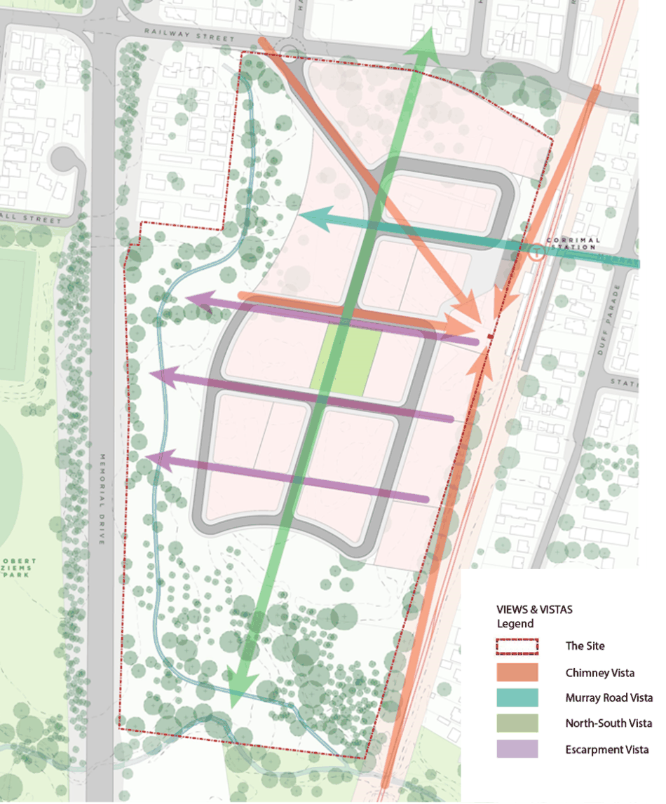

### 5.1 Views and Vistas

#### 5.1.1 Objectives

a. Ensure that development of the Site maintains and establishes key view corridors.

b. Ensure retained, repurposed, or reinterpreted heritage items are prominent in views and vistas across the Site.

#### 5.1.2 Development Controls

1\. New development will establish or maintain key view corridors as indicated in Figure 4. This includes:

a) a key view axis from Railway Street to the C1 Brick Chimney Stack;

b) views from Murray Street to the escarpment;

c) a new east west road within the Site to view the C1 Brick Chimney Stack;

d) a green link central view axis between the Southern Park and northern tree lined Railway Street edge; and

e) western view corridors to the riparian corridor and escarpment.

2\. The C1 Brick Chimney Stack is a significant landmark. Views to the C1 Brick Chimney Stack are to be preserved from Corrimal Railway Station, Railway Street, and Towradgi Road overpass.

3\. New development (not in existing structures) adjacent the C1 Brick Chimney Stack within the heritage curtilage should be stepped back in its form, or have an appropriate setback/buffer zone.

4\. Buildings adjacent the rail corridor shall utilise a natural colour and material palette to blend into the backdrop of the Illawarra Escarpment when viewed from East Corrimal.

5\. New commercial buildings should be positioned, scaled, and set back to ensure views along the visual axis from Railway Street to the C1 Brick Chimney Stack.

#### Figure 4 - Views and Vistas

> [Picture on page 9: a picture, saved as a picture (images/chapter-d19-former-corrimal-coke-works-site-page-9-2.gif, 150 dpi).]
