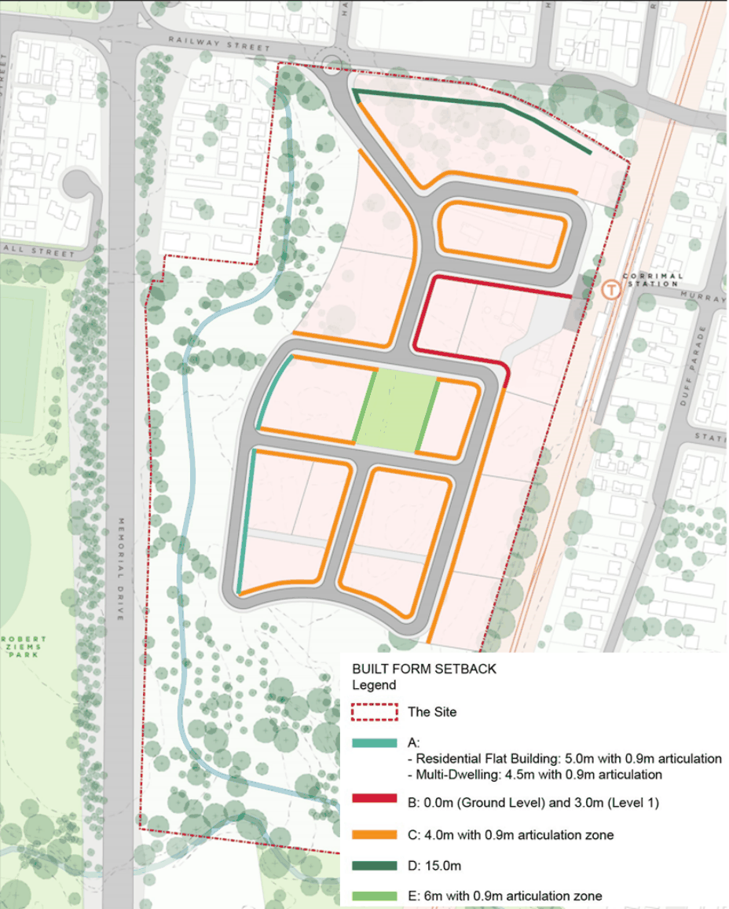

### 5.2 Built Form Setbacks

#### 5.2.1 Objectives

a. Setbacks and articulation are to create an appropriate street interface and maximise contiguous areas of deep soil adjacent to the public domain.

#### 5.2.2 Development Controls

1\. Building setbacks are to comply with Figure 5.

2\. Up to 70% of the articulation zone can be occupied by architectural elements. Articulation zone means a zone forward of the main facade line that may include architectural features such as pergolas, roof elements, bay windows, sun shading and verandas. The articulation zone may not include habitable floor area or basement levels above ground.

3\. Ground floor setbacks, including articulation zones, are not to incorporate basement levels.

#### Figure 5 - Built Form Setback

> [Picture on page 11: a picture, saved as a picture (images/chapter-d19-former-corrimal-coke-works-site-page-11-2.gif, 150 dpi).]
