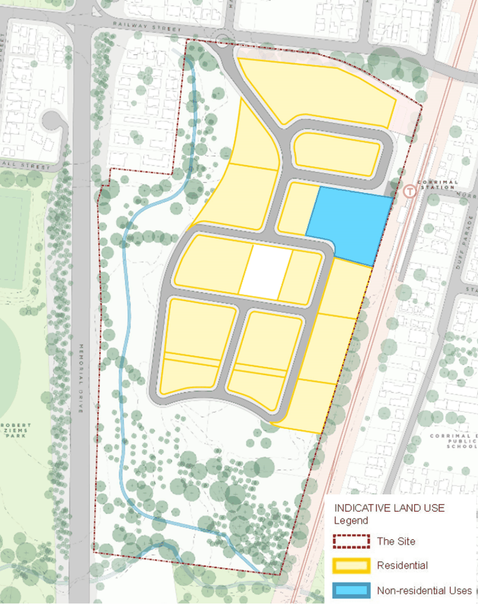
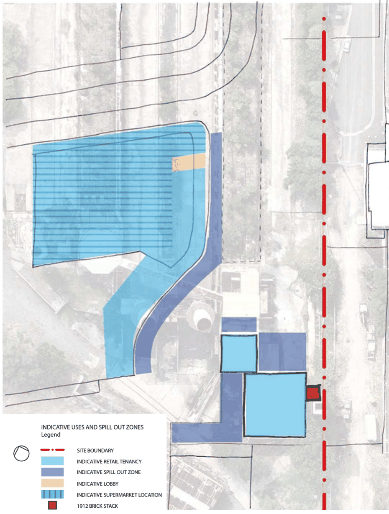
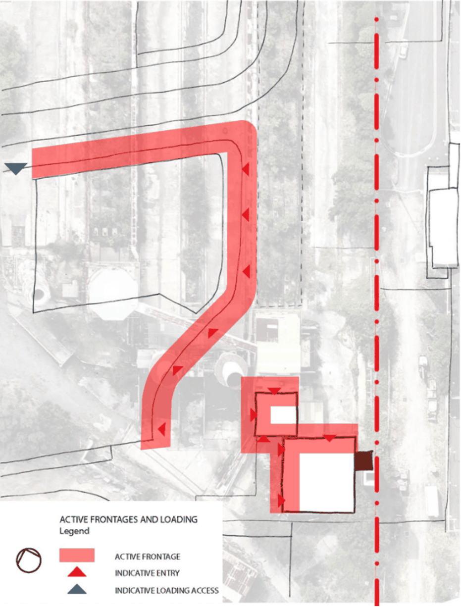

### 5.6 Non-Residential Development

#### 5.6.1 Objectives

a. Ensure that future development results in a high amenity public heritage plaza and is undertaken in a manner sympathetic to the heritage values.

#### 5.6.2 Development Controls

1\. All non-residential land uses permitted on the Site under Schedule 1 of Wollongong LEP are located on the Site in accordance with Figure 6 and are to be located at ground level.

2\. Non-residential uses may spill out into the Heritage Plaza as generally shown in Figure 7 and be managed by the owner.

3\. Any neighbourhood supermarket is to be located and designed to maximise the extent of active frontages including entries and transparent windows to public streets and open space. The indicative location for a neighbourhood supermarket is shown in Figure 7.

4\. Development within the Heritage Plaza shall integrate with the heritage of the Site, through the retention, conservation, and interpretation of significant Heritage elements, as well as through landscaping.

5\. Awnings should be included in developments associated with the proposed retail uses. Exceptions may be endorsed after a merit assessment where a listed heritage structure is being interpreted and adapted for retail and business purposes.

6\. Signage on heritage structures adapted for reuse should be kept to the minimum necessary for business identification and reflect the heritage character of the structure, as per the controls in Wollongong DCP 2009 Chapter C1: Advertising Signage and Structures.

7\. Access areas into buildings, active frontages and loading access shall be located generally in accordance with that shown in Figure 8. Alternative loading arrangements may be considered where heritage items are being adaptively re-used.

8\. All loading and unloading activities shall take place wholly within the designated loading bay, at all times. Alternative loading arrangements may be considered where heritage items are being adaptively re-used.

9\. Shade devices and shade trees are to be included in the landscaping plan for the Heritage Plaza.

#### Figure 6 - Indicative Land Use

> [Picture on page 14: a picture, saved as a picture (images/chapter-d19-former-corrimal-coke-works-site-page-14-2.gif, 150 dpi).]

#### Figure 7 - Indicative Uses and Spill Out Zone

> [Picture on page 15: a picture, saved as a picture (images/chapter-d19-former-corrimal-coke-works-site-page-15-2.gif, 150 dpi).]

#### Figure 8 - Active Frontages and Loading

> [Picture on page 16: a picture, saved as a picture (images/chapter-d19-former-corrimal-coke-works-site-page-16-2.gif, 150 dpi).]
