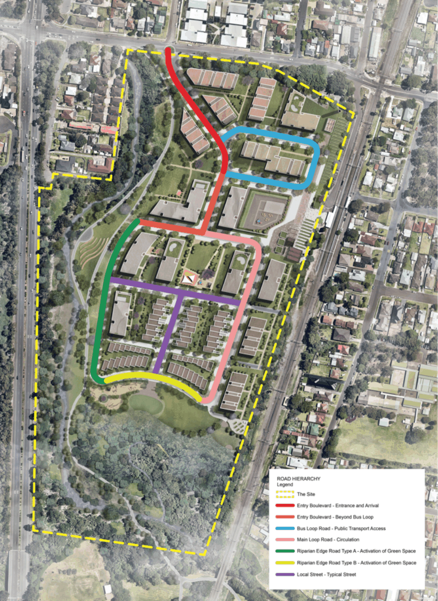
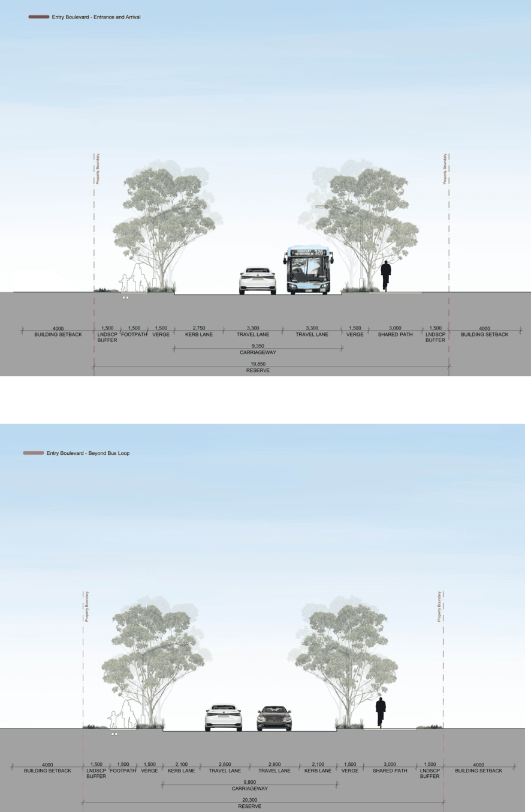
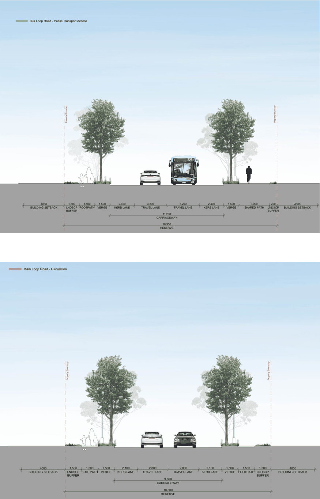
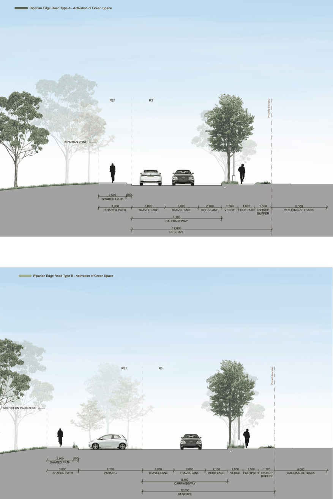
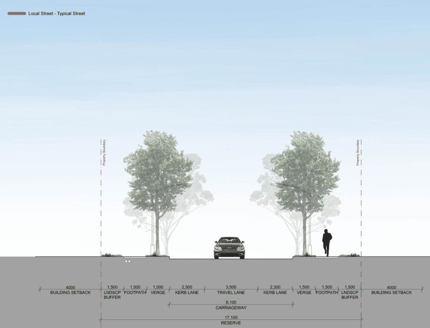

### 5.7 Movement Network

#### 5.7.1 Objectives

a. Establish a new access to the Site to connect with the surrounding Corrimal community.

b. Deliver a Site that is highly permeable for pedestrians and cyclists, linking the Site to surrounding amenities, services and facilities, public transport, and recreational opportunities.

c. Facilitate improved access to Corrimal Railway Station from the west.

d. Ensure a safe and functional internal road network, including the provision of on street parking and bus access to the railway station.

#### 5.7.2 Development Controls

1\. The Site is a designated Urban Release Area under the Wollongong Local Environmental Plan 2009. Future residential subdivision on the Site cannot proceed until the developer has reached ‘satisfactory arrangements’ with the Director General for Planning for the provision of designated State public infrastructure, including satisfactory transport arrangements with Transport for NSW. Although the satisfactory arrangements may precede the lodgement of a development application, these aspects must be satisfactorily resolved prior to any development consent being issued.

2\. Access to the Site is to be provided from Railway Street with a new roundabout constructed at the intersection with Harbinger Street. The associated removal of vegetation is to be assessed through a Biodiversity Assessment Report (BDAR) as part of the relevant development application.

3\. Wollongong DCP Chapter B2 Residential Subdivision stipulates the hierarchy of streets and the requirements for street trees, footpaths, and shared paths. This hierarchy applies, with variations as illustrated in Figure 9 to provide sufficient road width to accommodate bus access to Corrimal Railway Station and a bicycle path through the Site.

#### Figure 9 - Road Hierarchy

> [Picture on page 18: a picture, saved as a picture (images/chapter-d19-former-corrimal-coke-works-site-page-18-2.gif, 150 dpi).]

> [Picture on page 19: a picture, saved as a picture (images/chapter-d19-former-corrimal-coke-works-site-page-19-1.gif, 150 dpi).]

> [Picture on page 20: a picture, saved as a picture (images/chapter-d19-former-corrimal-coke-works-site-page-20-1.gif, 150 dpi).]

> [Picture on page 21: a picture, saved as a picture (images/chapter-d19-former-corrimal-coke-works-site-page-21-1.gif, 150 dpi).]

> [Picture on page 22: a picture, saved as a picture (images/chapter-d19-former-corrimal-coke-works-site-page-22-1.gif, 150 dpi).]
