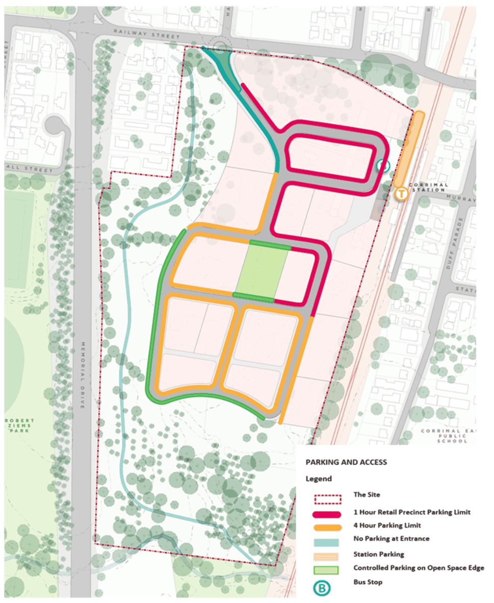

### 5.8 Car parking and vehicular access

#### 5.8.1 Objectives

a. Introduce time restrictions for on street parking to avoid the potential for all-day commuter parking and promote the turnover of on street parking spaces for visitors.

b. Provide for adequate car parking on the Site for various uses, while reflecting the opportunity for public transport-oriented development because the site is directly adjacent the Corrimal Railway Station.

c. Ensure appropriate access is provided for each of the buildings on the Site whilst minimising the impacts on the public domain from parking structures.

#### 5.8.2 Development Controls

1\. Car parking for residential flat buildings may be provided in the form of a full basement, ‘half in half out’ basement or sleeved above ground. Protrusion of carparks should not exceed one metre above ground level as per the ADG. Basement carparking, including any above ground portion, is not permitted within the ground floor setback or articulation zone. Wollongong DCP 2009 Chapter B1 Residential Development provides parking controls for multi dwelling houses.

2\. At grade resident and visitor carparking must be located behind the building and not visible from the street. At grade carparks must be landscaped in accordance with Wollongong DCP 2009 Chapter E6.

3\. Car parking in residential flat building developments should be designed to serve residents and visitors of the Site conveniently, efficiently and appropriately. The following outcomes should be achieved for car parking areas: Located close to entrances and access ways; Secure yet easily accessible for all residents; and Have clearly defined areas for visitor parking and disabled parking.

4\. Parking is to be provided for developments within the Site in accordance with the minimum rates in Table 4 below.

5\. Reduced parking rates for residential development in accordance with Wollongong DCP 2009 Chapter E3 Schedule 1 for development within 450m walking distance of a rail station may be adopted, subject to a traffic and parking assessment submitted with the development application.

#### Table 4: Parking Controls

| Land use |  | Car Parking Rates | Motorcycle Parking | Bicycle spaces |
|---|---|---|---|---|
| Residential Flat Building, and shop top housing | 1 bedroom 2 bedroom 3 bedroom Visitors | 1 space per dwelling (<70m2) 1.2 car space per dwelling (70- 110m2) 1.7 car spaces per dwelling (>110m2) 0.2 spaces per dwelling for visitors | 1 motorcycle space per 15 dwellings N/A | 1 bicycle space per 3 dwellings 1 bicycle space per 12 dwellings |
| Multi dwelling housing | 3 or more bedrooms | 2 car spaces per dwelling | N/A | N/A |
| Retail |  | 1 space per 25m2 | 1 motorcycle space per 25 car parking spaces | 1 bicycle space per 750m2 GFA for staff plus 1 space per 1,000m2 GFA for shoppers |
| Restaurant |  | 1 space per 25m2 | - | - |
| Food and drink premises |  | 1 space per 25m2 | - | - |

6\. On street parking will be subject to time restrictions in accordance with Figure 10.

#### Figure 10 – On Street Car Parking

> [Picture on page 24: a picture, saved as a picture (images/chapter-d19-former-corrimal-coke-works-site-page-24-2.gif, 150 dpi).]

7\. The design of basement car parking and access should comply with AS2890 and should support the use of natural ventilation where possible.

8\. The design of basement car parking should be integrated with the overall design of the development, and limiting the extent to which the podium extends beyond the building footprint will minimise the impact of the basement parking areas on the streetscape.

9\. Ventilation structures/openings/exhausts for basement parking and air-conditioning units must be orientated away from windows of habitable rooms and private open space areas on the subject site as well as adjoining sites. They must be designed to minimise any visual or amenity impacts on adjoining public domain.

10\. The visual impact of all basement walls must be minimised through the use of various design techniques including well-proportioned ground level articulation and relief, mixed finishes, and materials, terracing and/or dense landscaping.

11\. Any above-ground parking is to be sleeved behind a landscaped podium or retail uses where relevant, so it is not visible from the public domain.

12\. Waste collection vehicles may enter building basements from rear lanes to collect waste and/or recyclables subject to the requirements in Wollongong DCP 2009 Chapter E3.
