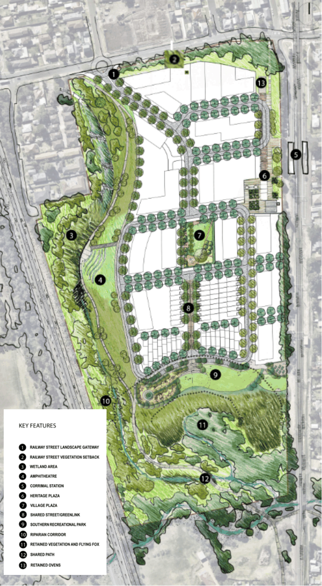

### 5.10 Public Domain

The former Corrimal Coke Works Site Master Plan in Section 4 of this Chapter provides a range of new parks and open spaces for the community, integrated with a realigned riparian corridor, biodiversity improvements, cycle, and pedestrian connections, proposed residential development and local retail hub.

#### 5.10.1 Objectives

a. Provide multiple open spaces of various scales  as identified in Figures 2 and 11 to create a high quality public domain and cater for a wide range of user needs, including both future residents and the wider community.

#### 5.10.02 Development Controls

1\. New open spaces are to be provided in accordance with Table 5 -

#### Table 5:  Open space typologies

| Open Space | Total Area (ha) | Ownership |
|---|---|---|
| Heritage Plaza | 0.3ha | Private |
| Village Park | 0.3ha | Council |
| Southern Recreational Park | 0.7ha | Council |
| Riparian Corridor | 7.7ha | Council |

2\. A landscaping plan is to be submitted to Council for approval with the relevant development application for any of the open space and public realm areas and generally be consistent with the landscape concept plan shown in Figure 11 below.

3\. The landscaping plan is to detail any proposed public art in accordance with Council’s Public Art Strategy and Guidelines 2016-2021. Public art should be considered at selected locations within the public domain, and particularly consider opportunities for salvage and re-use of the existing industrial elements. Any public art should be robust and low maintenance and designed with consideration of public safety.

4\. Locational and cultural interpretive signage and appropriate lighting shall be provided as part of the open space system.

5\. Any servicing facilities are to be located to minimise impacts on the public domain. Any substation located within the public domain is to be positioned to minimise its functional and visual impact, and appropriately screened.

#### Figure 11 - Indicative Landscape Plan

> [Picture on page 27: a picture, saved as a picture (images/chapter-d19-former-corrimal-coke-works-site-page-27-2.gif, 150 dpi).]
