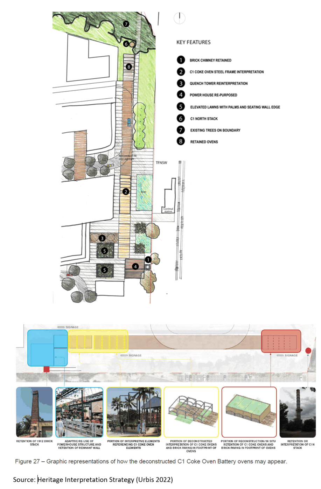
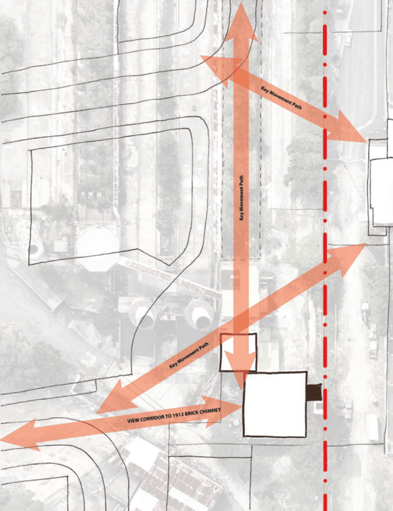

### 5.11 Heritage Plaza

a. Create a safe and accessible public domain that provides connectivity to Corrimal Railway Station.

b. Provide an attractive and comfortable community space that can be activated by adjoining neighbourhood scale retail and business uses.

c. Celebrate the heritage significance of the Site through the conservation, retention and re-purposing of significant structures and features and through innovative and interactive interpretation outcomes.

#### 5.11.2 Development Controls

1\. The Heritage Plaza must be a minimum 0.3ha in size.

2\. The Heritage Plaza must receive at least four hours of continuous solar access to at least 70% of its area all year round.

3\. The design of the Heritage Plaza shall generally be in accordance with the concept provided in Figure 12.

4\. The Heritage Plaza shall provide appropriate interpretive materials to allow for the interpretation of the retained industrial elements and the broader history of the Site.

5\. The design of the Heritage Plaza is to be appropriately integrated with and reflect key heritage elements, in particular retaining and interpreting elements of the former industrial use and materials.

6\. Ensure a high level of physical and visual permeability to facilitate access to Corrimal Railway Station and activation of the Heritage Plaza, generally in accordance with

#### Figure 13.

7\. Provide lighting in accordance with Wollongong DCP 2009 Chapter E2 – Crime Prevention through environmental design.

8\. Shade devices and shade trees are to be included in the landscaping plan for the Heritage Plaza. These shade trees are to be planted in soil which has a connection to natural ground to allow exchanges between soil profiles.

#### Figure 12 - Indicative concept design – Heritage Plaza

> [Picture on page 29: a picture, saved as a picture (images/chapter-d19-former-corrimal-coke-works-site-page-29-2.gif, 150 dpi).]

#### Figure 13 - Visual permeability and sight lines

> [Picture on page 30: a picture, saved as a picture (images/chapter-d19-former-corrimal-coke-works-site-page-30-2.gif, 150 dpi).]
