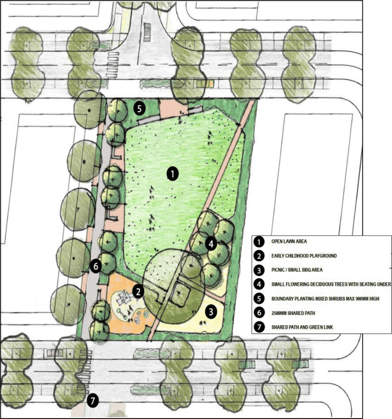

### 5.12 Village Park

#### 5.12.1 Objectives

a. Encourage community interaction and facilitate unstructured recreational activities for a range of demographics.

#### 5.12.2 Development Controls

1\. The Village Park must  be a minimum 0.3ha in size (neighbourhood scale).

2\. A minimum 50% of the park must be provided as open lawn area.

3\. Incorporate a designated playground area with an appropriate range of equipment as well as formal seating areas, as generally indicated in Figure 14.

4\. Provide a separate access path for any residential dwellings that front onto the park, with appropriate landscape screening to create appropriate privacy but simultaneously ensuring surveillance of the park.

5\. Visually permeable fencing is to be provided on the boundaries facing the park.

6\. The Village Park shall receive at least four hours of continuous solar access to at least 70% of its area all year round. Solar Access Studies showing the extent of overshadowing on the Village Park between 9am and 3pm on 21June are to accompany all development applications.

#### Figure 14 - Indicative concept design – Village Park

> [Picture on page 31: a picture, saved as a picture (images/chapter-d19-former-corrimal-coke-works-site-page-31-19.gif, 150 dpi).]
