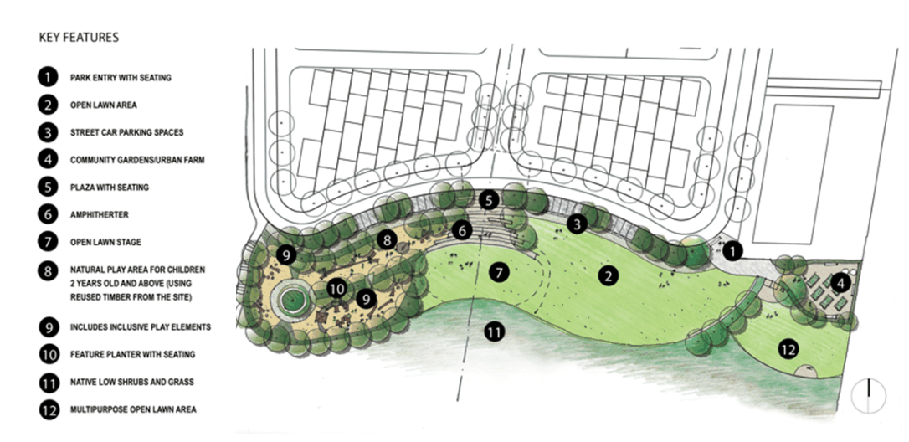

### 5.13 Southern Recreation Park

a. Encourage community interaction and facilitate unstructured recreational activities for a range of demographics.

b. Provide a transition zone between the Grey-headed Flying-fox core camp and future residential development.

c. Acknowledge and provide for retention and conservation of significant Aboriginal cultural value attachments to the creek and riparian vegetation areas in the south of the site.

#### 5.13.2 Development Controls

1\. The Southern Park must be a minimum 0.7ha in size.

2\. Incorporate a community garden/urban farm, as generally indicated in Figure 15. Provide appropriate facilities to support the operation of a community garden, including water supply and shed for storage of equipment.

3\. Design of this place is to provide flexibility to accommodate a designed off-leash area (fully fenced) if declared as such, excluding the 100m buffer zone from the Grey-Headed Flying-fox camp.

4\. Provide information/education signage or other acknowledgement of the Aboriginal cultural value attachments to the creeklines and remnant vegetation in the southern areas of the Site, in consultation with the local Aboriginal community.

5\. Provide information/education signage to facilitate community awareness and understanding of the Grey-headed Flying-fox camp located on the Site.

6\. A southern edge defining element shall be incorporated into the design (ie a fence, a pathway, or the like), to provide an adequate threshold between the park and the natural bushland, and respond to the topography of that part of the site. A viewing platform may be incorporated on the park edge.

7\. The Southern Park shall receive at least four hours of continuous solar access to at least 70% of its area all year round. Solar Access Studies showing the extent of overshadowing on the Southern Recreation Park between 9am and 3pm on 21June are to accompany development applications. Note: existing trees are not subject to this clause.

#### Figure 15 - Indicative concept design – Southern Recreation Park

> [Picture on page 32: a picture, saved as a picture (images/chapter-d19-former-corrimal-coke-works-site-page-32-31.gif, 150 dpi).]
