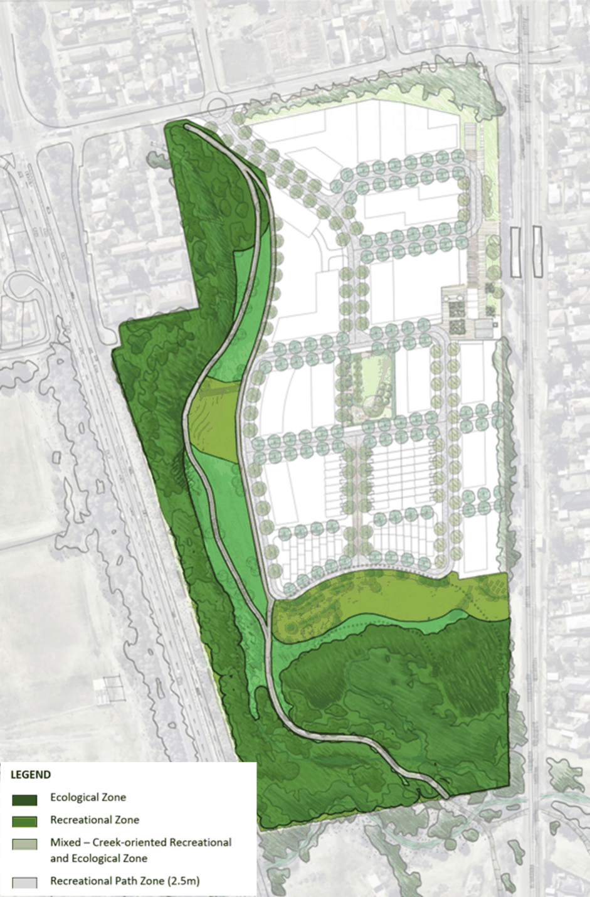

### 5.14 Riparian Corridor

#### 5.14.1 Objectives

a. Prevent flooding impacts on Site (and up and downstream) and improve environmental function through the realignment of North Corrimal Creek.

b. Create a flood free area suitable for residential development.

c. Ensure that the realignment of North Corrimal Creek provides for the long-term stability and hydraulic functioning of the creek.

d. Improve connectivity through the provision of a continuous concrete shared path that satisfies CPTED design objectives, is not located in a floodway, is appropriately fenced adjacent batters, and is accessible by all members of the community.

e. Provide passive recreational opportunities.

f. Protect the Grey-headed Flying-fox camp on Site by ensuring a buffer between the Camp and future residential development, through the conservation and enhancement of its habitat, the Illawarra Lowlands Grassy Woodland Endangered Ecological Community located in the southern part of the Site and the establishment of a Camp Management Strategy.

g. Acknowledge and appropriately interpret the broader Aboriginal cultural values to creeklines and riparian vegetation in the local area.

#### 5.14.2 Development Controls

1\. Incorporate a realigned North Corrimal Creek, as generally indicated in Figure16. The design of the realigned North Corrimal Creek shall consider the Corrimal Coke Works Creek Realignment Stability Assessment (BG&E 2019) submitted in support of the Planning Proposal, while recognising that future development application stages will require further detailed design and modelling, and that the objectives and controls contained in Wollongong DCP Chapter E13 are the primary design and modelling expectations for all development in the Wollongong LGA.

2\. The realigned North Corrimal Creek must be geomorphologically stable when considering shear forces, velocities, stream power and flow, as well as the impact and dynamic changes of debris for all storm events up to and including “bankfull’ flows, and more frequent flood events up to and including the Probable Maximum Flood. A study on climate change impacts must be undertaken to ensure geomorphological stability is achieved for predicted changes in rainfall intensity.

3\. All retaining structures are to be outside the floodplain.

4\. Opportunities for passive recreation should be incorporated along the eastern bank of the riparian corridor, without comprising flood management and stability requirements. This may include a community event space, supported by access to power.

5\. The riparian corridor must be naturalistic in character and planting to support its ecological function, while still providing appropriate recreational opportunities.

6\. A Vegetation Management Plan is to be submitted for Council approval at the time the initial Development Application is submitted proposing earthworks associated with the realignment of the riparian corridor, to achieve the ecological restoration of the entire length of the realigned corridor. Landscaping and vegetation species selection must be designed to prevent the expansion of the Grey-headed Flying-fox camp further north near future planned residential development. The Illawarra Lowlands Grassy Woodland Endangered Ecological Community in the southern part of the site and other native plant communities are to be conserved and enhanced. Landscaping along the western embankment shall be designed to establish a natural bushland context to provide a buffer to Memorial Drive while also minimising maintenance requirements.

7\. A final Camp Management Plan is to be submitted for Council approval at the time the initial Development Application is submitted proposing earthworks associated with the realignment of the riparian corridor and/or at the time a Development Application is submitted that proposes earthworks within the 100m buffer area of the Grey-headed

Flying-fox Camp. This is to ensure the protection of the Grey-headed Flying-fox Camp and shall address ongoing management and protection outcomes, including (but not limited to) - Vegetation outcomes and management within the buffer area. Community education. Provision of aquatic habitat within the riparian corridor. Any proposal for supplementary habitat to support expansion of the camp away from the residential development. Construction management measures to minimise potential disturbance to the Grey-headed Flying-fox camp.

8\. The realigned riparian corridor design is to incorporate a “belly dip” area in the south to enhance the protection of the Grey-headed Flying-fox camp.

9\. A continuous concrete shared pathway shall be provided linking Railway Street to the Council owned reserve south of the Site (with bridges or as otherwise determined by Council) that satisfies CPTED design objectives, is not located in a floodway, is appropriately fenced adjacent batters, and is accessible by all members of the community.

10\. The Site stormwater management strategy should provide flows to the gully through the Ecological Area to maintain the existing hydrology of the area.

11\. An updated Flood Study is to be submitted with the development application for realignment of North Corrimal Creek in accordance with the requirements of Wollongong DCP Chapter E13 objectives and development controls.

12\. The development shall not result in any net loss of floodplain storage.

13\. Vegetated Riparian Zones (VRZ) offset areas can be utilised for water quality treatment.

14\. The 10m width requirement from top of bank, as outlined in Chapter E23 Clause 6.2 Table 2 and Clause 6.2.2 can be varied on the Site, in cases where the realigned creek adjacent to Cross Street residential dwellings will not result in any adverse impact upon the functions of the riparian corridor or any adverse flood hazard risk or other hazard risk, and in this situation Council may consider a variation to the minimum property offset.

#### Figure 16 - Riparian Realignment Concept Design

> [Picture on page 35: a picture, saved as a picture (images/chapter-d19-former-corrimal-coke-works-site-page-35-2.gif, 150 dpi).]
