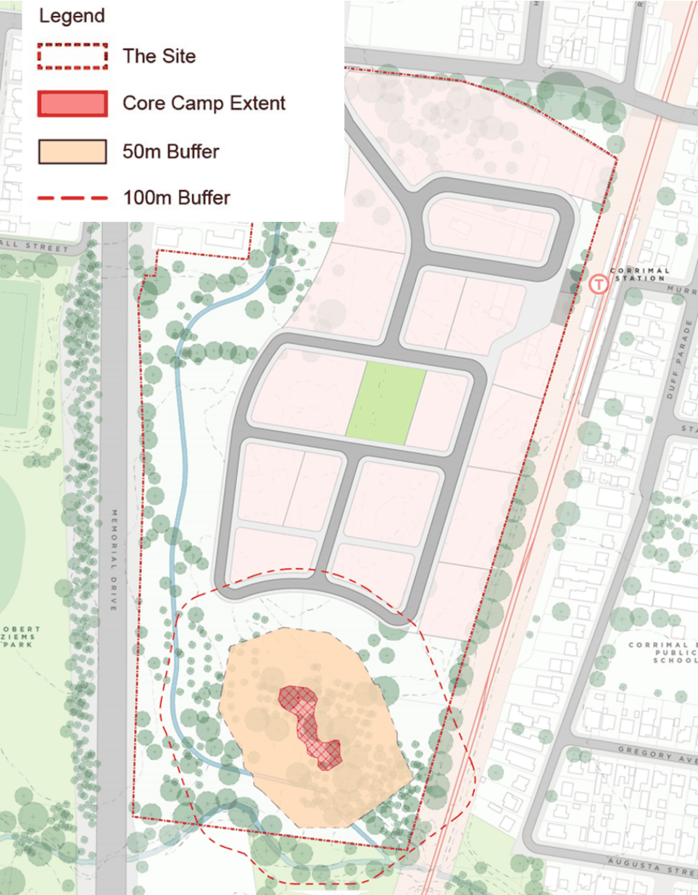

### 5.15 Grey-headed Flying-fox Camp

a. Protect the Grey-headed Flying-fox camp on Site through the conservation of Endangered Ecological Communities and native vegetation and maintenance of a buffer between the core mapped camp area and any future development.

b. Ensure future residential development is located and designed to mitigate against noise and other impacts associated with the Grey-headed Flying-fox camp on Site.

#### 5.15.2 Development Controls

1\. A minimum 100 metre buffer is to be maintained between the core mapped Grey-headed Flying-fox camp and any future development, as shown in Figure 17.

2\. Buildings in the vicinity of the Grey-headed Flying-fox camp are to be designed to reduce the level of potential disturbance, including orientation of buildings, material selection and noise attenuation.

3\. A final Camp Management Plan is to be submitted to Council for approval at the time the initial Development Application is submitted proposing earthworks associated with the realignment of the riparian corridor and/or at the time a Development Application is submitted that proposes earthworks within the 100m buffer area of the Grey-headed Flying-fox Camp. This is to ensure the protection of the Grey-headed Flying-fox camp and shall address ongoing management and protection outcomes, including (but not limited

to) - Vegetation outcomes and management within the buffer area. Community education. Provision of aquatic habitat within the riparian corridor. Any proposal for supplementary habitat to support expansion of the camp away from the residential development. Construction management measures to minimise potential disturbance to the Grey-headed Flying-fox camp.

4\. A Vegetation Management Plan is to be submitted to Council for approval at the time the initial Development Application is submitted proposing earthworks associated with the realignment of the riparian corridor, to achieve the ecological restoration of the entire length of the realigned corridor. Landscaping and vegetation species selection must be designed to prevent the expansion of the Grey-headed Flying-fox camp further north near future planned residential development.  The Illawarra Lowlands Grassy Woodland Endangered Ecological Community in the southern part of the Site and other native plant communities are to be conserved and enhanced.

5\. The realigned riparian corridor design is to incorporate a “belly dip” area in the south to enhance the protection of the Grey-headed Flying-fox camp.

#### Figure 17 – Grey-headed Flying-fox Camp

> [Picture on page 37: a picture, saved as a picture (images/chapter-d19-former-corrimal-coke-works-site-page-37-2.gif, 150 dpi).]
