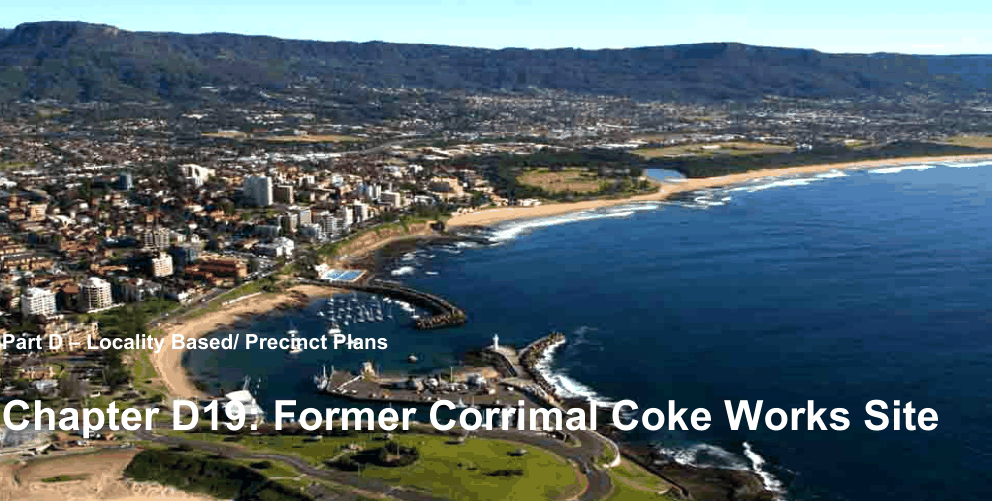

# Wollongong Development Control Plan 2009 - Chapter D19 Former Corrimal Coke Works Site

> This chapter is split into 22 section file(s), one per numbered heading, in the order they appear in the PDF.

Source PDF: [Wollongong-DCP-2009-Chapter-D19-Former-Corrimal-Coke-Works-Site.pdf](https://planfortomorrow.sharepoint.com/sites/Planfortomorrow/Shared%20Documents/00%20NSW-Planning-Resources/dcp/wollongong-development-control-plan-2009/chapter-d19-former-corrimal-coke-works-site/Wollongong-DCP-2009-Chapter-D19-Former-Corrimal-Coke-Works-Site.pdf)

Part D – Locality Based/ Precinct Plans

Set ID 22160408

> [Picture on page 1: a picture, saved as a picture (images/chapter-d19-former-corrimal-coke-works-site-page-1-3.gif, 150 dpi).]

#### Part D – Locality Based/ Precinct Plans

### Chapter D19: Former Corrimal Coke Works Site

> The PDF's contents list (page numbers of the printed document) is not repeated here - see Sections below.

<!-- sections -->
## Sections

1. [1 INTRODUCTION](01-introduction.md)
2. [2 AIMS AND OBJECTIVES](02-aims-and-objectives.md)
3. [3 DEFINITIONS](03-definitions.md)
4. [4 MASTER PLAN](04-master-plan.md)
5. [4.1 Existing Character](05-4-1-existing-character.md)
6. [4.2 Desired Future Character](06-4-2-desired-future-character.md)
7. [5 DEVELOPMENT CONTROLS](07-5-development-controls.md)
8. [5.1 Views and Vistas](08-5-1-views-and-vistas.md)
9. [5.2 Built Form Setbacks](09-5-2-built-form-setbacks.md)
10. [5.3 Architectural Diversity and Building Design](10-5-3-architectural-diversity-and-building.md)
11. [5.4 Residential Flat Buildings](11-5-4-residential-flat-buildings.md)
12. [5.5 Multi-dwelling and Attached Housing](12-5-5-multi-dwelling-and-attached-housing.md)
13. [5.6 Non-Residential Development](13-5-6-non-residential-development.md)
14. [5.7 Movement Network](14-5-7-movement-network.md)
15. [5.8 Car parking and vehicular access](15-5-8-car-parking-and-vehicular-access.md)
16. [5.9 Heritage](16-5-9-heritage.md)
17. [5.10 Public Domain](17-5-10-public-domain.md)
18. [5.11 Heritage Plaza](18-5-11-heritage-plaza.md)
19. [5.12 Village Park](19-5-12-village-park.md)
20. [5.13 Southern Recreation Park](20-5-13-southern-recreation-park.md)
21. [5.14 Riparian Corridor](21-5-14-riparian-corridor.md)
22. [5.15 Grey-headed Flying-fox Camp](22-5-15-grey-headed-flying-fox-camp.md)
