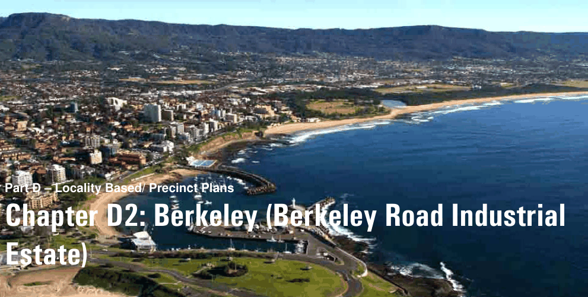

# Wollongong Development Control Plan 2009 - Chapter D2 Berkeley (Berkeley Road Industrial Estate)

> This chapter is split into 11 section file(s), one per numbered heading, in the order they appear in the PDF.

Source PDF: [Wollongong-DCP-2009-Chapter-D02-Berkeley-Berkeley-Road-Industrial-Estate.pdf](https://planfortomorrow.sharepoint.com/sites/Planfortomorrow/Shared%20Documents/00%20NSW-Planning-Resources/dcp/wollongong-development-control-plan-2009/chapter-d2-berkeley-berkeley-road-industrial-estate/Wollongong-DCP-2009-Chapter-D02-Berkeley-Berkeley-Road-Industrial-Estate.pdf)

> [Picture on page 1: a picture, saved as a picture (images/chapter-d2-berkeley-berkeley-road-industrial-estate-page-1-1.gif, 150 dpi).]

#### Part D – Locality Based/ Precinct Plans

### Chapter D2: Berkeley (Berkeley Road Industrial Estate)

### Contents

<!-- sections -->
## Sections

1. [10 NOISE IMPACT ASSESSMENT](01-10-noise-impact-assessment.md)
2. [1 INTRODUCTION](02-1-introduction.md)
3. [2 LAND TO WHICH THIS PLAN APPLIES](03-2-land-to-which-this-plan-applies.md)
4. [3 AIMS AND OBJECTIVES](04-3-aims-and-objectives.md)
5. [4 SCENIC ENVIRONMENTAL QUALITY AND BUILT FORM](05-4-scenic-environmental-quality-and-built.md)
6. [5 LANDSCAPING](06-5-landscaping.md)
7. [6 ACCESS DENIAL TO BERKELEY ROAD](07-6-access-denial-to-berkeley-road.md)
8. [7 RIPARIAN CORRIDOR WIDTHS](08-7-riparian-corridor-widths.md)
9. [8 STORMWATER MANAGEMENT / FLOODPLAIN](09-8-stormwater-management-floodplain.md)
10. [9 SITE CONSTRAINTS – ELECTRICITY TRANSMISSION LINES](10-9-site-constraints-electricity.md)
11. [10 NOISE IMPACT ASSESSMENT](11-10-noise-impact-assessment.md)
