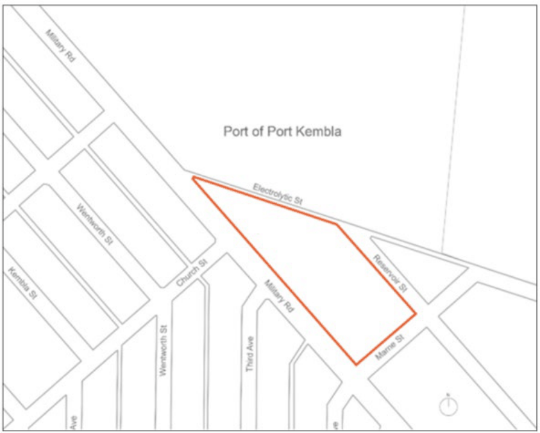

## 1 INTRODUCTION

This Locality Chapter applies to land identified as the former Port Kembla School Site, located

off Military Rd, Port Kembla (Lot 1 DP 811699), as shown in Figure 1 below. This Locality Chapter is intended to supplement the land use planning controls applied by

Part B of the Wollongong Development Control Plan 2009 (WDCP) to guide development of

the former Port Kembla school Site. This Chapter recognises the unique opportunity the

former school site offers to provide a variety of housing types in a high amenity, open space

setting, in close proximity to the Port Kembla Town Centre. This Chapter should also be read in conjunction with Part A, B, C, D and E of WDCP, the

Wollongong Local Environmental Plan 2009 (WLEP) and relevant State Environmental

Planning Policies. In the event of any inconsistency between the provisions of this and any

other chapters of WDCP, the provisions of this Chapter shall prevail to the extent of that

inconsistency. In the event of any inconsistency between the provisions of this chapter of the

WDCP 2009 and State Environmental Planning Policy 65 – Design Quality of Residential

Apartment Development (SEPP 65) and the Apartment Design Guide (ADG), SEPP 65 and

the ADG will prevail to the extent of that inconsistency

> [Picture on page 2: a picture, saved as a picture (images/chapter-d20-former-port-kembla-school-site-page-2-17.gif, 150 dpi).]

#### Figure 1- Land to which this plan applies
