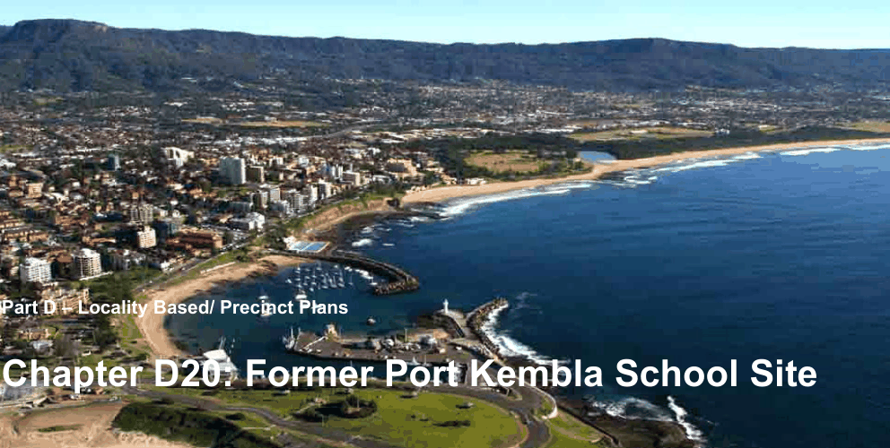

# Wollongong Development Control Plan 2009 - Chapter D20 Former Port Kembla School Site

> This chapter is split into 11 section file(s), one per numbered heading, in the order they appear in the PDF.

Source PDF: [Wollongong-DCP-2009-Chapter-D20-Former-Port-Kembla-School-Site.pdf](https://planfortomorrow.sharepoint.com/sites/Planfortomorrow/Shared%20Documents/00%20NSW-Planning-Resources/dcp/wollongong-development-control-plan-2009/chapter-d20-former-port-kembla-school-site/Wollongong-DCP-2009-Chapter-D20-Former-Port-Kembla-School-Site.pdf)

Part D – Locality Based/ Precinct Plans

Set ID 22470333

> [Picture on page 1: a picture, saved as a picture (images/chapter-d20-former-port-kembla-school-site-page-1-3.gif, 150 dpi).]

#### Part D – Locality Based/ Precinct Plans

### Chapter D20: Former Port Kembla School Site

> The PDF's contents list (page numbers of the printed document) is not repeated here - see Sections below.

Wollongong City Wide Development Control Plan 2009 – Chapter D20 Former Port Kembla School Site

#### Page i

<!-- sections -->
## Sections

1. [1 INTRODUCTION](01-introduction.md)
2. [2 AIMS AND OBJECTIVES](02-aims-and-objectives.md)
3. [3 DEFINITIONS](03-definitions.md)
4. [4 DESIGN PRINCIPLES](04-design-principles.md)
5. [4.1 Desired Future Character](05-4-1-desired-future-character.md)
6. [5 DEVELOPMENT CONTROLS](06-5-development-controls.md)
7. [5.1 Views and Vistas](07-5-1-views-and-vistas.md)
8. [5.2 Built Form Setbacks](08-5-2-built-form-setbacks.md)
9. [5.3 Architectural Diversity and Building Design](09-5-3-architectural-diversity-and-building.md)
10. [5.4 Movement Network](10-5-4-movement-network.md)
11. [5.5 Accessible Private Open Space and Natural Environment Public Domain](11-5-5-accessible-private-open-space-and.md)
