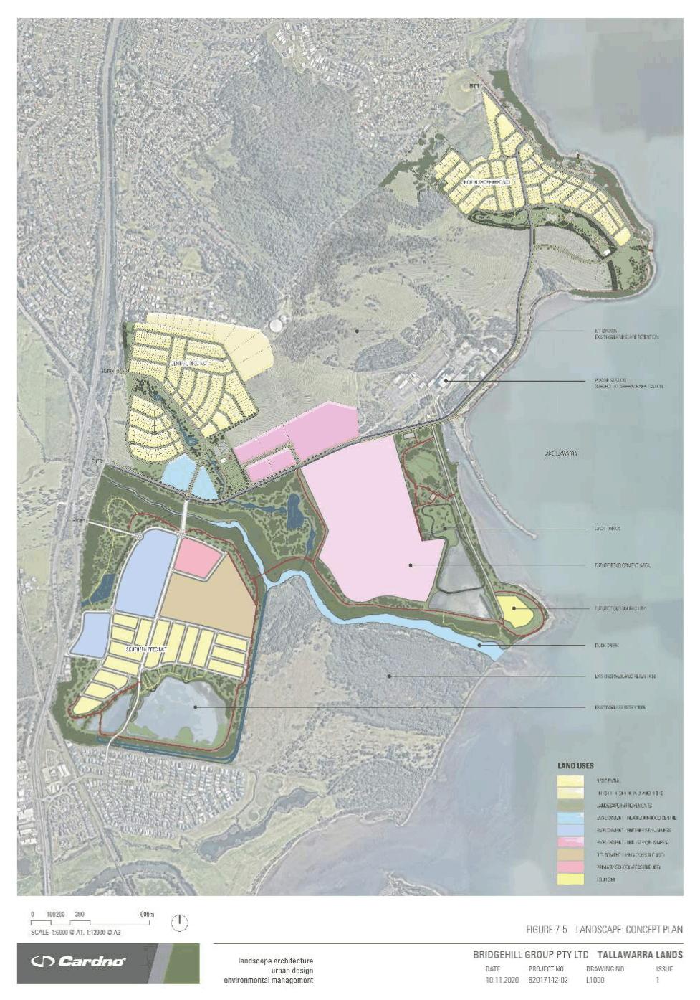
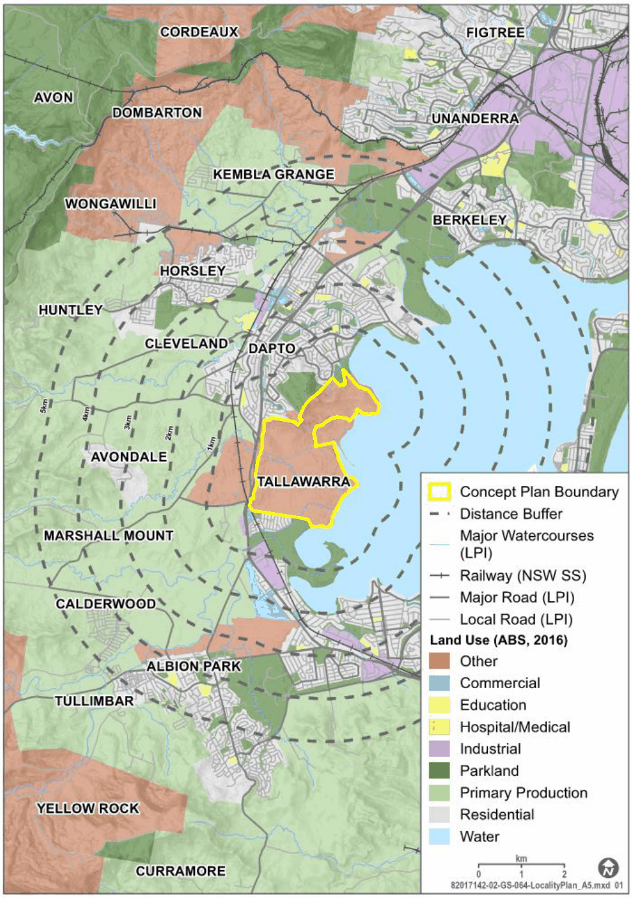
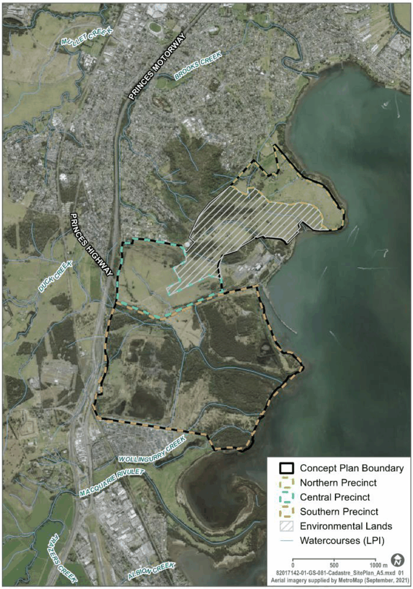

## 2 THE SITE

The Tallawarra Lands urban release area (URA) is a 535.9ha landholding located on the western foreshore of Lake Illawarra within the Wollongong LGA. The eastern edge of the site is defined by the western foreshore to the Lake and Tallawarra Power Station. The western edge of the site is the Princes Highway and Cormack Avenue. The northern border of the site is formed by Carlyle Close, Mount Brown Reserve, Wyndarra Way and the Council-owned recreation reserve known as Hector Harvey Park. The southern edge of the site adjoins Haywards Bay residential area, and the boundary is adjacent to Tallawarra Crescent and Haywards Bay Drive. Historically the site was predominately rural and has been used for power generation operations since the late 1950’s. Large portions of the site have undergone past disturbance particularly in the south and east where a number of former ash settling ponds used by the original coal-fired Tallawarra Power Station now remain. The construction of the current power station and its operational infrastructure has further contributed to the disturbance of the site. Extensive vegetation clearance has occurred across the remainder of the site for grazing purposes, resulting in large areas of exotic grassland. The majority of intact vegetation occurs in the south eastern corner of the site with smaller areas in the north, adjoining a large stand of vegetation in Mount Brown Reserve, as well as along the south western boundary. The subject site has a varying topography, ranging from near level ground to steep slopes. The northern boundary of the site is characterised by a steep hill side (Mount Brown) sloping downwards towards the east, south and southeast. The ground surface near Yallah Bay Road is generally near level ((<1° grade) and forms part of an alluvial flood plain and wetlands with exception of the areas near the western boundary. The area near the western site boundary (south of Yallah Bay Road) is locally elevated rising towards the Princes Highway to the west and sloping down towards the east.

#### Tallawarra Power Station

The Tallawarra Power Station is approximately 32.5ha in size. Before the current gas-fired power station commenced operations in January 2009, the site was a 320MW coal-fired power station which operated between 1954 and 1989. The former plant and many ancillary buildings have been demolished and the operational areas of the site remediated. The power station will continue to be owned and operated by EA, and is excluded from the concept plan and proposed DCP, apart from identifying site boundaries and occupancy, access and acoustic impact.

#### Northern Precinct

The Northern Precinct is located to the south of the established suburbs of Kanahooka and Koonawarra, and north of the Tallawarra Power Station. The precinct is 110ha in size and positioned on the eastern slopes of Mount Brown fronting Lake Illawarra. The majority of the Northern Precinct consists of rural fenced paddocks, which were previously used for agricultural purposes. A rural homestead and compound are located in the northern most part of the site and includes dams, fences, small fenced paddocks and animal shelters. A HV power line, with associated towers, runs through the central portion of the precinct in a north-south orientation. Residential lots within this precinct will be positioned in the middle section of the site, with foreshore land set aside for public open space and the conservation of existing vegetation. This precinct will be connected to Kanahooka through the extension of the existing Gilba Road, which connects through to Fowlers Road and to the Princes Highway.

#### Central Precinct

The Central Precinct is located adjacent to existing residential area, is 210ha in size and is positioned on the southern slopes of Mount Brown, providing an outlook to the south with views towards Albion Park and Shellharbour. The precinct extends from the Princes Highway in the west through to the power station in the

east. The topography of the Central Precinct is variable with the northern portion dominated by a moderate

to steep slope with a southern aspect that grades into a generally flat ground surface in the vicinity of Yallah Bay Road. Yallah Bay Road provides connection from the Princes Highway through to the Tallawarra Power Station and the proposed foreshore tourism site. Yallah Bay Road connects to the Princes Highway which provides connection to Dapto in the north and Albion Park Rail in the south. The precinct will accommodate standard residential lots, with larger lots located on the hillslope adjacent to Carlyle Close. Employment lands will be included on the northern side of Yallah Bay Road, between the proposed residential area and the power station. The precinct will also accommodate a neighbourhood centre within the residential zoned land, and a 2.5ha tourism site to be located on the foreshore headland near the eastern portion of the precinct.

#### Southern Precinct

The Southern Precinct is bounded by the Princes Highway, residential development in Haywards Bay, Duck Creek and existing wetlands adjacent to Lake Illawarra. The majority of this precinct is located within an existing bunded area that was formerly used as an ash dam for the previous coal fired power station. The site also comprises cleared grazing land, dense vegetated areas of both natural and introduced species, a road base stockpile and an asbestos landfill. The precinct is proposed to accommodate residential land, including opportunities for seniors living and a primary school. The precinct will also contain a significant area of employment zoned land. The site is proposed to be accessed from the north from Yallah Bay Road and south via the existing suburb of Haywards Bay. The Southern Precinct will remain in the ownership of EA for the foreseeable future and there are no plans for immediate development of this land.

#### Mount Brown

Mount Brown Reserve is located in the eastern portion of the Central Precinct and offers substantive views over the site and Lake Illawarra. Mount Brown will form a key element of the environmental lands between the Northern and Central Precincts and a buffer to the north of the EA land. The DCP controls apply to all land within the Tallawarra Lands concept plan boundary as shown in Figure 1.

Figure 1: Concept Plan

> [Picture on page 9: a picture, saved as a picture (images/chapter-d21-tallawarra-lands-page-9-2.gif, 150 dpi).]

#### Figure 2 Locality Plan

> [Picture on page 10: a picture, saved as a picture (images/chapter-d21-tallawarra-lands-page-10-2.gif, 150 dpi).]

#### Figure 3 Site Plan

> [Picture on page 11: a picture, saved as a picture (images/chapter-d21-tallawarra-lands-page-11-2.gif, 150 dpi).]
