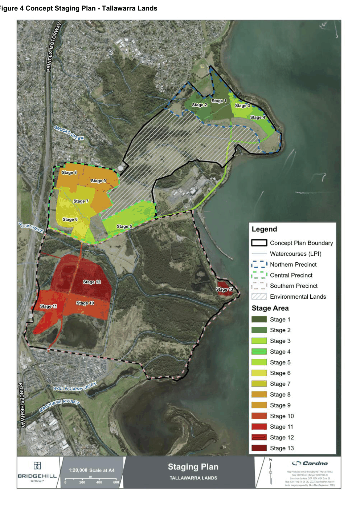

## 4 STRUCTURE PLAN AND STAGING

The Tallawarra Concept Plan detailed in Figure 1 (Concept Plan approved with MP 09_0131 Mod 1) shows the layout of future land uses and activities that will guide development applications and works. The Concept Plan includes: The Northern Precinct with residential land, open space areas and an environmental corridor linking the lake foreshore with elevated areas of Mount Brown. The Central Precinct with residential land ranging from medium density areas to large lots, a mixed use commercial centre and community centre, an active open space area and employment lands. The Southern Precinct accommodates provision for employment and commercial lands, a tourist facility site on the lake foreshore, regional scale recreational space and residential land for medium and low density living. Environmental Lands establishing a buffer to the Tallawarra Power Station to be managed for environmental enhancement ancillary to the operation of the power station. Part of the land adjacent the Princes Motorway will be dedicated to TfNSW for future road infrastructure, construction and maintenance.

Concept stages will generally be in accordance with Figure 4. The following key objectives which govern a legible and achievable development outcome include: Connecting with existing public road network and utilities infrastructure starting with connections to Gilba Road. Matching the adopted Sydney Water Servicing Strategy. Coordinating with the works for undergrounding the HV transmission line through the Northern Precinct. Works patterns matching sub-catchments to best manage installation and effective operation of WSUD infrastructure and achieving water quality targets. Providing flood free access routes for new residential precincts as they are developed. Balancing the urban development footprint with embellishment and potential dedication of land for public open space and revegetation. Land use intensity, traffic generation demand and connectivity with the surrounding road network will be matched to the timing for delivery of the east-west and north-south collector roads. Ensuring future development potential of adjoining lands is not prejudiced or constrained.

Development will commence in the Northern Precinct in accordance with the Concept Staging Plan (Figure 4). This will be undertaken in two (2) phases in accordance with the following position: match the adopted Sydney Water Servicing Strategy extend connections to the existing public road and utilities from Gilba Road, coordinate with the site works for undergrounding the HV transmission line (the subject of a separate approval) in the Northern Precinct; and establish a balance of land development with embellishment and potential dedication of land for public open space.

Development will then progress the Central Precinct, focussing initially on advancement of the employment lands, which will help to activate the surrounding residential precincts of the Central Precinct. Subsequent

stages of the residential precincts will yield mixed residential development, neighbourhood centre and seniors living opportunities, utilising road and infrastructure connections. Staging will be an evolving process as development progresses and infrastructure and urban footprints are refined with future development applications. Future development applications will demonstrate the ways in which each proposal stage is compatible with adjoining land and generally consistent with the Major Project Concept Approval. The Tallawarra Lands chapter of Wollongong DCP 2009 is intended to incorporate flexibility to align with the progress of future development stages.

> [Picture on page 15: a picture, saved as a picture (images/chapter-d21-tallawarra-lands-page-15-1.gif, 150 dpi).]

Figure 4 Concept Staging Plan - Tallawarra Lands
