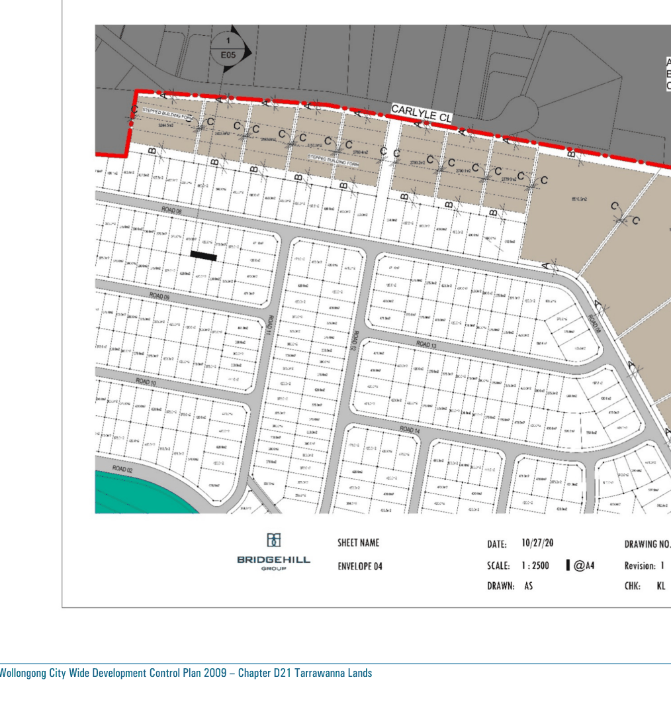
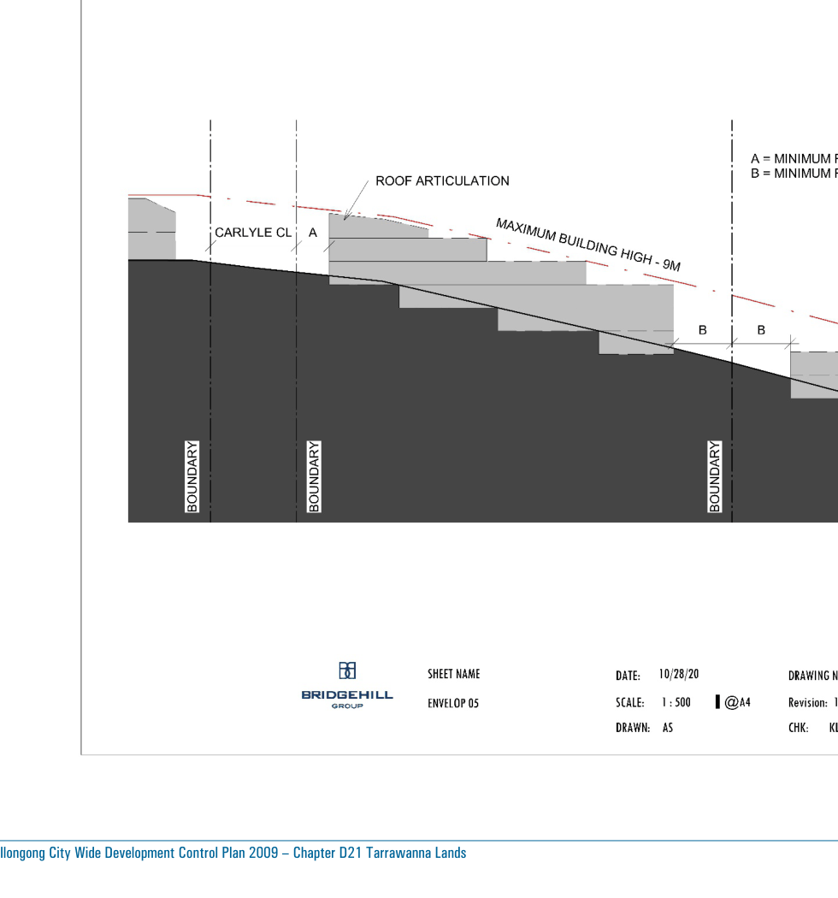

## 6 DEVELOPMENT CONTROLS

### 6.1 Residential Development

#### 6.1.1 Dwellings on visually prominent land – Central Precinct – lots fronting

#### Carlyle Close

#### Objectives

The objectives for housing on visually prominent land in the Central Precinct with frontage to Carlyle Close are to:

(a) Protect and improve the appreciation of the existing scenic and environmental quality of Mount Brown by creating building envelopes that share and maintain views and vistas.

(b) Facilitate low density and quality of design of residential development to complement the surrounding setting and topography.

(c) Create a form and external appearance of residential development which will be responsive to the natural slope.

(d) Maintain a building form and profile which will enhance the visual prominence of the ridgeline to Mount Brown.

(e) Integrate structures into the site that are responsive to the natural landform and topography.

(f) To ensure landscape design responds to the existing site conditions including changes in levels and views and proximity to adjoining environmental lands.

(g) To enhance the appearance of housing through integrated landscape design.

#### Controls

(a) Building envelopes and minimum setback requirements are to be in accordance with Figure 5.

(b) Partial excavation, finished floor levels, roof articulation and building height are to be set out to fit within the building setback controls in Figure 6.

(c) A minimum of half of the minimum rear setback must be provided as densely planted deep soil zone using endemic species on lots directly adjoining environmental lands. The deep soil zone is to be located along the length of the rear boundary to provide a corridor of vegetation and must be in addition to private open space requirements.

(d) Where private or communal open space is located on the rooftop provide 1.5 metre wide landscaped beds or screening devices, setback 1.5 metre from the edge of the building façade, to avoid overlooking into neighbouring properties.

> [Picture on page 24: a picture, saved as a picture (images/chapter-d21-tallawarra-lands-page-24-1.gif, 150 dpi).]

#### Figure 5 Plan view of building envelope controls - Central Precinct

Page 24

> [Picture on page 25: a picture, saved as a picture (images/chapter-d21-tallawarra-lands-page-25-1.gif, 150 dpi).]

Figure 6 Section view of Building Height, excavation and floor level stepping and roof articulation controls

Page 25
