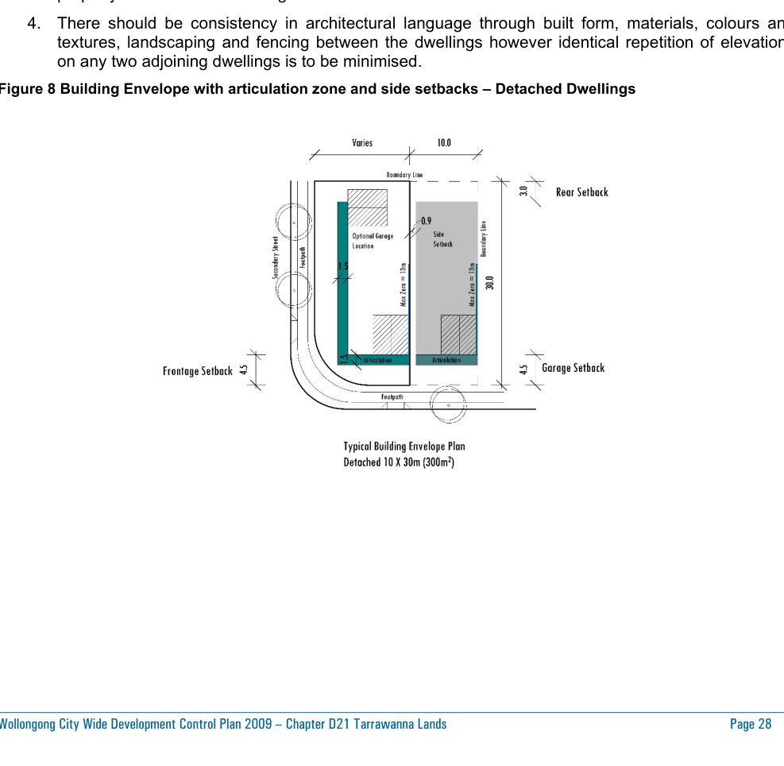
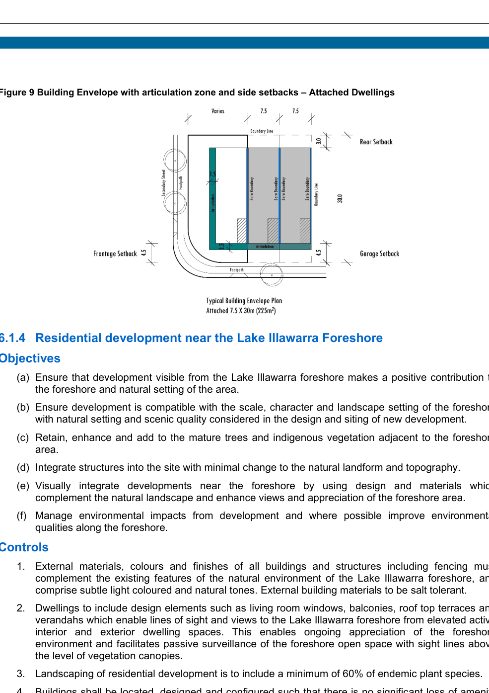

#### 6.1.3 Small lot Building Envelopes (lots up to 300m2) Objectives

(a) Optimise opportunities for canopy tree planting in the streetscape.

(b) Development that achieves articulation and interest in front facades proportional to the lot dimensions.

(c) Zero lot lines are encouraged for integrated development (where dwellings on adjoining lots are subject to the same DA).

#### Controls

1\. Front setbacks to be a minimum 4.5m with an articulation zone of 1m depth as shown in Figure 8 and Figure 9. A maximum of 50% of the width of the front façade should be articulated within the articulation zone with a variety of design elements such as balconies and verandahs, windows, blade walls and adequate landscape treatment provided. This does not apply to onsite carparking arrangements (garage or carport), which requires a minimum setback of 5.5m.

2\. The width of any garage shall not exceed 50% of the width of the dwelling at the front building alignment and shall be recessed at least 1m behind the street alignment of the dwelling. The garage setback shall be a minimum of 5.5m from the lot boundary.

3\. Zero lot lines shall be adopted for integrated dwelling designs on lots 10m wide or less as shown in Figure 9. Zero boundaries shall be utilised to maximise private open space utility and amenity and solar orientation and avoid inefficient narrow side setbacks. Where a zero lot line is created for attached housing adjacent to another lot, a maintenance easement will be required on the affected property to be controlled through section 88B covenants.

> [Picture on page 28: a picture, saved as a picture (images/chapter-d21-tallawarra-lands-page-28-22.gif, 150 dpi).]

Figure 8 Building Envelope with articulation zone and side setbacks – Detached Dwellings

4\. There should be consistency in architectural language through built form, materials, colours and textures, landscaping and fencing between the dwellings however identical repetition of elevations on any two adjoining dwellings is to be minimised.

> [Picture on page 29: a picture, saved as a picture (images/chapter-d21-tallawarra-lands-page-29-1.gif, 150 dpi).]
> Words printed on the picture (title and legend, copied from the PDF):
> area.
> qualities along the foreshore.

Figure 9 Building Envelope with articulation zone and side setbacks – Attached Dwellings
