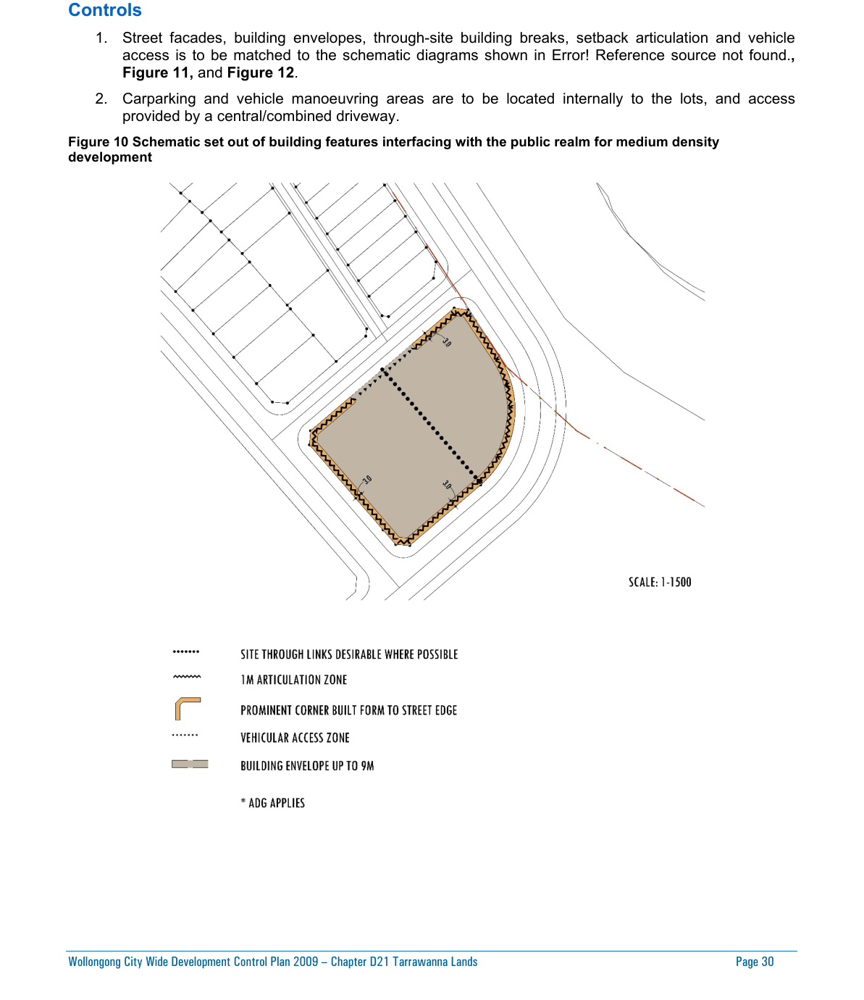
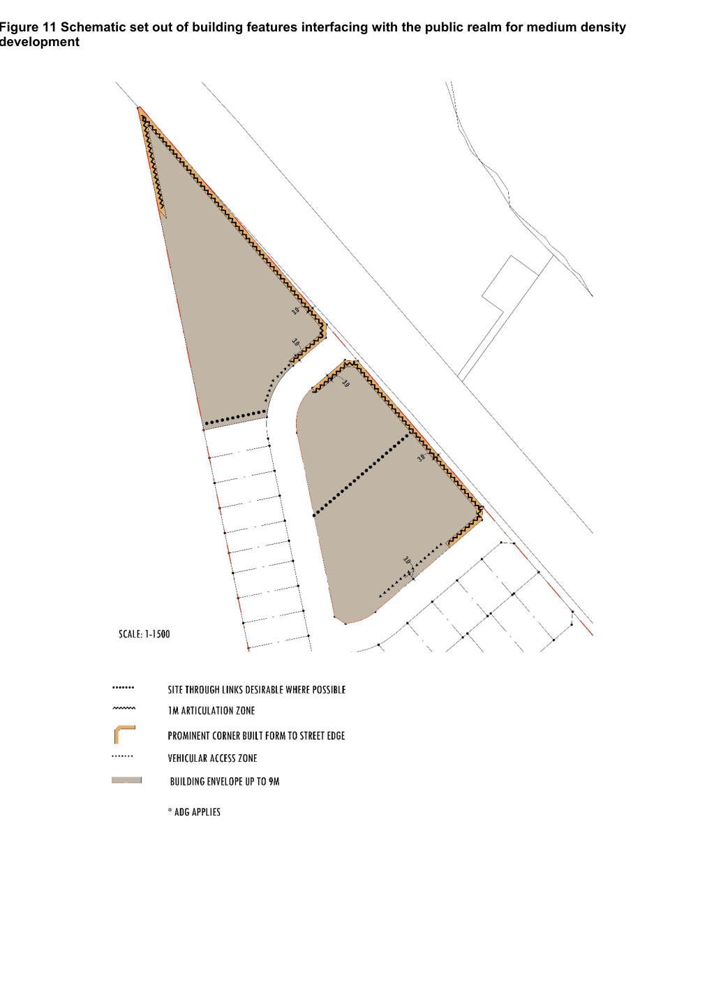
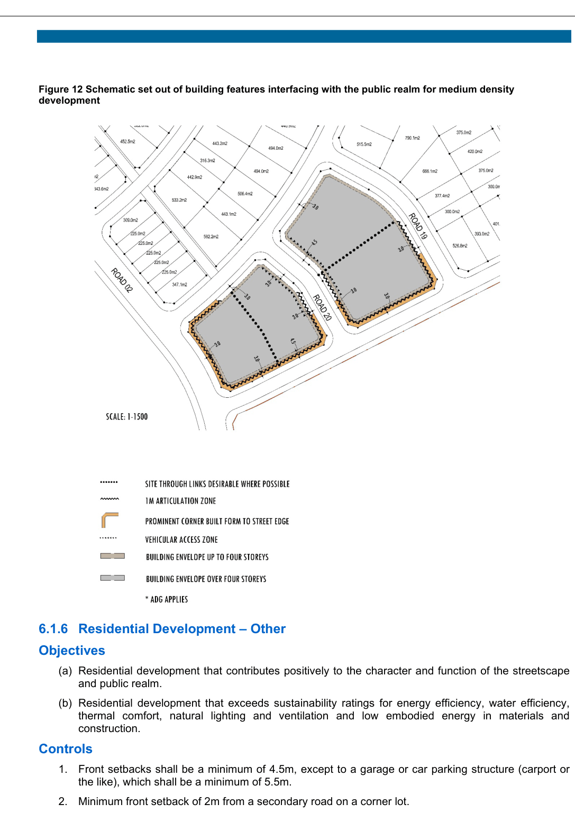

#### 6.1.5 Medium Density Housing setbacks and edge treatments to street frontages – Central Precinct Objectives

(a) Medium density residential development in the Central Precinct is to achieve a high quality of urban design and function so as to have positive impacts to the aesthetics and function of the adjoining public realm.

> [Picture on page 30: a picture, saved as a picture (images/chapter-d21-tallawarra-lands-page-30-7.gif, 150 dpi).]
> Words printed on the picture (title and legend, copied from the PDF):
> development

Figure 11, and Figure 12.

Figure 10 Schematic set out of building features interfacing with the public realm for medium density

#### Controls

1\. Street facades, building envelopes, through-site building breaks, setback articulation and vehicle access is to be matched to the schematic diagrams shown in Error! Reference source not found.,

2\. Carparking and vehicle manoeuvring areas are to be located internally to the lots, and access provided by a central/combined driveway.

> [Picture on page 31: a picture, saved as a picture (images/chapter-d21-tallawarra-lands-page-31-1.gif, 150 dpi).]
> Words printed on the picture (title and legend, copied from the PDF):
> development

Figure 11 Schematic set out of building features interfacing with the public realm for medium density

> [Picture on page 32: a picture, saved as a picture (images/chapter-d21-tallawarra-lands-page-32-1.gif, 150 dpi).]
> Words printed on the picture (title and legend, copied from the PDF):
> development
> and public realm.

Figure 12 Schematic set out of building features interfacing with the public realm for medium density
