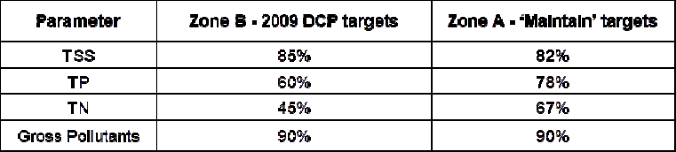

### 6.3 Water Management

#### Objectives

(a)  Increase public convenience and public safety as well as protection of property.

(b) Promote sustainable water resource management.

(c) Adopt a total catchment management approach to water quality and protection of water systems.

(d) Protect ecological habitats from water pollution.

(e)  Integrate water management into the landscape.

(f) Improve the water quality of Lake Illawarra and tributaries through the adoption of water sensitive urban design principles and the application of stormwater quality improvement devices along and on discharge points.

(g) Sustainably integrate natural systems with urban development.

(h) Minimise the volume of stormwater runoff.

(i) Improve the potential for urban run-off reuse.

(j) Minimise impervious areas where practicable.

(k) Protect watercourses from increased erosion and sedimentation.

(l) Preserve, restore and enhance riparian corridors as natural systems.

(m) Minimise the drainage infrastructure cost of development.

#### Controls

1\. Stormwater quality performance targets for the development as determined using the software MUSIC in the detailed design phase will be as follows:

> [Picture on page 34: a picture, saved as a picture (images/chapter-d21-tallawarra-lands-page-34-18.gif, 150 dpi).]

(note: this control is consistent with Wollongong DCP Chapter E15: Water Sensitive Urban Design which states that Developments in the Lake Illawarra catchment may have targets adjusted by Council.)

2\. Stormwater quality improvement devices will not be constructed on lands owned or managed by Crown Lands.

3\. There is to be no net increase in fill within the floodplain.

4\. Compensatory excavation may be used to offset fill; however, the compensatory excavation must be taken from an adjacent area of similar flood function that is lower in the floodplain (i.e. at a lower AEP inundation extent) than the proposed fill areas. Cut and fill drawings and volume calculations must be supplied to Council with a DA.

5\. Enhanced riparian corridors cannot be used to offset any floodplain storage in the flood modelling.

6\. Maintain consistency with other water quality objectives and controls contained in Chapter E15: Water Sensitive Urban Design of Wollongong Development Control Plan 2009, which have not been specifically covered by this Chapter.

7\. Water quality treatment system should be designed in accordance with Council’s requirements.

8\. Water management and monitoring undertaken before, during and after construction must demonstrate compliance with Australian and New Zealand Environment and Conservation Council guidelines for protection of aquatic ecosystems and be undertaken in accordance with Landcom guidelines – Managing Urban Stormwater: Soils and Construction.
