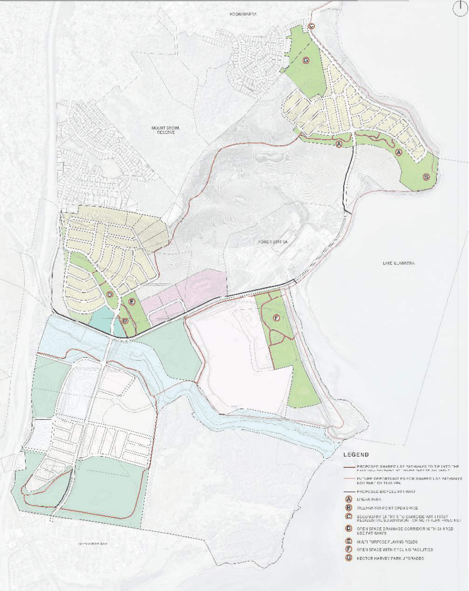

### 6.6 Open Space and Recreation

#### Objectives

(a) To ensure that open spaces including land for public open space, drainage and environmental conservation are appropriately provided within the site.

(b) To provide retention of the bushland areas of Mount Brown.

(c) To provide for the mixed use of land for open space, conservation and critical drainage function.

(d) Ensure the provision of additional structured (active) and casual (passive) open space within the Tallawarra locality to meet future demand. Build upon the existing network of open spaces in the nearby locality of Koonawarra and enhance opportunities for future improvements to the management of natural and public assets of the Lake Illawarra foreshore.

(e) Ensure a diverse range of open space to support a variety of active and passive recreational activity improving community health and well-being and reflecting community need and innovative, sustainable design.

(f) Open spaces to provide visual relief from the urban environment and designed to provide identity and a sense of place for the community by incorporating important landscape features, scenic vistas, cultural or historic characteristics and canopy trees.

(g) The open space network and road network will be connected to provide a network of pedestrian, shared paths and cycleways to achieve good access and improve connectivity and site permeability.

(h) Ensure commitment to the design of high quality multi-functional open spaces that are welcoming, attractive, accessible and safe, incorporating the principles of universal design, social inclusion and sustainability.

(i) Provide opportunity for the developer to deliver alternate open space types, uses and facilities in lieu of standard open space requirements to best suit the conditions of the site and surrounds such as space along the lake foreshore and improvements to Hector Harvey Reserve and Mount Brown Reserve.

(j) Ensure green linkages through urban precincts to connect open spaces into the greater (external) network, improve amenity, encourage walking and cycling and improve biodiversity links.

(k) Integrate the principles of water sensitive urban design (WSUD) into street and open space design.

#### Controls

1\. Public open space areas shall be provided with multiple connections to and from the public realm.

2\. Public open space areas are to be designed and sited to have optimum frontages to public roads and clear lines of sight from public roads to the majority of the open space area for surveillance and quality streetscape.

#### Figure 13 Open Space and Green Linkages

> [Picture on page 37: a picture, saved as a picture (images/chapter-d21-tallawarra-lands-page-37-2.gif, 150 dpi).]
