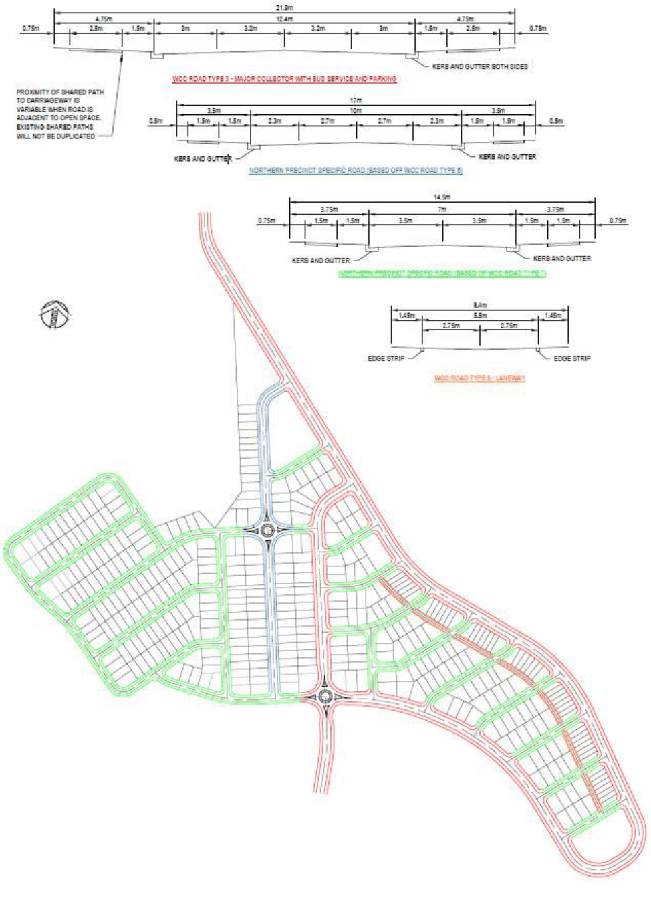
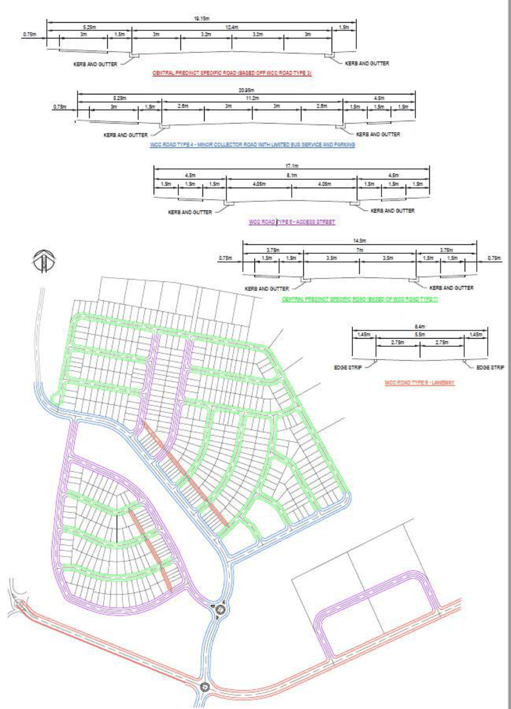
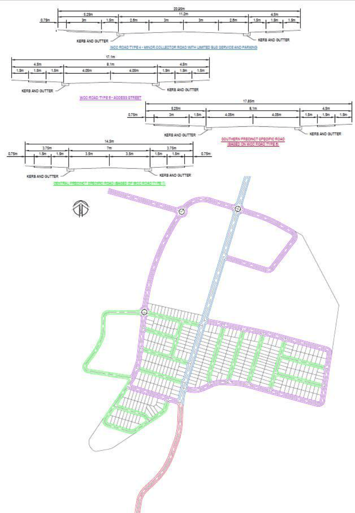
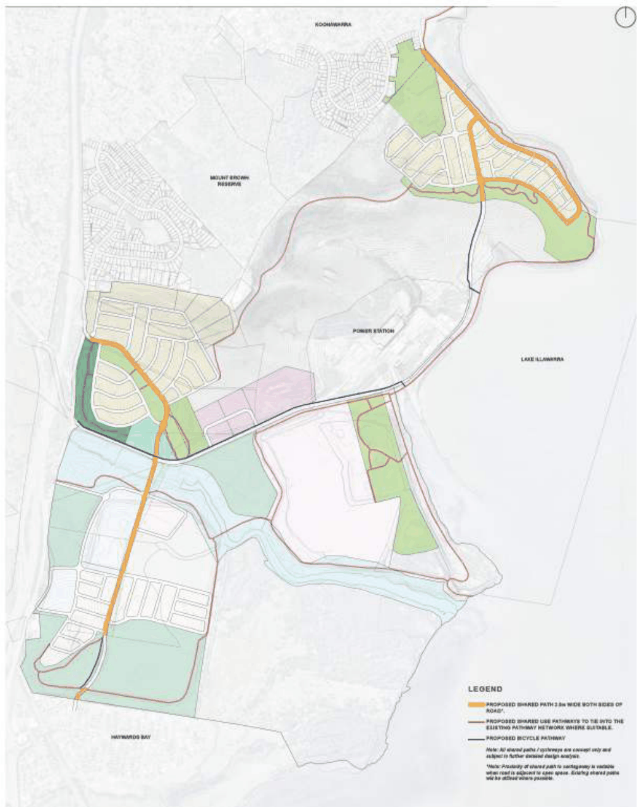

### 6.7 The Road and Pathway System

#### Objectives

(a) To provide a defined hierarchy of roads and streets, in order to provide an acceptable level of access, safety and convenience for all road users suited to the site conditions and network approved with the Concept Plan (Figure 1).

(b) To ensure that the design features of each residential road within a subdivision reflects the role, function and character of the road within the overall road network.

(c) To provide an acceptable level of access, safety and convenience for all road users whilst ensuring acceptable levels of amenity and minimising traffic management issues in the Tallawarra URA.

(d) To provide appropriate road access for larger and special purpose vehicles including garbage and recycling trucks, fire trucks, delivery trucks and vehicles for construction and ancillary to the employment and commercial uses within the URA.

(e) Ensure sufficient road carriageway and verge widths to enable all roads to perform their designated function within the road network within and connecting to Tallawarra URA.

(f) Ensure that the road reserves cater for all required functions including safe and efficient vehicular and pedestrian movement throughout the road network, provision of on-street parking and the provision of street tree planting and other landscaping and, in the case of some roads, achieving noise attenuation from Tallawarra Power Station and land to be dedicated to TfNSW.

(g) Ensure road verges are of sufficient width to physically accommodate all necessary infrastructure assets and utilities including, where necessary, noise attenuation measures and undergrounded high voltage electricity infrastructure.

(h) Provide road geometry that is consistent with the designated function of the specific road as well as the physical characteristics of the locality including bus routes and street tree planting.

(i) Ensure the road network is simple and safe for all road users, including motor vehicles, pedestrians and cyclists.

(j) Ensure that appropriate vehicle speed limits are communicated and clear through the road design and road environment to enhance the safety of pedestrians and cyclists, the young and people with a disability.

(k) Swept paths of the design and checking vehicles are to demonstrate acceptable manoeuvring on all roads as per Austroads requirements.

(l) Ensure road verges are of sufficient width to physically accommodate large canopy plantings and water sensitive urban design (WSUD).

#### Controls

1\. The design of any road as part of a subdivision in the Tallawarra URA shall be in accordance with the Wollongong DCP 2009 (Chapter B2 – Residential Subdivision) and the road design schedule detailed in Figure 14, Figure 15 and Figure 16 as follows relating to the Northern and Central Precincts.

2\. Provision for bus services will be accommodated in the following road types as shown in Figure 14, Figure 15 and Figure 16 as follows, and the following specific road types:

#### Northern Precinct:

WCC Road Type 3 – Major collector with bus service and parking; and WCC Road Type 6 – Access street.

#### Central Precinct:

Central Precinct Specific Road (Based off WCC Road Type 3); and WCC Road Type 4 – Minor collector road with limited bus service and parking.

3\. Any future subdivision application will need to demonstrate how compliance with TfNSW Guidelines for Public Transport Capable Infrastructure in Greenfield sites.

#### Figure 14 Road design schedule for Tallawarra URA – Northern Precinct

> [Picture on page 39: a picture, saved as a picture (images/chapter-d21-tallawarra-lands-page-39-2.gif, 150 dpi).]

#### Figure 15 Road design schedule for Tallawarra URA – Central Precinct.

> [Picture on page 40: a picture, saved as a picture (images/chapter-d21-tallawarra-lands-page-40-2.gif, 150 dpi).]

#### Figure 16 Road Design Schedule for Tallawarra URA – Southern Precinct.

> [Picture on page 41: a picture, saved as a picture (images/chapter-d21-tallawarra-lands-page-41-2.gif, 150 dpi).]

#### Figure 17 Tallawarra Cycleways

> [Picture on page 42: a picture, saved as a picture (images/chapter-d21-tallawarra-lands-page-42-2.gif, 150 dpi).]
