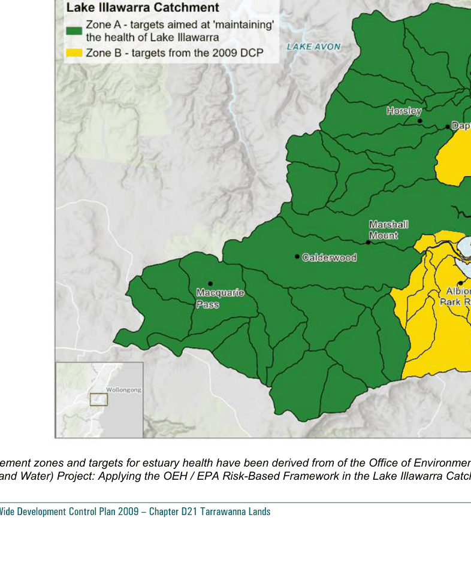

### Appendix 1 - Lake Illawarra Catchment

Note:  Management zones and targets for estuary health have been derived from of the Office of Environment and Heritage (now Department of Climate Change, Energy, the Wollongong City Wide Development Control Plan 2009 – Chapter D21 Tarrawanna Lands

Page 47

Environment and Water) Project: Applying the OEH / EPA Risk-Based Framework in the Lake Illawarra Catchment (Dela-Cruz et al, 2017).

> [Picture on page 47: a picture, saved as a picture (images/chapter-d21-tallawarra-lands-page-47-5.gif, 150 dpi).]
