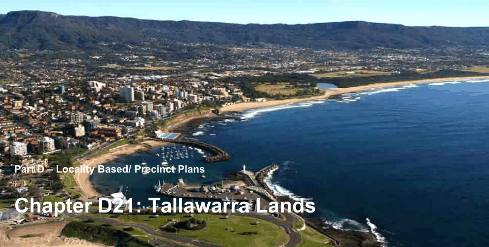

# Wollongong Development Control Plan 2009 - Chapter D21 Tallawarra Lands

> This chapter is split into 26 section file(s), one per numbered heading, in the order they appear in the PDF.

Source PDF: [Wollongong-DCP-2009-Chapter-D21-Tallawarra-Lands.pdf](https://planfortomorrow.sharepoint.com/sites/Planfortomorrow/Shared%20Documents/00%20NSW-Planning-Resources/dcp/wollongong-development-control-plan-2009/chapter-d21-tallawarra-lands/Wollongong-DCP-2009-Chapter-D21-Tallawarra-Lands.pdf)

Part D – Locality Based/ Precinct Plans

Set ID 24631382

> [Picture on page 1: a picture, saved as a picture (images/chapter-d21-tallawarra-lands-page-1-3.gif, 150 dpi).]

#### Part D – Locality Based/ Precinct Plans

### Chapter D21: Tallawarra Lands

> The PDF's contents list (page numbers of the printed document) is not repeated here - see Sections below.

Wollongong City Wide Development Control Plan 2009 – Chapter D21 – Tallawarra Lands

Page i

#### TABLE OF FIGURES

Figure 1: Concept Plan ..................................................................................................................................................................................9 Figure 2 Locality Plan ................................................................................................................................................................................. 10 Figure 3 Site Plan ....................................................................................................................................................................................... 11 Figure 4 Concept Staging Plan - Tallawarra Lands ..................................................................................................................................... 15 Figure 5 Plan view of building envelope controls - Central Precinct ............................................................................................................ 24 Figure 6 Section view of Building Height, excavation and floor level stepping and roof articulation controls ............................................. 25 Figure 7Noise contour impacts on the future Northern Precinct associated with Tallawarra Power Station ............................................. 27 Figure 8 Building Envelope with articulation zone and side setbacks – Detached Dwellings ....................................................................... 28 Figure 9 Building Envelope with articulation zone and side setbacks – Attached Dwellings ....................................................................... 29 Figure 10 Schematic set out of building features interfacing with the public realm for medium density development................................ 30 Figure 11 Schematic set out of building features interfacing with the public realm for medium density development................................ 31 Figure 12 Schematic set out of building features interfacing with the public realm for medium density development................................ 32 Figure 13 - Open Space and Green Linkages ............................................................................................................................................... 37 Figure 14 Road design schedule for Tallawarra URA – Northern Precinct .................................................................................................. 39 Figure 15 - Road design schedule for Tallawarra URA – Central Precinct. ................................................................................................. 40 Figure 16 - Road Design Schedule for Tallawarra URA – Southern Precinct. ............................................................................................. 41 Figure 17 Tallawarra Cycleways ................................................................................................................................................................ 42

| Document Control |  |  |
|---|---|---|
| Document ID24631382 | Wollongong DCP 2009 – D21 – Tallawarra Lands |  |
| Adoption Date | In Force Date | Revision Details |
| 6 May 2024 | 27 May 2024 |  |

<!-- sections -->
## Sections

1. [1.1 Overview](01-1-1-overview.md)
2. [A5 Development Guideline](02-a5-development-guideline.md)
3. [1.2 The Vision for Tallawarra](03-1-2-the-vision-for-tallawarra.md)
4. [1.3 Relationship to Wollongong Development Control Plan 2009](04-1-3-relationship-to-wollongong-development.md)
5. [1 Road widths](05-1-road-widths.md)
6. [2 Residential Building Controls](06-2-residential-building-controls.md)
7. [2 THE SITE](07-2-the-site.md)
8. [3 AIMS AND OBJECTIVES](08-3-aims-and-objectives.md)
9. [4 STRUCTURE PLAN AND STAGING](09-4-structure-plan-and-staging.md)
10. [5 DEVELOPMENT PRINCIPLES](10-5-development-principles.md)
11. [6.1.1 Dwellings on visually prominent land – Central Precinct – lots fronting](11-6-1-1-dwellings-on-visually-prominent-land.md)
12. [6.1.2 Building Design controls for dwellings adjacent to the Noise Contour control](12-6-1-2-building-design-controls-for-dwellings.md)
13. [6.1.3 Small lot Building Envelopes (lots up to 300m2) Objectives](13-6-1-3-small-lot-building-envelopes-lots-up-to.md)
14. [6.1.4 Residential development near the Lake Illawarra Foreshore Objectives](14-6-1-4-residential-development-near-the-lake.md)
15. [6.1.5 Medium Density Housing setbacks and edge treatments to street frontages – Central Precinct Objectives](15-6-1-5-medium-density-housing-setbacks-and-edge.md)
16. [6.1.6 Residential Development – Other Objectives](16-6-1-6-residential-development-other-objectives.md)
17. [6.2 Indigenous and European Heritage](17-6-2-indigenous-and-european-heritage.md)
18. [6.3 Water Management](18-6-3-water-management.md)
19. [6.4 Flood Management](19-6-4-flood-management.md)
20. [6.5 Riparian Corridors](20-6-5-riparian-corridors.md)
21. [6.6 Open Space and Recreation](21-6-6-open-space-and-recreation.md)
22. [6.7 The Road and Pathway System](22-6-7-the-road-and-pathway-system.md)
23. [6.8 Commercial Development](23-6-8-commercial-development.md)
24. [6.9 Employment Lands](24-6-9-employment-lands.md)
25. [6.10 Sustainable Urban Design](25-6-10-sustainable-urban-design.md)
26. [Appendix 1 - Lake Illawarra Catchment](26-appendix-1-lake-illawarra-catchment.md)
