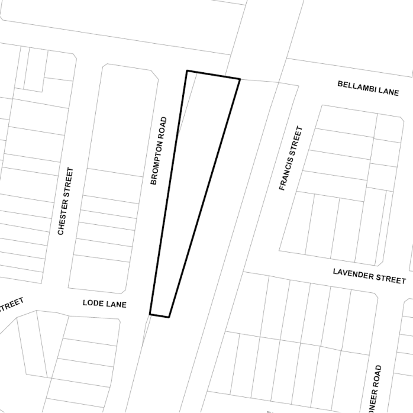

## 2 LAND TO WHICH THIS PLAN APPLIES

1\. The Brompton Road Precinct Plan applies to land known as Lot A and Lot 1 DP 881773, which is situated on the south-eastern corner of Bellambi Lane and Brompton Road, Bellambi, as shown in Figure 1. The subject site represents the land between the station and Brompton Road (ie to the immediate west of the Bellambi railway station). It includes the Bellambi Station Master’s Cottage, which is a heritage item. This precinct plan also includes the public domain areas in Brompton Road and Bellambi Lane, as part of an integrated approach to the redevelopment of this area.

2\. The subject site has been identified as excess railway land. The vacant portion of the site previously accommodated two railway cottages, but in recent years served as a yard and storage space to the station and was closely linked with the curtilage of the Station Master’s Cottage.

> [Picture on page 3: a picture, saved as a picture (images/chapter-d3-bellambi-brompton-road-page-3-20.gif, 150 dpi).]

#### Figure 1: Land to which this DCP applies
