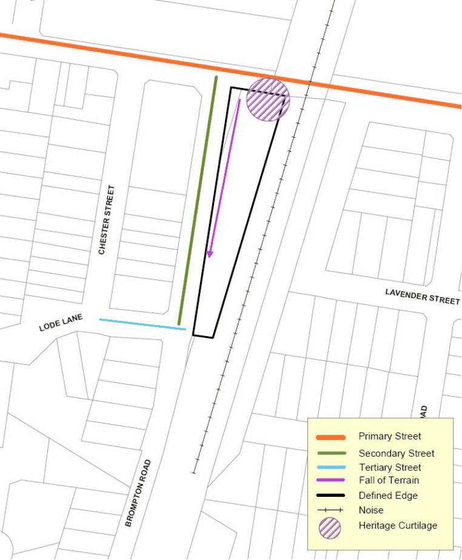

## 4 DEVELOPMENT CONTRAINTS

1\. Figure 2 indicates the primary physical constraints affecting the subject land

> [Picture on page 5: a picture, saved as a picture (images/chapter-d3-bellambi-brompton-road-page-5-1.gif, 150 dpi).]

#### Figure 2: Opportunities and Constraints
