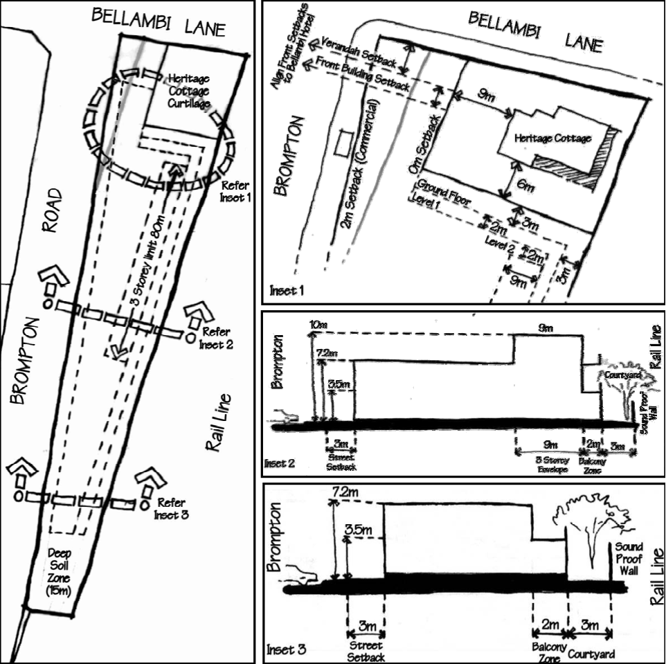
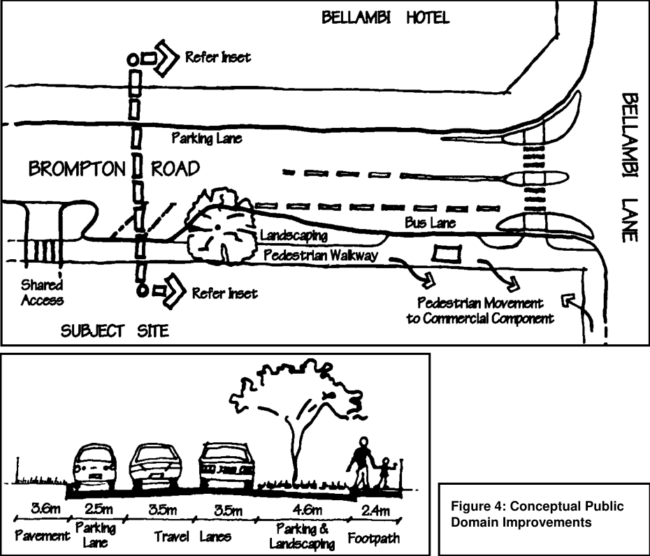

## 6 DEVELOPMENT CONTROLS

### 6.1 Building Envelope

1\. Building Envelope describes a three dimensional space within which the building may be designed on the subject site. This space will also be qualified by other controls such as open space and FSR. The following Figure 3 provides an indication of the building envelope controls. Figure 3 also defines the new heritage curtilage for the Station Master’s Cottage.  These boundaries are described as the cadastral site boundaries along Bellambi Lane and the railway line and new boundaries at 6m south and 9m west of the heritage building, parallel to the outer building walls of the cottage.

#### Setbacks

2\. Setback controls are as follows (please refer to Figure 3):

A minimum street setback of 3 m applies along Brompton Road.

Any new development onto Bellambi Lane must align with the building and balcony setbacks of the Bellambi Hotel.

A 0m setback is introduced for the eastern boundary of the site, facing directly onto the Station Master’s Cottage.  The eastern setback onto the rail reserve is set at 3m for Ground floor level and 5m for Levels 1 and 2.

Setbacks along the northern boundary, facing onto the Station Master’s cottage, vary at 3m for ground floor units, 5m for Level 1 and 7m for Level 3.  The incremental 2m setbacks for Levels 1 and 2 may be used for balconies, provided that such balconies do not encroach closer to this boundary than 3m for Level 1 and 5m for Level 2.

A 3 storey element (Level 2) will only be permitted along the eastern boundary of the site for a maximum building width of 9m extending north-south for a maximum distance of 80m (this retains a double storey appearance onto Brompton Road).

A 15m setback along the southern boundary allows for a Deep Soil Zone.

3\. A small retail/ commercial component may be introduced on this corner to commemorate the traditional use of this corner for commercial purposes.  This non-residential component will only be supported at ground level, provided that a residential use is introduced at first floor level, directly above.  The street setback from Brompton Road may therefore be relaxed to 2m for the commercial and above residential components to accommodate a continuous verandah at ground level and a similar “verandah style” continuous balcony for level 1. The character, massing and scale of this corner element must compliment the architectural style of the Bellambi Hotel.  The proposed verandah to the street alignment should also provide further articulation to the building at this corner.

#### Height Limit

4\. Generally a height limit of 2 storeys applies, but certain setback requirements apply, as per Figure 3.  A 3 storeys height limit applies to a portion of the site abutting the rail reserve and extending southwards for no more than 80m from the northernmost limit of this triple storey envelope.

5\. The traditional architectural character of the area suggests articulated roof forms and high roof pitches and buildings generally incorporate gables roofs and parapets.  These elements should be maintained in the final design of the buildings and such roof spaces may be used for additional floor space or storage areas, over and above the height limit stipulated in Figure 3.  However, the building should have a two-storey appearance onto Brompton Road.

> [Picture on page 8: a picture, saved as a picture (images/chapter-d3-bellambi-brompton-road-page-8-1.gif, 150 dpi).]

#### Figure 3: Setback requirements

### 6.2 Building Appearance and Address

a) The development should address the corner of Bellambi Lane and Brompton Road to compliment the Bellambi Hotel and provide a framing element for the heritage listed Station Master’s Cottage.  A small retail/ commercial component may be introduced on this corner at ground level to commemorate the traditional use of this corner for commercial purposes.  The second storey to this corner element must be used for residential purposes.  The character, massing and scale of this corner element must compliment the architectural style of the Bellambi Hotel.  A verandah to the street alignment should also provide further articulation to the building at the corner of Brompton Road and Bellambi Lane.

b) Residential units facing Brompton Road shall address this street and all building frontages and pedestrian entrances for these units shall be designed that they are readily apparent from the street.

c) Design of the building should orientate all habitable rooms onto the street, access courtyards or private open space on the site.

d) Design the development and select finishes and materials that relate to the style, character and finishing of the Bellambi Hotel.

e) Achieve a high level of finish to units facing Bellambi Lane, The Station Master’s Cottage and Brompton Road.

f) Articulate building facades through the use of architectural elements to manipulate proportions to create depth, add visual interest and enable differentiation of buildings as viewed from the streets.

### 6.3 Landscaping and Open Space

a) Driveways and communal pedestrian paths shall be separated from residential buildings by at least 1m wide landscaped beds.

b) Limit the use of impervious surfaces to the minimum required for vehicular movements, footpaths and garbage bin areas.

c) Provide suitable lighting to pedestrian ways, dwelling entries, driveways and car parks to ensure the appropriate level of safety and security for residents and visitors at night.  Lights are to be shaded to minimise light entering adjacent dwellings and should be designed to reduce energy consumption.

d) Select plant species that are likely to survive the specific environmental conditions, orientation and microclimate.

e) A Deep Soil Zone, measuring at least 15m along the southern boundary of the site, shall be densely planted with trees and shrubs.  This area may be combined with a stormwater retention facility to retain stormwater run-off and improve stormwater quality, provided that this facility does not cover more than 50% of the Deep Soil Zone.

f) Provide private open space to all dwellings in the form of a balcony, for units above ground floor, or a courtyard for units at ground level.  These private open spaces must act as a direct extension of the living areas that they serve.

g) Courtyards shall have a minimum dimension of 3m x 5m.

h) Screen private open space where appropriate to ensure privacy.

i) Communal open space is to be provided on the basis of 5m2 per residential unit and shall have a minimum dimension of 5m.  This is to be provided in addition to private open space and shall not include shared space for vehicle manoeuvring, clothes drying or bin areas.

j) Units above ground floor shall have balconies measuring a minimum of 8m2 with a minimum dimension of 2m.

k) Balcony balustrades facing the rail line should be designed to reduce noise into the habitable rooms of these units.

l) Balconies must be positioned to ensure sufficient light penetration into habitable rooms of the building.

### 6.4 Access and Parking

a) Access to at least 70% of the resident parking will be obtained via shared access lanes internal to the site.

b) Direct vehicular access/ egress to and from on site parking/ garages is discouraged.  Where the narrow site configuration (southern portion of the site) necessitates direct access to on-site parking spaces/ garages, such access ways should be shared where possible.

c) Ensure that all vehicles are able to enter and leave shared access lanes on the site in a forward direction.

d) Minimise hard surface areas to reduce stormwater runoff.

e) Minimum parking provision per unit shall be as follows:

f) Visitor parking may be developed within the street as an integral redevelopment of Brompton Road street frontage by the formulisation of a kerb along the eastern alignment of this street, the introduction of street parking, tree planting and the provision of a pedestrian walkway along Brompton Road and Bellambi Lane.

g) One bicycle rack shall be provided per ten residential units, a minimum of 4 open spaces are to be provided.

h) Stacked car parking (one space immediately behind another) shall be permitted for residents parking where two parking spaces are provided per unit.  However, this should not interfere with normal common manoeuvring areas.

i) Provide a carwash bay accessible by all residents.  This bay must preferably have an impervious surface or be connected to an on-site water re-use system.

#### Table 1: Minimum parking provision per unit

| No. of Bedrooms | Provision of Parking |
|---|---|
| 1 | 0.75 per unit |
| 2 | 1 per unit |
| 3 | 1.25 per unit |
| Visitor | 0.25 per unit |

### 6.5 Ecological Sustainable Development

1\. Energy efficient design is essential to optimise thermal performance/ comfort whilst reducing greenhouse gas emission through reduced energy consumption. Sustainable development not only considers energy smart buildings, but seeks to achieve the environmental, social and economic objectives.  This DCP seeks to achieve excellence in these 3 areas, including the specific areas of design, landscape, heritage and reduced pollution.

2\. The subject site has a north-south orientation and the narrow configuration of the site provides little opportunity to achieve optimal solar access to habitable rooms and private open spaces. The subject site’s locality in relation to the rail infrastructure provides an incentive to reduce reliance on private vehicles and increase densities near public transport infrastructure.  This development control plan therefore seeks to increase development potential in exchange for increased environmental outcomes and environmental sensitive design strategies.

3\. The development should therefore apply the following design standards:

a) The development should seek to maximise on direct sunlight access to habitable rooms, private and communal open spaces.

b) A minimum of 60% of all units will be cross ventilated.

c) Each dwelling must achieve at least a 3.5 star NatHERS rating under the “House Energy Rating Scheme” as certified by a person or organisation accredited by the NSW NatHERS Energy Management Body.

4\. In addition to the above controls, additional floor space will be considered for the site, provided that certain special environmental sensitive design elements are introduced within the development

5\. The narrow site configuration necessitates an east-west orientation of units.  This is not desirable and some sun screening may therefore be required to offer solar protection to units

### 6.6 Privacy

1\. Maximise privacy between internal living areas of apposing dwellings through:

a) Site buildings so as to maximise visual privacy between individual buildings on the site – individual residential buildings are to be separated by 12m;

b) Design building layouts to maximise offsetting windows and balconies; and

c) Utilising screening devices such as louvres and landscaping.

### 6.7 Safety and Security

1\. Section 79C of The Environmental Planning and Assessment Act, 1979 requires all development to consider ways to minimise crime risks associated with building and precinct design. Issues in relation to personal and property security are to be addressed when designing buildings, streetscapes or open space areas.

(a) Design dwellings so that residents can survey streets, open car parks, public areas and approaches to dwelling entries.

(b) Ensure buildings adjacent to public streets or spaces have habitable rooms facing such areas.

(c) Provide adequate lighting to all paths, accessways, parking areas and building entries.

(d) Avoid the creation of blind or dark alcoves which might conceal intruders. Provide clear lines of sight and well lit routes throughout the development.

(e) Promote the use of landscape elements such as plants to increase security to windows of units at ground level.

(f) Employ safety by design strategies in the landscaping treatment of the Deep Soil Zone to increase pedestrian safety.

### 6.8 Fencing

1\. Fencing may be erected on the subject site to achieve a number of objectives relating to noise mitigation, privacy of private open space and habitable rooms and to define the curtilage of the heritage building on the site.

#### 6.8.1 Noise Barrier Wall

1\. The site is directly affected by noise and vibration impacts from the rail facility.  A noise barrier fence must therefore be constructed along the eastern boundary of the site in accordance with the following standards:

2\. The wall shall be a masonry wall at a minimum thickness of 150mm.

3\. Wall height will be between 3m and 3.5m above finished ground floor level of the new residential development.

4\. The wall shall be detailed to ensure that it is free from openings so as not to detract from its acoustic performance and will not acoustically couple to dwelling structures.

5\. The noise barrier will not extend further north than the south-eastern corner of the curtilage for the Station Masters Cottage, as defined in Section 6.

#### 6.8.2 Heritage Curtilage Fencing

1\. The heritage curtilage is defined by the setbacks described in Figure 3 (Inset 1) – Section 6.1. Although the eastern boundary will be affected by the noise barrier wall for most of the site, this wall shall not extend into the heritage curtilage (refer to point 4 of this section), so as to remember the original function of this heritage building in relation to the station.  The fencing of this heritage curtilage shall comply with the following guidelines:

2\. All fencing shall be of Victorian architectural style and materials in keeping with the historical era of this heritage cottage.

3\. Fencing along the side and rear boundaries shall not exceed a height of 1.8m.

4\. Fencing along Bellambi Lane street boundary shall not exceed a height of 1.2m.

5\. Fence posts may protrude above the permitted fence heights.

6\. Fencing along the side and rear boundaries may be a picket style fence or a semi-solid fence, whereas the fence along the front boundary must maintain permeability of at least 30%.

7\. Fencing must be of high design standard and no sheet metal or colourbond fencing will be supported.

#### 6.8.3 Other Fencing

1\. The controls applicable to the street boundary of the heritage curtilage also apply to any other fencing along Bellambi Lane.  No fencing will be permitted for non-residential uses at the corner of Bellambi Lane and Brompton Road.

2\. Construct new fencing with materials and finishes that are compatible with the local character and development style.

3\. Fencing for the residential development along Brompton Road may not exceed a height of 1.5m of which at least the top 500mm will offer minimum permeability of 30%.

4\. No sheet metal fencing will be visible from any street frontage of this site.

5\. Fencing abutting communal open space may not exceed a height of 1.2m and must have a minimum permeability of at least 50%, unless such fencing is erected to comply with safety requirements around pools and spas.

6\. Any other fencing may not exceed a height of 1.8m.

> [Picture on page 13: a picture, saved as a picture (images/chapter-d3-bellambi-brompton-road-page-13-1.gif, 150 dpi).]
> Words printed on the picture (title and legend, copied from the PDF):
> Domain Improvements

Figure 4: Conceptual Public

### 6.9 Public Domain Improvements

1\. The exiting public domain elements contribute little to pedestrian amenity, street character and offer little encouragement to use public transport systems.

2\. The subject site will have a significant impact on the character of the area and the developer should therefore address public domain improvements to meet the following objectives:

3\. Introduce a streetscape in Brompton Road in keeping with the residential function and character of the area so as to increase the functionality of the road reserve.

4\. Facilitate ease of use of public transport systems and increase pedestrian amenity.

5\. Provide a visual setting to preserve the historical value of the Station Master’s Cottage within the Bellambi Lane Streetscape.

6\. Introduce traffic management measures to optimise the use and safety of these public roads.

7\. The public domain improvements should introduce the following elements to meet the above objectives – refer to Figure 4:

8\. Remarking of Brompton Road to accommodate street parking, a dedicated bus lane near the existing bus stop and two-way traffic flow.

9\. Provide for a pedestrian walkway along the eastern alignment of Brompton Road and the Southern alignment of Bellambi Lane for the entire street frontage of the subject site.  The walkway should link with an active street front for the commercial component proposed at this intersection and pedestrian activity near the Bellambi Hotel and the rail station.

10\. Improve and introduce basic facilities at the current bus stop to provide shelter for users, information of bus schedules and safe access.

11\. Introduce soft landscaping and tree planting, between the public walkway and the proposed development, where practical and in such a manner that it will not reduce public safety.

12\. Offer pedestrian safety at the intersection of Brompton Road and Bellambi Lane.

### 6.10 Site Facilities

13\. Poorly designed or unattractive site facilities for multi-dwelling developments can significantly detract from the image and amenity of a residential development.  The following controls should therefore be considered:

#### 6.10.1 Stormwater Management

a) All developments must provide for stormwater management in accordance with Stormwater Management and Water Sensitive urban Design chapters in Part E of the DCP.

b) Minimise stormwater impacts by introducing:

i) On-site detention systems;

ii) Porous paving;

iii) Rainwater storage tanks to enable re-use of rainwater; and

iv) On-site infiltration trenches (soil characteristics and water table permitting).

c) Any proposal to alter the existing Council drainage system will require the approval of Council’s Works Division

#### 6.10.2 Fire Brigade Servicing and Access

a) All dwellings must be located within 60m of a fire hydrant.

b) Provision must be made so that NSW Fire Brigade vehicles can enter and leave the site in a forward direction where:

i) NSW Fire Brigades can not park their vehicles within the road reserve to enable all dwellings to be serviced due to the location of hydrants from dwellings and/or restricted vehicular access to hydrants; and

ii) The site has an access driveway longer than 15 metres.

iii) [For developments where this occurs, vehicular access/ egress and manoeuvring must be provided to, from and on the site in accordance with the NSW Fire Brigades Code of Practice - Building Construction - NSWFB Vehicle Requirements.]

#### 6.10.3 Laundries and Clothes Drying

a) Provide secure open air clothes drying facilities that:

i) Are easily accessible;

ii) Are screened from the public domain and communal open spaces; and

iii) Have a high degree of solar access.

iv) [Where open air drying is not possible, provide a clothes dryer with a minimum 3.5 star rating.]

#### 6.10.4 Site Storage

a) Provide a secure space exclusively for storage with a minimum area of 4m2 per dwelling (minimum

volume 8m3) set aside exclusively for storage – this area may form an extension to the garage area.

#### 6.10.5 Waste and Recycling

a) Waste facilities must be provided at a minimum rate of 80 litres of waste capacity per dwelling.

b) Recycling facilities must be provided at a minimum rate of 120 litres waste capacity per dwelling.

c) In developments not exceeding six dwellings, individual facilities may be permitted. A designated area must be provided to store waste and recycling bins that:

i) Is not visible from the street;

ii) Is easily accessible to dwelling occupants; and

iii) Does not immediately adjoin windows or clothes drying areas.

#### 6.10.6 Communication Structures

a) Locate satellite dish, telecommunication antennae and any ancillary structures:

i) Away from the street frontage;

ii) In a position where such facilities will not become a skyline feature at the top of any building;

iii) In a central position within the development to ensure that as many units as possible may share facilities, to reduce the number of these structures;

iv) Adequately setback from the perimeter wall or roof edge of buildings; and

v) So that they do not encroach upon any easements, rights-of-ways, vehicular access or parking spaces required for the property.

#### 6.10.7 Ancillary and Service Structures

a) Provide mailboxes adjacent to the major entrance, ensuring they are secure and large enough to accommodate large articles such as newspapers; integrated into a wall where possible and meeting the Australia Post Service standards.

b) Written advice from Integral Energy must be provided with the development application stating their servicing requirements for the development. If a substation or similar structure is required for the development details of the location and design of this structure are to be provided with the development application.
