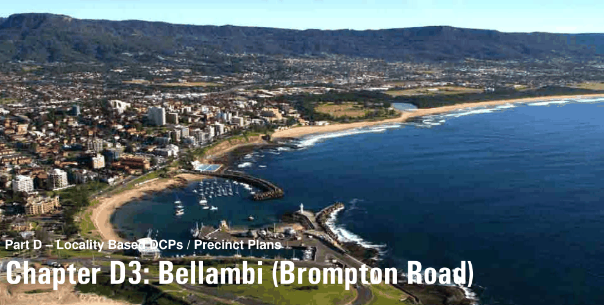

# Wollongong Development Control Plan 2009 - Chapter D3 Bellambi (Brompton Road)

> This chapter is split into 9 section file(s), one per numbered heading, in the order they appear in the PDF.

Source PDF: [Wollongong-DCP-2009-Chapter-D03-Brompton-Road.pdf](https://planfortomorrow.sharepoint.com/sites/Planfortomorrow/Shared%20Documents/00%20NSW-Planning-Resources/dcp/wollongong-development-control-plan-2009/chapter-d3-bellambi-brompton-road/Wollongong-DCP-2009-Chapter-D03-Brompton-Road.pdf)

> [Picture on page 1: a picture, saved as a picture (images/chapter-d3-bellambi-brompton-road-page-1-1.gif, 150 dpi).]

#### Part D – Locality Based DCPs / Precinct Plans

### Chapter D3: Bellambi (Brompton Road)

### Contents

<!-- sections -->
## Sections

1. [3 AIMS AND OBJECTIVIES](01-3-aims-and-objectivies.md)
2. [5 HERITAGE CONSIDERATION](02-5-heritage-consideration.md)
3. [6 DEVELOPMENT CONTROLS](03-6-development-controls.md)
4. [1 INTRODUCTION](04-1-introduction.md)
5. [2 LAND TO WHICH THIS PLAN APPLIES](05-2-land-to-which-this-plan-applies.md)
6. [3 AIMS AND OBJECTIVIES](06-3-aims-and-objectivies.md)
7. [4 DEVELOPMENT CONTRAINTS](07-4-development-contraints.md)
8. [5 HERITAGE CONSIDERATION](08-5-heritage-consideration.md)
9. [6 DEVELOPMENT CONTROLS](09-6-development-controls.md)
